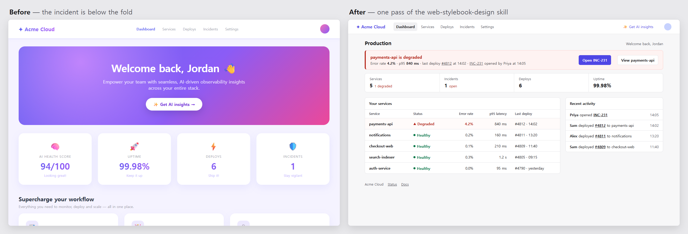

<div align="center">

# web-stylebook-mcp

**コーディングエージェント向けのデザイン判断。今あるUIを改善し、その根拠を示します。**

[](https://www.npmjs.com/package/web-stylebook-mcp)
[](https://www.npmjs.com/package/web-stylebook-mcp)
[](./LICENSE)
[](https://nodejs.org)
[](https://modelcontextprotocol.io)

[English](./README.md) · [한국어](./README.ko.md) · **日本語**

</div>



<sub>左は一般的な生成スタイルで作成したサンプルのダッシュボードです。右は Claude Opus 5.5 が
`web-stylebook-design` スキルを1回実行し、人の手を加えずに改善した同じページです。データは架空のものです。
[作り方、計測した値、示していない内容 →](./docs/demo/README.ja.md)</sub>

- **デザインの知識を持っています。** 調査済みのデザイン原論 24 件（出典 30 件）、インターフェース原則 25 件、
  UX 原則 23 件、ビジュアルの方向性 48 件、実在サイトの参考例 520 件を収録しています。各ルールには、いつ適用し、
  いつ適用しないか、結果をどう確認するかが書かれています。
- **エージェントに最後までやり切らせます。** エージェントはページをキャプチャし、計画を立て、実際のソースを編集し、
  再度キャプチャして比較します。`complete` になるのは、変更前後のキャプチャが揃い、リンクとテストフックが保たれ、
  動作とアクセシビリティの確認が済んだ場合だけです。そうでなければ `needs-work` となり、不足している項目を一覧で示します。
- **ローカルで完結します。** API キーもモデル呼び出しもネットワークも不要で、プロジェクトのファイルは読みません。
  同じ入力からは常に同じ出力が得られます。

## インストール

Node 20 以降が必要です。

### Cursor

ボタンを押してください。

[](https://cursor.com/install-mcp?name=web-stylebook&config=eyJjb21tYW5kIjoibnB4IiwiYXJncyI6WyIteSIsIndlYi1zdHlsZWJvb2stbWNwQGxhdGVzdCJdfQ==)

ボタンを押すと Cursor のインストール用ディープリンクが開きます。Cursor が開かない場合は、次のディープリンクをブラウザに貼り付けてください。

```text
cursor://anysphere.cursor-deeplink/mcp/install?name=web-stylebook&config=eyJjb21tYW5kIjoibnB4IiwiYXJncyI6WyIteSIsIndlYi1zdHlsZWJvb2stbWNwQGxhdGVzdCJdfQ==
```

または、プロジェクトの `.cursor/mcp.json` にサーバーを追加します（すべてのプロジェクトで使う場合は `~/.cursor/mcp.json`）。

```json
{
  "mcpServers": {
    "web-stylebook": {
      "command": "npx",
      "args": ["-y", "web-stylebook-mcp@latest"]
    }
  }
}
```

### Claude Code

プラグインでスキルと MCP サーバーをまとめてインストールできます（Claude Code 2.1.275 以降）。

```text
/plugin install web-stylebook --marketplace seungdori/web-stylebook-mcp
```

MCP サーバーだけを使う場合は、次のコマンドを実行します。

```bash
claude mcp add web-stylebook -- npx -y web-stylebook-mcp@latest
```

このコマンドは、現在のプロジェクトで自分だけがサーバーを使えるようにします。すべてのプロジェクトで使うには `add` の後ろに `--scope user` を付けます。チームで共有するには `--scope project` を付けます。その場合、Claude Code がプロジェクトルートの `.mcp.json` に書き込みます。このファイルを直接書いてもかまいません。

```json
{
  "mcpServers": {
    "web-stylebook": {
      "type": "stdio",
      "command": "npx",
      "args": ["-y", "web-stylebook-mcp@latest"]
    }
  }
}
```

Claude Code は `.mcp.json` のサーバーを使う前に、利用者ごとに一度承認を求めます。`claude mcp list` で、サーバーに接続できたかを確認できます。

### Codex

```bash
codex mcp add web-stylebook -- npx -y web-stylebook-mcp@latest
```

このコマンドは `~/.codex/config.toml` にサーバーを追加します。このファイルに次の行を直接書いてもかまいません。

```toml
[mcp_servers.web-stylebook]
command = "npx"
args = ["-y", "web-stylebook-mcp@latest"]
```

### VS Code

VS Code の GitHub Copilot では、ボタンを押してください。

[](https://vscode.dev/redirect?url=vscode%3Amcp%2Finstall%3F%257B%2522name%2522%253A%2522web-stylebook%2522%252C%2522command%2522%253A%2522npx%2522%252C%2522args%2522%253A%255B%2522-y%2522%252C%2522web-stylebook-mcp%2540latest%2522%255D%257D)

VS Code がサーバーのページを開きます。インストールする前に、そのページでコマンドを確認してください。

または、ワークスペースのルートにある `.mcp.json` にサーバーを追加します。Claude Code が読むファイルと同じです。すべてのワークスペースで使うには `~/.copilot/mcp-config.json` に追加します。

```json
{
  "mcpServers": {
    "web-stylebook": {
      "type": "stdio",
      "command": "npx",
      "args": ["-y", "web-stylebook-mcp@latest"]
    }
  }
}
```

信頼されたワークスペースでは、VS Code は `.mcp.json` のサーバーを追加の確認なしに起動します。コマンドパレットの **MCP: List Servers** で、サーバーを確認できます。古いガイドには `servers` キーを持つ `.vscode/mcp.json` が出てきますが、VS Code はこの形式を廃止予定として扱っています。

### スキルとその他のクライアント

スキルに対応したエージェント（Claude Code、Codex、Cursor など）は、スキルをインストールできます。`npx skills` には Node 22.20 以降が必要です。

```bash
npx skills add seungdori/web-stylebook-mcp
```

Windsurf と Claude Desktop の設定は[リファレンス](./docs/reference.ja.md#インストール)にあります。

## 使い方

既存の画面の改善を依頼します。

> ダッシュボードを改善して、オンコール担当者が問題のある箇所を真っ先に確認できるようにしてください。

エージェントはページをキャプチャして `get_design_improvement_plan` を呼び出します。次にコードを編集し、
`compare_page_revisions` で既存の要素が保たれたかを確認したうえで、`validate_design_improvement_result` で締めくくります。
変更前後のスクリーンショット、変更ごとの理由、実行した確認、未検証の項目が得られます。

新しいページの場合は、代わりに製品を説明してください。例えば *「決済 API のランディングページ」* のように書きます。
エージェントは `recommend_design_direction` から始め、順位を付けた候補と、除外した候補および除外の理由を示します。

レビューだけを依頼した場合、エージェントは点検して報告するだけで、何も編集しません。

## MCP なしで使う

スキルは MCP サーバーがなくても動作します。同じツールをシェルから実行すれば、同じ結果が得られます。

```bash
npx -y web-stylebook-mcp tools
```

```bash
npx -y web-stylebook-mcp call get_design_improvement_plan --input plan-args.json
```

## ツール

| 用途 | ツール |
|---|---|
| 既存 UI の改善 | `get_design_improvement_plan`, `compare_page_revisions`, `validate_design_improvement_result` |
| レビュー | `get_design_audit_plan`, `audit_page_structure`, `validate_design_audit_result` |
| 方向性の選択 | `recommend_design_direction`, `compare_design_directions`, `search_design_references`, `get_design_reference` |
| 原則と状態 | `get_design_principle_plan`, `get_ux_principle_plan`, `get_ui_state_plan` |
| 実装 | `compose_design_tokens`（JSON、CSS 変数、Tailwind、TypeScript、DESIGN.md） |

ツールごとの例、結果の契約、リソース、プロンプト、CLI は[リファレンス](./docs/reference.ja.md)にあります。

## 詳しく見る

- [リファレンス](./docs/reference.ja.md): ツールの例、契約、CLI、互換性
- [デモ](./docs/demo/README.ja.md): 上記の変更前後の比較と、すべての証拠ファイル
- [MCP あり・なしの比較](./showcase/README.ja.md): 10 組のペアによる作例、ブラインド比較、記録された結果
- [変更履歴](./CHANGELOG.md) · [セキュリティ](./SECURITY.md) · [リリース](./RELEASING.md)

## ライセンス

[MIT](./LICENSE)。コードと同梱のカタログスナップショットに適用されます。webstylebook.com のウェブサイト自体は
CC BY-NC です。帰属表示の詳細は[リファレンス](./docs/reference.ja.md#ライセンス)にあります。
