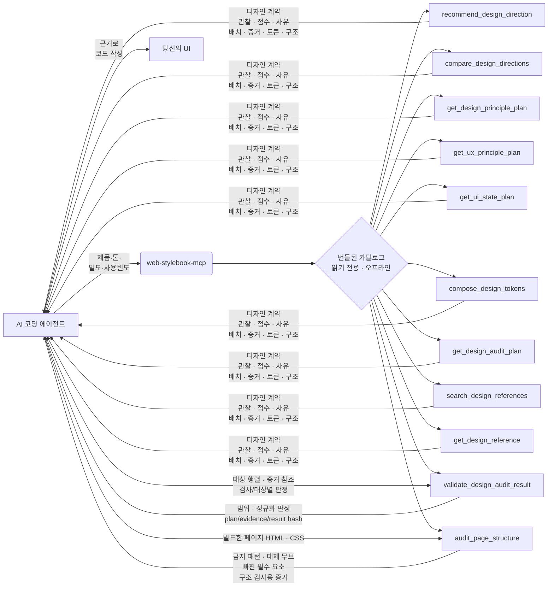

<div align="center">

# web-stylebook-mcp

**AI 코딩 에이전트를 위한 디자인 인텔리전스.** 매번 똑같은 히어로 + 카드 3개는 그만.
에이전트가 점수화된 디자인 *계약*(방향·인터페이스 디자인 계획·UX 원칙 계획·UI 상태 계획·토큰·근거 기반 감사 계획)을 받아, 근거를 바탕으로 코드를 쓰고 검증합니다.

[](https://www.npmjs.com/package/web-stylebook-mcp)
[](https://www.npmjs.com/package/web-stylebook-mcp)
[](./LICENSE)
[](https://nodejs.org)
[](https://modelcontextprotocol.io)

[English](./README.md) · **한국어**

</div>

---

코딩 에이전트는 *무엇이 어떻게 생겨야 하는지*를 정하지 못해서 매번 똑같은 UI로 도망칩니다 — 히어로 + 카드 3개 + 그라데이션. `web-stylebook-mcp`는 에이전트에게 **디자인 계약**(점수화된 시각 방향, 배치 중심 인터페이스 디자인 계획, 근거 수준이 표시된 UX 원칙 계획, UI 상태 계획, 디자인 토큰)을 건네는 Model Context Protocol 서버이고, [webstylebook.com](https://webstylebook.com)과 동일한 큐레이션 카탈로그에서 가져옵니다. **코드가 아니라 근거**를 돌려줍니다. 코드는 여전히 에이전트가 쓰지만, 이제 무엇을 만들고 무엇을 검증할지 알고 씁니다.

API 키 없음. 모델 호출 없음. 네트워크 없음. 프로젝트 파일시스템 접근 없음. **결정적이고, 읽기 전용이며, 완전히 로컬.**

## 없을 때 / 있을 때

| | `web-stylebook-mcp` 없이 | `web-stylebook-mcp`로 |
|---|---|---|
| **방향** | 한 가지 룩을 찍어서 밀어붙임 | 점수화된 후보 + 사유 코드 + *무엇을 왜 탈락*시켰는지 |
| **제작 원칙** | 문서에 원칙 이름만 적고 검증은 없음 | 원칙마다 배치 지침 + 관찰 가능한 검증 기준 + 주의점 |
| **UX 근거** | "힉의 법칙에 따르면…"으로 논의 종료 | 근거 신뢰도(strong·contextual·contested)가 붙어 법칙으로 단정할 수 없는 점검 질문 |
| **UI 상태** | 해피패스만, 빈/에러/로딩은 나중에 덧붙임 | 표면별 필수/권장/도메인 상태를 처음부터 |
| **토큰** | 손으로 고른 hex, 대비는 거의 미확인 | 역할 기반 토큰 + WCAG 대비 경고 |
| **구조** | 토큰이 기본 템플릿(히어로 + 로고 + 카드 3장)의 색만 바꿈 | 방향마다 레이아웃 아키타입과 시그니처 무브, 그리고 빌드한 페이지에서 템플릿을 잡아내는 감사 |
| **감사** | 요약만 보고 "좋아 보임" 판정 | 안정적인 검사 ID·심각도·필요 증거·미검증 상태를 갖춘 화면별 감사 계획 |
| **결과** | 천편일률 AI UI | 에이전트가 근거로 삼아 구현하는 디자인 계약 |

## 직접 판단하는 걸 보세요

> *"SRE용 고밀도 모니터링 대시보드. 온콜로 하루 종일 본다. 차분하고 기술적으로. 사이버펑크는 피해서."*

```jsonc
// → recommend_design_direction  (입력)
{
  "productDescription": "High-density monitoring dashboard for SREs, watched all day on call",
  "productType": "operational-saas",
  "tone": ["calm", "technical"],
  "density": "high",
  "usageFrequency": "daily",
  "avoid": ["cyberpunk"],
  "locale": "ko"
}
```

```jsonc
// ← 결과 (일부만 표시)
{
  "confidence": "high",
  "candidates": [
    { "styleId": "quiet-utility",  "score": 0.93 },
    { "styleId": "runtime-signal", "score": 0.89 },
    { "styleId": "notion-style",   "score": 0.83 },
    { "styleId": "console-launch", "score": 0.77 },
    { "styleId": "platform-core",  "score": 0.77 }
  ],
  "ranking": {
    "winner": "quiet-utility",
    "runnerUp": "runtime-signal",
    "gap": 0.04,
    "tied": false,
    "reasonCodes": ["USE_CASE_FIT", "LOWER_UPKEEP"],
    "explanation": "quiet-utility — runtime-signal보다 0.04점 높음: bestFor 3개 중 3개가 operational-saas 대상 (runtime-signal: 3개 중 2개); daily 사용 기준 유지 부담이 낮음 (quiet-utility: 모션 low, 유지보수 low; runtime-signal: 모션 low, 유지보수 medium)."
  },
  "rejected": [                        // 모두 29개, 3개만 표시
    { "styleId": "aurora-gradient",  "reasonCodes": ["PRODUCT_NOT_IDEAL", "DAILY_USE_OVERSTIMULATION"] },
    { "styleId": "claymorphism",     "reasonCodes": ["PRODUCT_NOT_IDEAL"] },
    { "styleId": "cyberpunk-glitch", "reasonCodes": ["EXPLICITLY_AVOIDED", "DAILY_USE_OVERSTIMULATION"] }
  ],
  "pairings": [
    {
      "styleId": "notion-style",
      "pairWith": "quiet-utility",
      "role": ["forms", "navigation", "repetitive surfaces"],
      "rationale": "operational-saas용으로 짝지은 보조 스타일 — quiet-utility의 차분하고 반복적인 화면을 보완한다."
    },
    {
      "styleId": "macos-liquid-glass",
      "pairWith": "quiet-utility",
      "role": ["forms", "navigation", "repetitive surfaces"],
      "rationale": "operational-saas용으로 짝지은 보조 스타일 — quiet-utility의 차분하고 반복적인 화면을 보완한다."
    }
  ],
  "guidance": "후보는 점수화된 근거다 — 제품 맥락으로 직접 고르라. candidates[0]은 가장 강한 후보일 뿐 강제가 아니다."
}
```

여기서 달라진 점에 주목하세요 — 상위 후보가 뚜렷이 다른 점수(0.93, 0.89, 0.83)를 받고, `ranking`이 1위가 2위를 이긴 이유를 알려 줍니다. 이 예시에서는 `quiet-utility`의 `bestFor` 항목이 모두 운영 SaaS를 겨냥하고, 매일 쓰는 용도에 유지 부담이 더 낮습니다. 상위 두 방향의 점수가 정말 같으면 승자를 만들어 내지 않고 `ranking.tied`로 동점이라고 알립니다. 탈락한 스타일에는 사유 코드가 붙고, 페어링은 강제가 아니라 제안입니다. 서버는 근거를 주고, 결정은 에이전트가 합니다.

그다음 고른 방향을 실제 토큰으로:

```jsonc
// → compose_design_tokens(style: "quiet-utility", format: "css-variables", theme: "light")
// WCAG 대비 경고 0건
:root {
  --color-canvas: #ffffff;
  --color-text:   #1f2328;
  --color-accent: #526371;
  --color-border: #cecfd0;
  /* … 역할 기반 색·타이포·간격·radius·모션·밀도 */
}
```

요청 한 번에 — 에이전트는 방향을 고르고, 무엇이 왜 탈락했는지 보고, WCAG를 통과하는 토큰까지 받았습니다. 코드 한 줄 생성하지 않고.

## 토큰이 아니라 구조

토큰은 페이지의 색만 바꿉니다. 그래서 모든 후보에 `structure`가 함께 붙습니다. 레이아웃 아키타입(히어로 구성, 그리드 리듬, 섹션 순서, 밀도, 타입 스케일 쓰는 법), 각자 맡는 역할이 적힌 시그니처 무브 2~3개, 그리고 페이지에 넣으면 안 되는 패턴입니다. `webstylebook://styles/{id}`에는 무브별 구현 단계와 금지 항목별 탐지 기준이 더 들어 있습니다. `compose_design_tokens`는 이 구조를 가리키는 참조(스타일 id, 리소스 URI, 무브 id)를 돌려주고 텍스트 출력에 히어로와 무브를 적습니다. 아키타입이 스타일의 표본 페이지와 다르면 `basis`가 `authored`이고, `departure`에 그 이유가 있습니다.

빌드한 뒤에는 페이지의 HTML과 CSS를 `audit_page_structure`에 넘깁니다. 아래는 에이전트가 기본 SaaS 템플릿으로 만든 페이지([`generic-saas-tailwind.html`](https://github.com/seungdori/web-stylebook-mcp/blob/master/tests/fixtures/page-structure/generic-saas-tailwind.html))를 `quiet-utility` 기준으로 검사한 실제 출력입니다.

```jsonc
// → audit_page_structure({ html, styleId: "quiet-utility", locale: "ko" })
// ← 구조 감사 결과 (일부)
{
  "summary": { "clean": false, "findings": 8, "major": 6, "minor": 2, "notVerified": 0, "checked": 12 },
  "findings": [
    {
      "patternId": "logo-strip",
      "name": "로고 띠",
      "severity": "major",
      "locations": ["section#customers > div.mx-auto"],
      "observed": { "logos": 5, "marquee": false, "muted": true },
      "replaceWith": {
        "instruction": "실제 고객을 밝힐 권한과 이유가 없다면 지우세요. 대신 방문자가 직접 확인할 수 있는 근거(실제 결과·결과물·이름이 있는 사례)를 이 스타일의 근거 무브로 보여 주세요.",
        "moves": [
          { "id": "hairline-gap-list", "name": "Gap-as-hairline state list", "purpose": "Triage: shows many resources and their current state at an even rhythm, with dividers that cannot drift out of alignment." },
          { "id": "stepped-state-badges", "name": "Three-step state badges", "purpose": "Calm status: state reads through steps of weight and fill instead of traffic-light colors, so the one urgent item stands out." }
        ]
      }
    },
    {
      "patternId": "generic-saas-skeleton",
      "observed": { "sections": "opening → proof → features → testimonials → cta", "templateSections": 5 },
      "replaceWith": {
        "archetype": {
          "sectionOrder": [
            "Top bar: breadcrumb path on the left, search and one primary action on the right",
            "The primary working list or table with its filter row",
            "A detail or form panel for the selected item",
            "Secondary panels such as activity, audit history, or settings for the same object",
            "Empty, loading, and error states drawn in the same slots as the data"
          ]
        }
      }
    }
    // 나머지 6개: centered-stack-hero, trusted-by-band, icon-feature-grid, testimonial-carousel, closing-cta-banner, quiet-utility/corner-radius
  ]
}
```

발견 항목마다 위치, 관찰값, 그리고 그 자리에 대신 넣을 것을 알려 줍니다. 대신 넣을 것은 고른 스타일에서 같은 역할을 하는 시그니처 무브(로고 띠라면 근거 역할), 히어로 구성, 섹션 순서입니다. 다시 빌드하고 감사를 한 번 더 돌린 뒤, `get_design_audit_plan.includeGroups`에 `"structure"`를 넣고 돌려받은 `evidence`와 `results`를 `validate_design_audit_result`에 넘기세요. 뷰포트마다 다른 `targetId`로 감사하세요. 증거 id에 `targetId`가 들어가므로 여러 실행 결과를 함께 검증할 수 있습니다. 이 검사는 브라우저 렌더링이 아니라 제출한 HTML과 CSS에 대한 결정적 휴리스틱입니다. `clean`은 모든 검사가 실행되었고 이 패턴들을 찾지 못했다는 뜻이지, 디자인이 통과했다는 뜻이 아닙니다. 스타일별 지침(아키타입과 무브)은 카탈로그의 `layout`·`typography` 필드처럼 영어로 작성되어 있고, 패턴 이름과 안내 문장은 `locale`을 따릅니다.

### 스타일이 뺄 수 없는 필수 요소

디자인 방향 때문에 페이지가 제 기능을 잃으면 안 됩니다. 보류된 쇼케이스 실험(#7)에서 MCP로 만든 럭셔리 스킨케어 페이지는 첫 화면에 구매 버튼 하나만 남겼습니다. 대조군 페이지는 용량, 하룻밤 기준 가격, 장바구니 담기, 배송·보증 안내를 보여 줬습니다. 그래서 `recommend_design_direction`은 `mustHaves`도 반환합니다. 판단한 제품 유형에 꼭 필요한 요소와 각 요소가 있어야 할 위치(zone)입니다. 스타일은 이 요소의 모양을 바꿀 수 있지만, 빼거나 정해진 위치 밖으로 옮기면 안 됩니다. 이 요소는 첫 화면에 대한 아키타입의 제한("행동 하나, 짧은 문장 하나")보다 우선합니다. 첫 화면 항목은 모두 히어로에 넣으세요. 후보마다 `structure.mustHaves`가 같은 역할을 하는 그 스타일의 시그니처 무브를 알려 줍니다. 예를 들어 배송·보증 안내를 담을 수 있는 근거 무브입니다.

| 제품 유형 | 페이지 | 첫 화면 | 페이지 어디든 |
|---|---|---|---|
| `operational-saas` | 메인 대시보드 | 현재 상태 (`current-status`), 변경 사항 (`recent-changes`) | — |
| `developer-tool` | 제품 랜딩 페이지 | 코드 예시 (`code-sample`), 문서 링크 (`docs-link`) | — |
| `documentation` | 문서 홈 | 검색 (`search`), 빠른 시작 (`quickstart`) | — |
| `data-analytics` | 분석 대시보드 | 현재 상태 (`current-status`), 변경 사항 (`recent-changes`), 기간 (`time-range`) | — |
| `security-console` | 보안 개요 화면 | 현재 상태 (`current-status`), 변경 사항 (`recent-changes`) | — |
| `finance-admin` | 재무 개요 화면 | 현재 상태 (`current-status`), 변경 사항 (`recent-changes`) | — |
| `healthcare-portal` | 포털 홈 | 주요 행동 (`primary-cta`) | 연락 방법 (`contact`), 개인정보 안내 (`privacy-notice`) |
| `commerce` | 상품 상세 페이지 | 가격 (`price`), 옵션 선택 (`variant-choice`), 장바구니 담기 (`add-to-cart`), 배송·보증 안내 (`purchase-assurance`) | — |
| `ai-chat` | 대화 화면 | 메시지 입력창 (`composer`) | AI 한계 안내 (`ai-limits`) |
| `content-editorial` | 기사 페이지 | 작성자 (`author`), 발행일 (`publish-date`) | — |
| `knowledge-base` | 도움말 센터 홈 | 검색 (`search`) | 주제별 목록 (`topic-index`) |
| `portfolio` | 포트폴리오 홈 | — | 작업 예시 (`work-samples`), 연락 방법 (`contact`) |
| `campaign` | 랜딩 페이지 | 주요 행동 (`primary-cta`) | 근거 (`proof`) |
| `consumer-app` | 앱 랜딩 페이지 | 주요 행동 (`primary-cta`) | 근거 (`proof`) |

첫 화면은 첫 섹션(페이지의 `h1`이 있는 섹션)의 끝까지입니다. 지금까지의 섹션이 모두 짧으면 뒤따르는 섹션을 2개까지 더 넣습니다. 짧은 섹션은 40단어 이하이고, 이미지·비디오·표·큰 SVG가 없고, 화면을 채우는 높이를 선언하지 않은 섹션입니다. 사이트 헤더는 첫 화면에 들어가고, 푸터는 들어가지 않습니다. 제품 유형을 받지도 추론하지도 못한 설명은 `other`가 됩니다. `other`에는 목록이 없고, 결과는 목록을 지어내지 않고 그 사실을 알립니다. 모든 판단 기준은 `webstylebook://structure/must-haves`에 있습니다.

같은 `productType`을 `audit_page_structure`에 넘기면, 빌드한 페이지에서 빠진 필수 요소를 알려 줍니다. 아래는 쇼케이스의 실패 사례를 fixture로 다시 만든 페이지([`commerce-buy-button-only.html`](https://github.com/seungdori/web-stylebook-mcp/blob/master/tests/fixtures/must-haves/commerce-buy-button-only.html))의 실제 출력입니다.

```jsonc
// → audit_page_structure({ html, styleId: "midnight-noir", productType: "commerce", locale: "ko" })
// ← 필수 요소 감사 결과 (일부)
{
  "mustHaves": {
    "productType": "commerce",
    "page": "상품 상세 페이지",
    "missing": [],
    "misplaced": ["price", "variant-choice", "purchase-assurance"],
    "items": [
      { "id": "price", "checkId": "structure-must-have-price", "zone": "first-screen", "status": "misplaced", "count": 1,
        "locations": ["section#buy > div > p.price:nth-of-type(1)"] },
      { "id": "add-to-cart", "checkId": "structure-must-have-add-to-cart", "zone": "first-screen", "status": "present", "count": 1,
        "locations": ["body > main > section.masthead:nth-of-type(1) > div > a.button"] }
      // 나머지 2개: variant-choice, purchase-assurance
    ]
  },
  "findings": [
    {
      "patternId": "must-have/price",
      "scope": "must-have",
      "severity": "major",
      "observed": { "status": "misplaced", "zone": "first-screen", "found": 1, "inZone": 0 },
      "replaceWith": {
        "instruction": "첫 화면으로 옮기세요. 검사에서는 페이지 더 아래에서만 찾았습니다. 상품명 옆에 통화와 함께 가격을 보여 주세요. 용량마다 가격이 다르면 고른 용량의 가격을 보여 주세요.",
        "moves": [],
        "archetype": { "hero": "Left-heavy and low: a 1.7fr/1fr grid with align-items: end …" }
      }
    }
    // 나머지 2개: must-have/variant-choice, must-have/purchase-assurance
  ]
}
```

필수 요소의 상태는 `present`(있음), `missing`(없음), `misplaced`(페이지에는 있지만 첫 화면에는 없음), `not-verified`(확인 못 함) 중 하나입니다. `not-verified`는 스타일시트가 선택자 한도를 넘었거나, 페이지 끝까지 분석하지 못했거나, 첫 화면을 정할 섹션이 없을 때입니다. 필수 요소마다 `structure-must-have-<id>` 검사도 있습니다. `get_design_audit_plan`에 `structure` 그룹과 `productType`을 함께 넘기면, 감사가 돌려준 evidence와 results를 그대로 검증할 수 있습니다. 탐지는 마크업, ARIA role, 영어·한국어·일본어로 된 보이는 텍스트를 읽습니다. 숨긴 요소(`hidden`, `display: none`, 시각적으로 숨긴 `sr-only` 상자, `aria-hidden="true"`)는 세지 않습니다. 기본 컨트롤은 안정적으로 찾습니다. 옵션은 `select`나 라디오 그룹, 검색은 `input type="search"`, 날짜는 `time` 요소를 쓰세요.

## 에이전트가 이걸로 만든 결과물

다른 브리프 — *"흩어진 고객 피드백(지원 티켓, 세일즈 콜, 앱 리뷰, 슬랙)을 하나의 우선순위 로드맵으로 정리해주는 B2B SaaS **Throughline**의 마케팅 랜딩."* 레이아웃도, 히어로도, 스타일도 지정하지 않았습니다. 동반 스킬을 따라 에이전트는 스톡 히어로로 도망치는 대신 **제품의 핵심 아이디어에서** 첫 화면을 구성했습니다 — 오른쪽 절반은 다른 사이트에 복붙할 수 있는 장식 카드가 아니라, 제품의 실제 메커니즘(피드백 소스가 모여 자동 랭킹된 로드맵이 되는)을 그린 맞춤 다이어그램입니다.

<div align="center">

</div>

<div align="center"><sub>동반 스킬을 따른 AI 에이전트가 구성 — 프롬프트는 제품과 스택만 설명했고, 레이아웃은 한마디도 없었습니다.</sub></div>

## 동작 방식



에이전트가 제품을 설명하면, 서버가 큐레이션 카탈로그를 점수화해 구조화된 근거를 돌려줍니다. 빌드한 뒤에는 에이전트가 페이지 마크업을 구조 감사에 넘깁니다. 구조 감사는 스스로 파일을 읽지 않습니다. 검사 후 validator는 참조된 artifact를 직접 열거나 시각 품질을 판단하지 않고 결과 계약만 검증합니다. 코드는 생성하지 않고, 어떤 것도 기기를 벗어나지 않습니다.

## 설치

**Node 20 이상** 필요.

<details open>
<summary><b>Codex CLI · IDE 확장</b></summary>

Codex CLI로 추가:

```bash
codex mcp add web-stylebook -- npx -y web-stylebook-mcp@latest
```

또는 `~/.codex/config.toml`에 추가하세요. 신뢰한 저장소에서는 프로젝트 범위
`.codex/config.toml`도 사용할 수 있습니다:

```toml
[mcp_servers.web-stylebook]
command = "npx"
args = ["-y", "web-stylebook-mcp@latest"]
```

설정을 편집한 뒤 Codex를 재시작하거나 새 세션을 여세요. Codex TUI에서는 `/mcp`로
서버 활성 상태를 확인할 수 있습니다.

</details>

<details>
<summary><b>Claude Code</b></summary>

```bash
claude mcp add web-stylebook -- npx -y web-stylebook-mcp@latest
```

</details>

<details>
<summary><b>Cursor · Windsurf · 일반 MCP 클라이언트</b></summary>

MCP 설정에 추가:

```json
{
  "mcpServers": {
    "web-stylebook": {
      "command": "npx",
      "args": ["-y", "web-stylebook-mcp@latest"]
    }
  }
}
```

</details>

<details>
<summary><b>Claude Desktop</b></summary>

같은 블록을 `claude_desktop_config.json`에 추가하고 재시작:

- **macOS:** `~/Library/Application Support/Claude/claude_desktop_config.json`
- **Windows:** `%APPDATA%\Claude\claude_desktop_config.json`

```json
{
  "mcpServers": {
    "web-stylebook": {
      "command": "npx",
      "args": ["-y", "web-stylebook-mcp@latest"]
    }
  }
}
```

</details>

## 툴

| 툴 | 받는 것 | 정직한 점 |
|------|--------------|-----------------|
| **`recommend_design_direction`** | 사유 코드가 붙은 점수화 스타일 후보, 1위가 2위를 이긴 이유(또는 동점)를 알리는 `ranking`, *이유*가 붙은 **탈락** 스타일, 보조 페어링, 신뢰도, 후보별 페이지 `structure`, 제품 유형의 필수 요소와 각 위치를 담은 `mustHaves` | 최종 선택은 모델이 — 이건 근거 제공자입니다 |
| **`compare_design_directions`** | 2~4개 방향을 제품 적합성·반복 사용·밀도·신뢰·차별성·접근성 리스크·모션·유지보수로 비교 | 정답 하나를 선언하지 않습니다 |
| **`search_design_references`** | 실제 디자인 레퍼런스를 텍스트·카테고리·태그로 제한 검색하고 간결한 다국어 관찰 결과 제공 | 스크린샷이나 브랜드 자산 복제가 아니라 출처가 붙은 연구 요약을 반환합니다 |
| **`get_design_reference`** | 팔레트·레이아웃·인터랙션·모션 관찰, 정규화 토큰, 원본 리비전, 출처와 권리 고지를 포함한 레퍼런스 1건 | 원 사이트 카피·서체·스크린샷·시각 정체성의 권리는 각 권리자에게 있습니다 |
| **`get_design_principle_plan`** | 시각적 관심사·화면·설계 단계·원칙 ID로 고른 배치/적용/검증 계획 — 가능한 경우 출처 링크 포함 | 제작 원칙은 경험 법칙이나 고정 레시피가 아니라 검증 가능한 점검 질문입니다 |
| **`get_ux_principle_plan`** | 결과 목표·화면·설계 단계·원칙 ID로 고른 적용/검증 계획 — 질문·주의점·근거 신뢰도·참고 링크 포함 | 원칙은 보편 법칙이나 사용자 조사의 대체물이 아니라 맥락별 점검 질문입니다 |
| **`get_ui_state_plan`** | 표면(데이터 테이블·폼·체크아웃·채팅·개발자 콘솔)의 필수/권장/도메인 UI 상태 — 트리거·표시 필수·금지·접근성·모션 | 에이전트가 잊는 상태까지: 빈·에러·로딩·엣지 |
| **`compose_design_tokens`** | 역할 기반 토큰을 `json` / `css-variables` / `tailwind` / `typescript`로 출력하거나 `DESIGN.md` 파일 하나(`design-md`)로 내보내며, 공통 시각 명세를 선택하면 스타일 원본과 편집값을 보존 | 명세에 작성된 색상 모드를 사용하며, 명시적으로 수락한 대비 수정만 적용합니다 |
| **`get_design_audit_plan`** | 안정적인 검사 ID·심각도·적용 조건·필요 증거·수정 방향·사용자용 콘텐츠 검사·선택 원칙 검사·UI 상태 범위를 담은 다국어 감사 계획 | 프로젝트를 실제로 봤다고 가장하지 않으며, 증거가 없으면 `PASS`가 아니라 `NOT_VERIFIED`입니다 |
| **`validate_design_audit_result`** | plan query·대상 행렬·지속 가능한 증거 참조·검사/대상별 판정을 검증하고 정규화 판정과 안정 hash를 반환 | 범위와 증거 정합성을 검증할 뿐 시각 품질을 판정하지 않으며, `valid: true`는 전체 디자인 통과가 아닙니다 |
| **`audit_page_structure`** | 넘겨받은 HTML·CSS에서 일반 금지 패턴과 스타일 전용 금지 항목을 찾아, 위치·관찰값·고른 스타일의 대체 무브와 함께 반환합니다. `productType`을 주면 페이지에 없거나 첫 화면 밖에 있는 필수 요소도 알려 줍니다. `structure` 감사 그룹용 증거와 결과도 만듭니다 | 브라우저가 아니라 선언된 스타일로 판단하며, 결과가 깨끗해도 디자인 통과가 아닙니다 |

**카탈로그:** 실제 디자인 레퍼런스 520 · 스타일 48 · 인터페이스 디자인 원칙 25 · UX 원칙 23 · 구조화 감사 검사 51 · 컴포넌트 20 · 표면 5 · UI 상태 레시피 57 · 모션 프로파일 29 · 제품 아키타입 14.

**구조:** 레이아웃 아키타입 48 · 시그니처 무브 144 · 일반 금지 패턴 9 · 탐지기 19종으로 만든 스타일 전용 금지 항목 142 · 제품 유형 14개의 필수 요소 21종.

레퍼런스 라이브러리는 [OpenDesign](https://opendesign.cc)의 완성도 높은 항목을 선별·수정한 데이터이며, 구조화 스펙은 [CC BY 4.0](https://creativecommons.org/licenses/by/4.0/)으로 제공됩니다. Web Stylebook은 원본 스크린샷과 브랜드 자산을 포함하지 않습니다. 원 사이트·브랜드·카피·서체·시각 정체성의 권리는 각 권리자에게 있으므로 사용 전 상세 항목의 출처와 권리 고지를 확인하세요.

## 웹사이트의 시각 명세 그대로 전달하기

선택한 스타일이나 웹 편집기에서 수정한 값을 토큰으로 옮길 때 공통 명세를 선택합니다.

```json
{
  "primaryStyleId": "brutalist-grid",
  "format": "css-variables",
  "contract": { "schema": "webstylebook.visual.v1" },
  "locale": "ko",
  "overrides": {
    "colors": { "text": "#111111" },
    "typography": { "body": { "lineHeight": 1.75 } }
  }
}
```

`webstylebook://manifest`에서 `visualContract.contractSchema`와 번들 명세의 `visualContract.contentHash`를 읽습니다. `webstylebook://styles/brutalist-grid`에서는 선택한 스타일의 기본 명세와 `visualContract.revision`을 읽습니다. 이 값을 각각 `contract.schema`, `contract.contentHash`, `contract.revision`으로 보내면 원본을 고정할 수 있으며, 일치하지 않으면 `INVALID_INPUT`을 반환합니다. `colorMode`를 생략하면 스타일의 원래 모드를 사용합니다. `light`, `dark`, `both`는 필요한 모드가 원본에 작성되어 있을 때만 가능합니다.

`overrides`는 역할별 색상, 타이포그래피, 간격, 밀도, 폰트 정보를 받습니다. 다른 스타일에서 가져온 요소도 이 명시적 값으로 전달합니다. 기존 `secondaryStyleId`는 강조색만 겹치는 옵션이므로 공통 명세와 함께 사용하면 거절합니다. 알 수 없는 필드, `density` 또는 `accentOverride`와 충돌하는 편집값도 거절합니다. `overrides`나 `acceptedRepairs`를 보낼 때는 `contract`가 필요합니다.

응답에는 선택한 `visualContract`, 원본 식별 정보인 `contract`, 대비 수정안인 `repairProposals`가 들어 있습니다. 수정안의 객체를 그대로 `acceptedRepairs`에 담아 다시 보내야 적용되며, 현재 값과 맞지 않는 이전 수정안은 거절합니다. CSS를 전달할 때도 `visualContract`를 함께 보존하세요. 여기에는 컴포넌트별 색상 조합, 폰트 로딩·라이선스 정보, 사용 규칙, 출처, 적용한 수정이 남습니다. 테마 출력은 `roleStyles`와 전체 명세인 `metadata`도 포함합니다. 실제 폰트 로딩과 화면 표현은 적용하는 앱에서 확인해야 합니다.

수정안을 수락할 때는 `light` 또는 `dark`를 각각 요청합니다. `both`는 모드별 제안만 반환하며, 수락한 수정안을 두 모드에 일괄 적용하지 않습니다.

## DESIGN.md로 내보내기

`compose_design_tokens`에 `format: "design-md"`를 주면 고른 방향을 [DESIGN.md](https://github.com/google-labs-code/design.md) 파일(스펙 버전 `alpha`)로 돌려줍니다. 다른 에이전트와 도구가 이 파일을 읽을 수 있습니다. 서버는 파일을 쓰지 않습니다. `content`를 프로젝트에 `DESIGN.md`로 저장하세요.

```json
{
  "primaryStyleId": "brutalist-grid",
  "format": "design-md",
  "contract": { "schema": "webstylebook.visual.v1" },
  "locale": "ko",
  "designMd": { "tokenPlacement": "interleaved", "productType": "developer-tool" }
}
```

- `designMd.tokenPlacement`: `front-matter`(기본값)는 모든 토큰을 맨 위 YAML 블록 하나에 넣습니다. `interleaved`는 그 블록에 `name`과 `description`만 두고, 토큰 그룹은 각 섹션 안의 YAML 블록에 넣습니다.
- `includeProse`, `includeDoDont`, `includeStructure`(모두 기본값 `true`)는 산문, 스타일 금지 항목과 금지 페이지 패턴으로 만든 Do's and Don'ts, Layout의 페이지 구조를 켜고 끕니다. `productType`을 주면 그 제품 유형의 필수 요소를 Layout에 적습니다.
- 색 이름은 DESIGN.md 관례를 따릅니다. `primary`는 글자색, `surface`는 페이지 배경이고, 그다음 `accent`, `on-accent`, `surface-container`, `outline` 등이 옵니다. Colors 산문에 각 이름의 `compose_design_tokens` 역할을 적습니다. 컴포넌트는 `{colors.action-primary}`처럼 토큰을 참조합니다. 치수는 px, em, rem만 쓰고, 유동 크기 글자는 최댓값을 씁니다.
- 결과에는 `sections`, `omitted`(뺀 섹션과 이유), `lossy`(DESIGN.md에 키가 없는 값: 두 번째 색상 모드, 상태 색, 모션, 그림자 등), `specVersion`, `sourceHash`도 들어 있습니다. 입력이 같으면 출력 바이트도 같습니다.
- `webstylebook://design-md/{id}`는 스타일 하나의 같은 파일을 고정한 시각 명세로 만들어 돌려줍니다. 선택 쿼리: `locale`, `mode`, `placement`.

모든 스타일을 두 배치 방식, 세 언어, 시각 명세 사용 여부별로 만들어 `npx @google/design.md lint`(0.4.0)로 검사했고, 오류는 없습니다. 경고는 글자/배경 대비가 4.5:1보다 낮은 쌍에서만 나오며, 이 쌍은 `compose_design_tokens`도 경고합니다.

## 다국어 출력

모든 툴은 선택적 `locale`을 받습니다. 사유 코드·가이던스·라벨이 요청한 언어로 돌아옵니다:

```text
"en" | "ko" | "ja"     // English · 한국어 · 日本語
```

## 리소스

카탈로그를 MCP 리소스로 직접 탐색:

```
webstylebook://manifest
webstylebook://styles · /styles/{id}
webstylebook://motion · /motion/{id}
webstylebook://components · /components/{id}
webstylebook://principles · /principles/{id}
webstylebook://design-principles · /design-principles/{id}
webstylebook://states/surfaces · /states/{surface} · /states/{surface}/{state}
webstylebook://products · /products/{id}
webstylebook://references · /references/{id}
webstylebook://policies/anti-patterns · /policies/verification · /policies/audit-checks
webstylebook://structure/banned-patterns · /structure/must-haves
webstylebook://design-md/{id}
```

스타일 상세에는 `locale`, `mode`, 기대하는 `revision`을 쿼리로 지정할 수 있습니다. 예: `webstylebook://styles/brutalist-grid?locale=ko&mode=light`. 선택한 언어와 모드 1개의 명세를 반환하며, 지원하지 않는 값·중복 인자·알 수 없는 쿼리 이름은 명확한 오류로 반환합니다.

## 프롬프트

자주 쓰는 워크플로우용 MCP 프롬프트:

`design-product` · `design-screen` · `complete-ui-states` · `redesign-with-style` · `audit-design-direction` · `audit-design-principles` · `audit-ux-principles`

`audit-design-direction`에 범위가 명시되지 않으면 검사 전에 두 가지를 짧게 묻습니다.
감사 범위(시각 / 시각 + 문구·정보 구조 / 전체 경험)와 변경 깊이(결과만 / 개선안 / 실제
수정·검증)입니다. 감사 요청만으로 파일 수정·커밋·릴리스·배포 권한을 추정하지 않습니다.

콘텐츠 감사는 내부 용어만 검사하지 않습니다. 중요한 주장·결론·권고의 강도와 확신이
근거에 맞는지, 눈에 띄는 문구가 구체적이고 해당 맥락에 필요한 정보를 전달하는지,
시각적 강조가 정보 가치·과업 관련성·근거 수준에 맞는지도 검사합니다. 카드·통계·Sitemap
링크는 유형 자체를 금지하지 않고 실제 사용자 과업에 도움이 되는지로 판단합니다.

## 감사 결과 계약

`get_design_audit_plan`은 이제 catalog version/hash와 결정론적 `planHash`를 담은 `identity`를
반환합니다. 실제 구현을 검사한 뒤 같은 plan query와 함께 다음을 제출합니다.

- 검사한 route 또는 screen·state·viewport·theme·locale·role별 target;
- 지속 가능한 artifact reference, content hash 또는 정확한 route/selector/file/region이 있는 evidence;
- interaction evidence의 before/input/after/recovery phase;
- 모든 계획된 check/target 쌍에 대한 결과 1건.

`validate_design_audit_result`는 plan을 다시 생성해 오래된 plan hash, 누락·중복 결과,
끊어진 evidence reference, 다른 target의 evidence, 잘못된 region, 부당한
`NOT_APPLICABLE`, 필수 증거가 없거나 실패 증거와 모순되는 `PASS`를 거부합니다. 누락된
결과는 숨기지 않고 `NOT_VERIFIED`로 구체화합니다. `includeGroups`에 `structure`를 넣고 `styleId`를 주면,
plan에 금지 패턴마다 자동 검사가 1개씩 붙고, `productType`을 주면 필수 요소마다 1개씩 더 붙습니다. `audit_page_structure`는 이 검사 id에 맞는 evidence와
results를 돌려주고, validator는 그대로 받습니다. 재검증 가능한 비교를 위해 plan,
evidence bundle, 정규화된 result의 content-addressed hash도 반환합니다. 이 툴은 artifact를
직접 열지 않으며 계약 유효성을 디자인 품질 점수로 바꾸지 않습니다.

저장소에는 재현 가능한 계약 품질 벤치마크가 포함됩니다.

```bash
npm run eval:audit-contract
```

사람이 라벨링한 정상·adversarial 사례 14건에서 기존 pass-through 판정은 4/14(28.57%)와
잘못된 `PASS` 9건을 기록했습니다. 새 validator는 14/14, 잘못된 `PASS` 0건이며 계약의
유효/무효도 14건 모두 올바르게 분류했습니다. 증거 누락·서술뿐인 증거·알 수 없는 증거·
다른 target의 증거·판정 불가·interaction phase 누락·blocker/major/minor 실패·정직한
`NOT_VERIFIED`·유효/무효 `NOT_APPLICABLE`을 포함합니다. 이는 결과 계약의 정확도 개선을
증명하며, 주관적 시각 판단 자체가 100% 정확하다고 주장하는 수치는 아닙니다.

## CLI

```bash
web-stylebook-mcp                 # stdio로 서버 실행 (기본)
web-stylebook-mcp --version
web-stylebook-mcp --catalog-info
web-stylebook-mcp --validate-catalog
```

## 동반 스킬

[`skill/`](./skill)에 동반 스킬이 함께 들어있어, 에이전트가 적절한 순간에 이 툴들을 꺼내 쓰고 결과를 제대로 활용하게 합니다(색만 바꾸지 말 것, 후보를 여러 개 제시할 것, 신뢰는 지어내지 말 것, 재사용 컴포넌트로 떨어뜨릴 것):

**Codex**

- `skill/web-stylebook-design/`를 저장소의 `.agents/skills/web-stylebook-design/` 또는
  사용자 범위 `~/.agents/skills/web-stylebook-design/` 같은 Codex 스킬 위치로 복사하거나
  심볼릭 링크하세요.
- 스킬을 설치하지 않을 경우 `skill/AGENTS.md`를 프로젝트의 `AGENTS.md`에 복사하세요.

**Claude Code 및 기타 에이전트**

- 에이전트의 스킬 디렉터리를 `skill/web-stylebook-design/`로 지정하거나,
- `skill/CLAUDE.md`를 프로젝트의 `CLAUDE.md` 또는 해당 에이전트의 rules 파일에 복사하세요.

## 프라이버시 · 보안

| 항목 | |
|----------|---|
| API 키 | 없음 |
| 모델 호출 | 없음 |
| 네트워크 접근 | 없음 — 완전 오프라인 동작 |
| 프로젝트 파일시스템 접근 | 없음 — 서버는 번들된 카탈로그 스냅샷만 읽음 |
| 동작 | 결정적, 읽기 전용 |

서버는 패키지에 번들된 카탈로그 스냅샷만 읽습니다. 어디로도 전송하지 않으며, 같은 입력은 항상 같은 계약을 냅니다.

## 카탈로그 원본 동기화

카탈로그 원본은
[`web-stylebook`](https://github.com/seungdori/web-stylebook) 저장소에서 작성합니다. 그 저장소에서
로컬 MCP 전달용 스냅샷을 생성한 뒤, 이 패키지를 릴리스하기 전에 바이트 단위 일치를 확인하세요.

```bash
npm run catalog:check-canonical -- /absolute/path/to/web-stylebook/packages/mcp/generated
```

인자를 생략하면 `WEB_STYLEBOOK_CANONICAL_CATALOG_DIR` 또는 로컬 형제 경로
`../showcase/packages/mcp/generated`를 사용합니다. 일반 테스트는 번들 아티팩트 내부의 해시,
enum, 개수, 런타임 계약을 검증하고, 이 명령은 두 저장소 사이의 원본 일치를 명시적으로 검증합니다.

## 호환성

- **Node:** 20 이상
- **전송:** stdio (Model Context Protocol)
- **클라이언트:** Codex CLI / IDE 확장 · Claude Code · Claude Desktop · Cursor · Windsurf, 그리고 모든 MCP 호환 클라이언트

도구 입력은 새 선택값이 생긴 것 말고는 그대로이고, `structure`는 출력에 추가된 필드입니다. `structure` 그룹은 직접 지정할 때만 들어가므로, `includeGroups` 없이 요청한 plan의 검사 목록과 hash는 바뀌지 않습니다. `contract`를 생략한 호출은 같은 토큰 형식과 라이트 모드 기본값을 유지합니다. 0.11.0부터 이 호출은 일반 소프트 섀도 대신 핀된 스타일의 작성 섀도를 내고, 에디토리얼·모노스페이스 스타일은 계열 글꼴 대신 작성된 글꼴을 냅니다. 색, 타입 스케일, 행간, 간격, 반지름, 모션, 밀도를 생략했을 때의 값은 이전 레거시 경로입니다. 명시한 밀도는 여전히 계열의 row·gutter보다 우선하고, CSS·테마 출력에 줄간격 토큰이 포함됩니다. 작성값 전체가 필요하면 `contract`를 넘깁니다. 공통 명세는 기존 도구에 추가한 옵션이므로 새 도구가 필요하지 않습니다.

## 라이선스

[MIT](./LICENSE) — 코드 **및** 번들된 카탈로그 스냅샷에 적용 (상업적 사용 자유).

> [webstylebook.com](https://webstylebook.com) 웹사이트는 CC BY-NC로 배포됩니다. 동일한 저작권자가 이 패키지에 번들된 카탈로그 스냅샷에 대해 MIT를 부여합니다.
>
> UX 원칙 항목은 독자적으로 작성한 적용·검증 가이드입니다. [Laws of UX](https://lawsofux.com)
> (CC BY-NC-ND 4.0)와 보조 근거를 출처로 표시하고 링크하지만, Laws of UX의 문구·삽화·페이지
> 레이아웃은 번들하지 않습니다.
>
> 인터페이스 디자인 원칙은 현대 인터페이스를 위한 과업 중심 검토 체계로 독자 작성했습니다.
> 의미 구조·반응형 재배치·현지화·토큰과 테마·다중 입력 방식·전체 상태 모델·복구·동작 선호를
> 함께 다룹니다.
