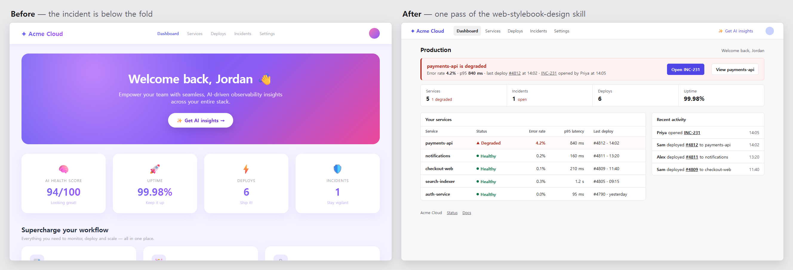

<div align="center">

# web-stylebook-mcp

**코딩 에이전트를 위한 디자인 판단. 지금 있는 UI를 고치고, 그 근거를 보여 줍니다.**

[](https://www.npmjs.com/package/web-stylebook-mcp)
[](https://www.npmjs.com/package/web-stylebook-mcp)
[](./LICENSE)
[](https://nodejs.org)
[](https://modelcontextprotocol.io)

[English](./README.md) · **한국어**

</div>



<sub>왼쪽은 흔한 AI 생성 스타일로 작성한 예시 대시보드입니다. 오른쪽은 Claude Opus 5.5가
`web-stylebook-design` 스킬을 한 번 따라 고친 같은 페이지이며, 사람이 손대지 않았습니다. 데이터는
가상입니다. [만든 방법, 측정한 값, 보여 주지 않는 것 →](./docs/demo/README.md)</sub>

- **디자인 지식이 들어 있습니다.** 조사된 디자인 원론 24개(출처 30개), 인터페이스 원칙 25개, UX
  원칙 23개, 시각 방향 48개, 실제 사이트 레퍼런스 520개를 담고 있습니다. 규칙마다 언제 적용하고
  언제 적용하지 않는지, 결과를 어떻게 확인하는지가 적혀 있습니다.
- **에이전트가 끝까지 하게 만듭니다.** 에이전트는 화면을 캡처하고, 계획하고, 실제 소스를 고치고,
  다시 캡처해 비교합니다. 조건이 같은 전후 캡처, 유지된 링크와 테스트 훅, 동작과 접근성 확인이
  모두 있어야 `complete`입니다. 하나라도 빠지면 `needs-work`와 함께 빠진 항목을 알려 줍니다.
- **로컬에서만 동작합니다.** API 키, 모델 호출, 네트워크가 필요 없고 프로젝트 파일을 읽지
  않습니다. 같은 입력에는 항상 같은 결과가 나옵니다.

## 설치

스킬을 지원하는 에이전트(Claude Code, Codex, Cursor 등):

```bash
npx skills add seungdori/web-stylebook-mcp
```

Claude Code에서는 플러그인으로 스킬과 MCP 서버를 함께 설치할 수 있습니다(Claude Code 2.1.275 이상).

```text
/plugin install web-stylebook --marketplace seungdori/web-stylebook-mcp
```

MCP 서버만 쓰려면:

```bash
claude mcp add web-stylebook -- npx -y web-stylebook-mcp@latest
```

```bash
codex mcp add web-stylebook -- npx -y web-stylebook-mcp@latest
```

Cursor, Windsurf, Claude Desktop 설정은 [레퍼런스](./docs/reference.ko.md#설치)에 있습니다.
Node 20 이상이 필요하고, `npx skills`는 Node 22.20 이상이 필요합니다.

## 사용

이미 있는 화면의 개선을 요청하세요.

> 대시보드에서 당직자가 고장 난 곳을 먼저 볼 수 있게 고쳐 줘.

에이전트는 화면을 캡처하고 `get_design_improvement_plan`을 호출합니다. 그다음 코드를 고치고,
`compare_page_revisions`로 기존 요소가 유지됐는지 확인한 뒤 `validate_design_improvement_result`로
마무리합니다. 전후 스크린샷, 바꾼 점과 이유, 실행한 확인, 확인하지 못한 부분을 받게 됩니다.

새 페이지라면 제품을 설명하세요. 예를 들어 *"결제 API의 랜딩 페이지"*처럼요. 에이전트는
`recommend_design_direction`으로 시작해, 순위를 매긴 후보와 제외한 후보를 이유와 함께 보여 줍니다.

리뷰만 요청하면 에이전트는 아무것도 고치지 않고 점검 결과만 보고합니다.

## MCP 없이 쓰기

스킬은 MCP 서버 없이도 동작합니다. 같은 툴을 셸에서 실행하고, 결과도 같습니다.

```bash
npx -y web-stylebook-mcp tools
```

```bash
npx -y web-stylebook-mcp call get_design_improvement_plan --input plan-args.json
```

## 툴

| 용도 | 툴 |
|---|---|
| 기존 UI 개선 | `get_design_improvement_plan`, `compare_page_revisions`, `validate_design_improvement_result` |
| 리뷰 | `get_design_audit_plan`, `audit_page_structure`, `validate_design_audit_result` |
| 방향 고르기 | `recommend_design_direction`, `compare_design_directions`, `search_design_references`, `get_design_reference` |
| 원칙과 상태 | `get_design_principle_plan`, `get_ux_principle_plan`, `get_ui_state_plan` |
| 구현 | `compose_design_tokens` (JSON, CSS 변수, Tailwind, TypeScript, DESIGN.md) |

툴별 예시, 결과 계약, 리소스, 프롬프트, CLI는 [레퍼런스](./docs/reference.ko.md)에 있습니다.

## 더 보기

- [레퍼런스](./docs/reference.ko.md): 툴 예시, 계약, CLI, 호환성
- [데모](./docs/demo/README.md): 위 전후 비교와 모든 증거 파일(영문)
- [MCP 사용·미사용 비교](./showcase/README.ko.md): 브리프 10개의 비교 화면과 실험 기록
- [변경 기록](./CHANGELOG.md) · [보안](./SECURITY.md) · [릴리스](./RELEASING.md)

## 라이선스

[MIT](./LICENSE). 코드와 함께 들어 있는 카탈로그 스냅샷에 적용됩니다. webstylebook.com 웹사이트
자체는 CC BY-NC이며, 저작자 표시 관련 내용은 [레퍼런스](./docs/reference.ko.md#라이선스)에 있습니다.
