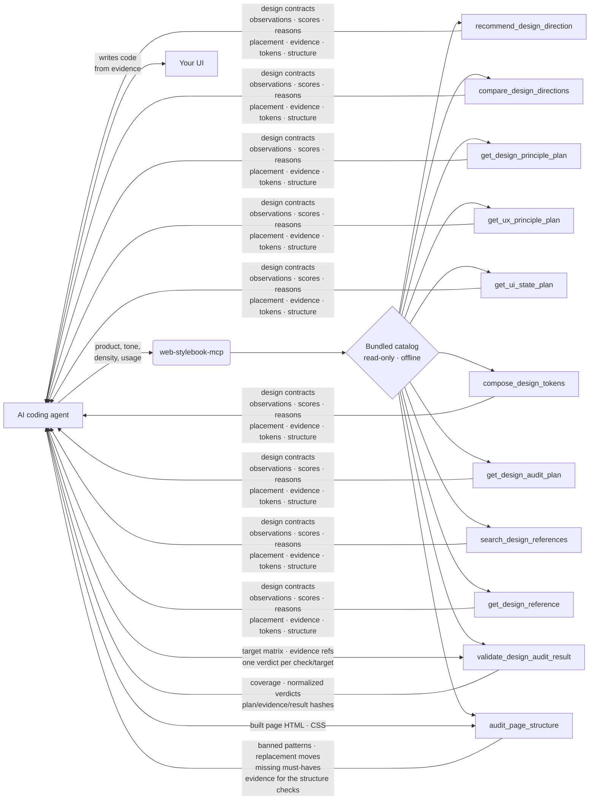

<div align="center">

# web-stylebook-mcp

**Design intelligence for AI coding agents.** Stop shipping the same hero-plus-three-cards.
Your agent gets scored design *contracts* — directions, interface-design plans, UX-principle plans, UI-state plans, tokens, evidence-backed audit plans — then writes and verifies the code from evidence.

[](https://www.npmjs.com/package/web-stylebook-mcp)
[](https://www.npmjs.com/package/web-stylebook-mcp)
[](./LICENSE)
[](https://nodejs.org)
[](https://modelcontextprotocol.io)

**English** · [한국어](./README.ko.md)

</div>

---

Coding agents default to the same generic UI because they can't *decide* what it should look like — so they fall back to hero + 3 cards + a gradient. `web-stylebook-mcp` is a Model Context Protocol server that hands the agent **design contracts** — scored visual directions, placement-aware interface-design plans, evidence-labeled UX-principle plans, UI-state plans, and design tokens — drawn from the same curated catalog as [webstylebook.com](https://webstylebook.com). It returns **evidence, not code**. Your agent still writes the code — now it knows what to build and what to verify.

No API key. No model call. No network. No project filesystem access. **Deterministic, read-only, fully local.**

## Without it / with it

| | Without `web-stylebook-mcp` | With `web-stylebook-mcp` |
|---|---|---|
| **Direction** | Guesses one look, commits to it | Scored candidates + reason codes + what it *rejected* and why |
| **Craft** | Principle names dropped into a doc, nothing verified | Placement guidance + an observable check per principle, cautions attached |
| **UX evidence** | "Hick's Law says…" as a conversation-ender | Evidence-labeled prompts (`strong` / `contextual` / `contested`) you can't restate as law |
| **UI states** | Happy path only; empty / error / loading bolted on later | Required / recommended / domain states up front, per surface |
| **Tokens** | Hand-picked hexes, contrast rarely checked | Role-based tokens with WCAG contrast warnings |
| **Structure** | Tokens recolor the default hero + logos + 3 cards template | A layout archetype and signature moves per direction, and an audit that flags the template in the built page |
| **Audit** | "Looks good" from a summary | Surface-aware checks with stable ids, severity, required evidence, and explicit unverified states |
| **Result** | Generic AI UI | A defensible design contract the agent builds from |

## Watch it decide

> *"High-density monitoring dashboard for SREs, watched all day on call. Calm, technical. Avoid cyberpunk."*

```jsonc
// → recommend_design_direction  (input)
{
  "productDescription": "High-density monitoring dashboard for SREs, watched all day on call",
  "productType": "operational-saas",
  "tone": ["calm", "technical"],
  "density": "high",
  "usageFrequency": "daily",
  "avoid": ["cyberpunk"]
}
```

```jsonc
// ← result (trimmed)
{
  "confidence": "high",
  "candidates": [
    { "styleId": "quiet-utility",  "score": 0.93 },
    { "styleId": "runtime-signal", "score": 0.89 },
    { "styleId": "notion-style",   "score": 0.83 },
    { "styleId": "console-launch", "score": 0.77 },
    { "styleId": "platform-core",  "score": 0.77 }
  ],
  "ranking": {
    "winner": "quiet-utility",
    "runnerUp": "runtime-signal",
    "gap": 0.04,
    "tied": false,
    "reasonCodes": ["USE_CASE_FIT", "LOWER_UPKEEP"],
    "explanation": "quiet-utility outranks runtime-signal by 0.04: 3 of 3 bestFor entries aim at operational-saas (runtime-signal: 2 of 3); lighter upkeep for daily use (quiet-utility: motion low, maintenance low; runtime-signal: motion low, maintenance medium)."
  },
  "rejected": [                        // 29 in total, three shown
    { "styleId": "aurora-gradient",  "reasonCodes": ["PRODUCT_NOT_IDEAL", "DAILY_USE_OVERSTIMULATION"] },
    { "styleId": "claymorphism",     "reasonCodes": ["PRODUCT_NOT_IDEAL"] },
    { "styleId": "cyberpunk-glitch", "reasonCodes": ["EXPLICITLY_AVOIDED", "DAILY_USE_OVERSTIMULATION"] }
  ],
  "pairings": [
    { "styleId": "notion-style",       "pairWith": "quiet-utility", "role": ["forms", "navigation", "repetitive surfaces"] },
    { "styleId": "macos-liquid-glass", "pairWith": "quiet-utility", "role": ["forms", "navigation", "repetitive surfaces"] }
  ],
  "guidance": "Treat candidates as scored evidence; choose using product context. candidates[0] is the strongest match, not a mandate."
}
```

Notice what it does: the top candidates get clearly different scores (0.93, 0.89, 0.83), and `ranking` says why #1 beat #2 — here every `bestFor` entry of `quiet-utility` targets operational SaaS, and its upkeep is lighter for daily use. When the top two really do score alike, `ranking.tied` says so instead of inventing a winner. Rejected styles come with reason codes, and pairings are suggestions rather than a mandate. The server provides evidence; the agent decides.

Then turn the chosen direction into real tokens:

```jsonc
// → compose_design_tokens(style: "quiet-utility", format: "css-variables", theme: "light")
// 0 WCAG contrast warnings
:root {
  --color-canvas: #ffffff;
  --color-text:   #1f2328;
  --color-accent: #526371;
  --color-border: #cecfd0;
  /* … role-based color, type, spacing, radius, motion, density */
}
```

One request in — and the agent chose a direction, saw what was rejected and why, and got tokens that pass WCAG, without generating a line of code.

## Structure, not just tokens

Tokens only recolor a page, so every candidate also carries `structure`: a layout archetype (hero composition, grid rhythm, section order, density, and how the type scale is used), two or three signature moves with the job each one does, and the patterns the page must not ship. `webstylebook://styles/{id}` adds each move's build steps and each ban's detection criteria, and `compose_design_tokens` points back to it (style id, resource URI, and move ids) and prints the hero and moves in its text output. Where an archetype breaks from the style's specimen page, its `basis` is `authored` and `departure` says why.

After building, pass the page's HTML and CSS to `audit_page_structure`. This is its real output for a page an agent built from the default SaaS template ([`generic-saas-tailwind.html`](https://github.com/seungdori/web-stylebook-mcp/blob/master/tests/fixtures/page-structure/generic-saas-tailwind.html)), checked against `quiet-utility`:

```jsonc
// → audit_page_structure({ html, styleId: "quiet-utility" })
// ← structure audit (trimmed)
{
  "summary": { "clean": false, "findings": 8, "major": 6, "minor": 2, "notVerified": 0, "checked": 12 },
  "findings": [
    {
      "patternId": "logo-strip",
      "name": "Logo strip",
      "severity": "major",
      "locations": ["section#customers > div.mx-auto"],
      "observed": { "logos": 5, "marquee": false, "muted": true },
      "replaceWith": {
        "instruction": "Remove it unless you have permission and a reason to name real customers; show proof a visitor can inspect instead (a real result, artifact, or named case) with this style's proof move.",
        "moves": [
          { "id": "hairline-gap-list", "name": "Gap-as-hairline state list", "purpose": "Triage: shows many resources and their current state at an even rhythm, with dividers that cannot drift out of alignment." },
          { "id": "stepped-state-badges", "name": "Three-step state badges", "purpose": "Calm status: state reads through steps of weight and fill instead of traffic-light colors, so the one urgent item stands out." }
        ]
      }
    },
    {
      "patternId": "generic-saas-skeleton",
      "observed": { "sections": "opening → proof → features → testimonials → cta", "templateSections": 5 },
      "replaceWith": {
        "archetype": {
          "sectionOrder": [
            "Top bar: breadcrumb path on the left, search and one primary action on the right",
            "The primary working list or table with its filter row",
            "A detail or form panel for the selected item",
            "Secondary panels such as activity, audit history, or settings for the same object",
            "Empty, loading, and error states drawn in the same slots as the data"
          ]
        }
      }
    }
    // 6 more: centered-stack-hero, trusted-by-band, icon-feature-grid, testimonial-carousel, closing-cta-banner, quiet-utility/corner-radius
  ]
}
```

Each finding names where the pattern is, what was observed, and what to put there instead: the chosen style's signature moves for the same job (proof, in the logo strip's case), its hero composition, or its section order. Rebuild, run the audit again, then add `"structure"` to `get_design_audit_plan.includeGroups` and pass the returned `evidence` and `results` to `validate_design_audit_result`. Audit each viewport with its own `targetId`: the evidence ids include it, so the runs validate together. The checks are deterministic heuristics over the submitted HTML and CSS, not a browser render, so `clean` means every check ran and found none of these patterns, not that the design passed. Per-style guidance (archetypes and moves) is written in English, like the catalog's own `layout` and `typography` fields; pattern names and instructions follow `locale`.

### Must-haves a style can't remove

A direction must not cost the page its function. In the shelved showcase run (#7), the luxury skincare page built with the MCP kept a single buy button above the fold, while the control page showed sizes, a per-night price, add to bag, and delivery and guarantee details. So `recommend_design_direction` also returns `mustHaves`: the elements the resolved product type requires and the zone each one must sit in. A style restyles them but never removes them or moves them out of their zone, and they come before the archetype's limits on the opening ("one action, one short line"): every first-screen item goes in the hero. Each candidate's `structure.mustHaves` names that style's signature moves that do the same job, for example the proof move that can carry delivery and guarantee details.

| Product type | Page | First screen | Anywhere on the page |
|---|---|---|---|
| `operational-saas` | main dashboard | Current status (`current-status`), What changed (`recent-changes`) | — |
| `developer-tool` | product landing page | Code sample (`code-sample`), Documentation link (`docs-link`) | — |
| `documentation` | docs home | Search (`search`), Quickstart (`quickstart`) | — |
| `data-analytics` | analytics dashboard | Current status (`current-status`), What changed (`recent-changes`), Time range (`time-range`) | — |
| `security-console` | security overview | Current status (`current-status`), What changed (`recent-changes`) | — |
| `finance-admin` | finance overview | Current status (`current-status`), What changed (`recent-changes`) | — |
| `healthcare-portal` | portal home | Primary action (`primary-cta`) | Contact (`contact`), Privacy notice (`privacy-notice`) |
| `commerce` | product detail page | Price (`price`), Variant choice (`variant-choice`), Add to cart (`add-to-cart`), Delivery and guarantee details (`purchase-assurance`) | — |
| `ai-chat` | chat screen | Message input (`composer`) | AI limits note (`ai-limits`) |
| `content-editorial` | article page | Author (`author`), Publication date (`publish-date`) | — |
| `knowledge-base` | help center home | Search (`search`) | Topic index (`topic-index`) |
| `portfolio` | portfolio home | — | Work samples (`work-samples`), Contact (`contact`) |
| `campaign` | landing page | Primary action (`primary-cta`) | Proof (`proof`) |
| `consumer-app` | app landing page | Primary action (`primary-cta`) | Proof (`proof`) |

The first screen is everything up to the end of the opening section (the section that holds the page's `h1`), plus up to two following sections while each section so far is short (≤ 40 words, no image, video, table, or large SVG, and not sized to fill the viewport). The site header counts; the footer does not. A brief whose product type is neither given nor inferred resolves to `other`, which has no list, and the result says so instead of inventing one. Every criterion is in `webstylebook://structure/must-haves`.

Pass the same `productType` to `audit_page_structure`, and it reports which must-haves the built page is missing. This is its real output for the showcase failure, rebuilt as a fixture ([`commerce-buy-button-only.html`](https://github.com/seungdori/web-stylebook-mcp/blob/master/tests/fixtures/must-haves/commerce-buy-button-only.html)):

```jsonc
// → audit_page_structure({ html, styleId: "midnight-noir", productType: "commerce" })
// ← must-have audit (trimmed)
{
  "mustHaves": {
    "productType": "commerce",
    "page": "product detail page",
    "missing": [],
    "misplaced": ["price", "variant-choice", "purchase-assurance"],
    "items": [
      { "id": "price", "checkId": "structure-must-have-price", "zone": "first-screen", "status": "misplaced", "count": 1,
        "locations": ["section#buy > div > p.price:nth-of-type(1)"] },
      { "id": "add-to-cart", "checkId": "structure-must-have-add-to-cart", "zone": "first-screen", "status": "present", "count": 1,
        "locations": ["body > main > section.masthead:nth-of-type(1) > div > a.button"] }
      // 2 more: variant-choice and purchase-assurance, both misplaced
    ]
  },
  "findings": [
    {
      "patternId": "must-have/price",
      "scope": "must-have",
      "severity": "major",
      "observed": { "status": "misplaced", "zone": "first-screen", "found": 1, "inZone": 0 },
      "replaceWith": {
        "instruction": "Move it onto the first screen; the audit found it only further down the page. Show the price with its currency next to the product name; when sizes differ in price, show the price of the selected size.",
        "moves": [],
        "archetype": { "hero": "Left-heavy and low: a 1.7fr/1fr grid with align-items: end …" }
      }
    }
    // 2 more: must-have/variant-choice, must-have/purchase-assurance
  ]
}
```

Each must-have is `present`, `missing`, `misplaced` (on the page, but not on the first screen), or `not-verified` (the stylesheets exceeded the selector budget, parsing stopped before the end of the page, or the page has no section to place the first screen in). Each one is also a `structure-must-have-<id>` check: pass `productType` with the `structure` group to `get_design_audit_plan`, and the audit's evidence and results validate as they are. Detection reads markup, ARIA roles, and visible text in English, Korean, and Japanese. Anything hidden (`hidden`, `display: none`, a visually hidden `sr-only` box, or `aria-hidden="true"`) does not count. Native controls are found reliably: a `select` or radio group for variants, an `input type="search"` for search, a `time` element for dates.

## What an agent builds with it

A different brief — *"a marketing landing page for **Throughline**, a B2B SaaS that turns scattered customer feedback (support tickets, sales calls, app reviews, Slack) into one prioritized roadmap."* No layout, no hero, no styling was specified. Following the companion skill, the agent composed the opening **from the product's core idea** instead of reaching for a stock hero: the right half is a bespoke diagram of the product's actual mechanic — feedback sources converging into an auto-ranked roadmap — not a decorative card you could paste onto any other site.

<div align="center">

</div>

<div align="center"><sub>Composed by an AI agent following the companion skill — the prompt described the product and stack, nothing about the layout.</sub></div>

## How it works



The agent describes the product; the server scores its curated catalog and returns structured evidence. After building, the agent passes the page markup to the structure audit, which never reads files on its own. After inspection, the validator checks the result contract without opening the referenced artifacts or judging visual quality. No code is generated and nothing leaves your machine.

## Install

Requires **Node ≥ 20**.

<details open>
<summary><b>Codex CLI · IDE extension</b></summary>

Use the Codex CLI:

```bash
codex mcp add web-stylebook -- npx -y web-stylebook-mcp@latest
```

Or add it to `~/.codex/config.toml`. You can also use a project-scoped
`.codex/config.toml` in a trusted repository:

```toml
[mcp_servers.web-stylebook]
command = "npx"
args = ["-y", "web-stylebook-mcp@latest"]
```

Restart Codex or open a new session after editing config. In the Codex TUI, run `/mcp`
to confirm the server is active.

</details>

<details>
<summary><b>Claude Code</b></summary>

```bash
claude mcp add web-stylebook -- npx -y web-stylebook-mcp@latest
```

</details>

<details>
<summary><b>Cursor · Windsurf · generic MCP client</b></summary>

Add to your MCP config:

```json
{
  "mcpServers": {
    "web-stylebook": {
      "command": "npx",
      "args": ["-y", "web-stylebook-mcp@latest"]
    }
  }
}
```

</details>

<details>
<summary><b>Claude Desktop</b></summary>

Add the same block to your `claude_desktop_config.json`, then restart:

- **macOS:** `~/Library/Application Support/Claude/claude_desktop_config.json`
- **Windows:** `%APPDATA%\Claude\claude_desktop_config.json`

```json
{
  "mcpServers": {
    "web-stylebook": {
      "command": "npx",
      "args": ["-y", "web-stylebook-mcp@latest"]
    }
  }
}
```

</details>

## Tools

| Tool | What you get | The honest part |
|------|--------------|-----------------|
| **`recommend_design_direction`** | Scored style candidates with reason codes, a `ranking` that says why #1 beat #2 (or reports a tie), **rejected** styles with *why*, secondary pairings, confidence, each candidate's page `structure`, and the product type's `mustHaves` with the zone each must sit in | The model makes the final pick — this is the evidence provider |
| **`compare_design_directions`** | 2–4 directions compared across product-fit, repeated-use, density, trust, distinctiveness, accessibility-risk, motion, maintenance | No single winner is declared |
| **`search_design_references`** | Bounded search across real-world references by text, category, and tags, with concise localized observations | Returns attributed research summaries, not copied screenshots or brand assets |
| **`get_design_reference`** | One complete localized reference with palette/layout/interaction/motion observations, normalized tokens, source revision, attribution, and rights notice | Original-site copy, typefaces, screenshots, and visual identity remain with their owners |
| **`get_design_principle_plan`** | A focused placement, application, and verification plan selected by visual concerns, surface, phase, or principle ids — with source references where available | Craft prompts are testable guidance, not empirical laws or a fixed recipe |
| **`get_ux_principle_plan`** | A focused apply-and-verify plan selected by outcomes, surface, phase, or principle ids — with questions, cautions, confidence, and references | Principles are contextual prompts, not universal laws or a substitute for research |
| **`get_ui_state_plan`** | Required / recommended / domain UI states for a surface (data-table, form, checkout, chat, developer-console) — triggers, must-show, must-not, a11y, motion | Covers the states agents forget: empty, error, loading, edge |
| **`compose_design_tokens`** | Role-based tokens as `json` / `css-variables` / `tailwind` / `typescript`, or a whole `DESIGN.md` file (`design-md`); opt into the shared visual contract to preserve authored style values and editor changes | Contract mode uses authored color modes and applies only explicitly accepted contrast repairs |
| **`get_design_audit_plan`** | Localized, surface-aware checks with stable ids, severity, applicability, required evidence, remediation, user-facing content checks, selected principle checks, and UI-state coverage | The tool plans the audit but never pretends it inspected your project; missing evidence is `NOT_VERIFIED`, not `PASS` |
| **`validate_design_audit_result`** | Contract validation for the plan query, target matrix, durable evidence references, and one verdict per check/target, with normalized verdicts and stable hashes | It verifies coverage and evidence consistency, not visual quality; `valid: true` is never an overall design pass |
| **`audit_page_structure`** | Banned generic and style-specific patterns found in the HTML and CSS you pass in, each with its location, observed values, and the chosen style's replacement moves; with `productType`, the must-haves the page is missing or keeps off the first screen; plus evidence and results for the `structure` audit group | Declared-style heuristics, not a browser; a clean result is not a design pass |
| **`compare_page_revisions`** | Before/after comparison of a redesign: which links, form fields and labels, handlers, test hooks, script selectors, headings, figures, landmarks, visible words, and product must-haves it kept, reworded, or dropped, with `acknowledged` for intended removals; plus evidence and results for a `revisionPreservation` audit plan | Static markup, not a browser; it does not run your scripts or record screenshots |

**Catalog:** 520 real-world design references · 48 styles · 25 interface design principles · 23 UX principles · 51 structured audit checks · 20 components · 5 surfaces · 57 UI-state recipes · 29 motion profiles · 14 product archetypes.

**Structure:** 48 layout archetypes · 144 signature moves · 9 banned generic patterns · 142 style-specific bans from 19 detectors · 21 must-haves across 14 product types.

The reference library is an adapted, high-completeness subset of [OpenDesign](https://opendesign.cc), whose structured specifications are licensed under [CC BY 4.0](https://creativecommons.org/licenses/by/4.0/). Web Stylebook excludes upstream screenshots and brand assets. Original sites, brands, copy, typefaces, and visual identities remain the property of their respective owners; inspect each detail's attribution and rights notice before use.

## Preserve the website's visual specification

Opt into the shared contract when the selected style or web-editor adjustments must survive token generation:

```json
{
  "primaryStyleId": "brutalist-grid",
  "format": "css-variables",
  "contract": { "schema": "webstylebook.visual.v1" },
  "locale": "ko",
  "overrides": {
    "colors": { "text": "#111111" },
    "typography": { "body": { "lineHeight": 1.75 } }
  }
}
```

Read `webstylebook://manifest` for `visualContract.contractSchema` and the bundled library's `visualContract.contentHash`. Read `webstylebook://styles/brutalist-grid` for the selected native contract and its `visualContract.revision`. Pass those values as `contract.schema`, `contract.contentHash`, and `contract.revision` to pin the source; a mismatch returns `INVALID_INPUT`. Omitting `colorMode` uses the style's authored native mode. Requesting `light`, `dark`, or `both` succeeds only when the required modes are authored.

`overrides` accepts semantic colors, typography roles, spacing, density, and font metadata. Use these explicit values for selections taken from another style; `secondaryStyleId` remains the legacy accent overlay and is rejected in contract mode. Unknown fields and conflicting `density` / `accentOverride` aliases are rejected. Supply `contract` whenever using `overrides` or `acceptedRepairs`.

The result includes the selected `visualContract`, source identity in `contract`, and `repairProposals`. Repairs stay unapplied until their exact proposal objects are sent back in `acceptedRepairs`; stale proposals are rejected. Apply accepted repairs with a single `light` or `dark` request; `both` requests return separate mode proposals. Keep `visualContract` alongside exported CSS: it carries component color pairs, font loading and license metadata, usage rules, provenance, and accepted repairs. Theme output also includes `roleStyles` and a complete `metadata` companion. Font loading and rendered appearance still require checks in the consuming app.

The shared runtime includes seven portable MIT sources, including `fontSources.ts` metadata for Korean/Japanese heavy display fallbacks. It includes no browser font loader or font binaries. `visual:sync` preflights the source import closure and license declarations before writing, and `visual:check` verifies the source hashes and artifact bytes. When updating the website revision, regenerate and synchronize `catalog.v1.json`, `manifest.v1.json`, and the visual artifact together; update the exact source pin in `.github/workflows/publish.yml` as well.

## Export a DESIGN.md

`compose_design_tokens` with `format: "design-md"` returns the chosen direction as a [DESIGN.md](https://github.com/google-labs-code/design.md) file (spec version `alpha`), so other agents and tools can read it. The server never writes the file: save `content` as `DESIGN.md` in the project.

```json
{
  "primaryStyleId": "brutalist-grid",
  "format": "design-md",
  "contract": { "schema": "webstylebook.visual.v1" },
  "locale": "ko",
  "designMd": { "tokenPlacement": "interleaved", "productType": "developer-tool" }
}
```

- `designMd.tokenPlacement`: `front-matter` (default) puts every token in one YAML block at the top. `interleaved` keeps only `name` and `description` there and puts each token group in a YAML block inside its section.
- `includeProse`, `includeDoDont`, and `includeStructure` (all `true` by default) control the prose, the Do's and Don'ts built from the style's bans and the banned page patterns, and the page structure in Layout. `productType` adds that product type's must-haves to Layout.
- Colors use DESIGN.md names: `primary` is the text color, `surface` the page background, then `accent`, `on-accent`, `surface-container`, `outline`, and so on. The Colors prose names the `compose_design_tokens` role behind each one. Components reference tokens, for example `{colors.action-primary}`. Dimensions are px, em, or rem only, and fluid type keeps its maximum size.
- The result also has `sections`, `omitted` (sections left out, each with a reason), `lossy` (values DESIGN.md has no key for, such as a second color mode, status colors, motion, and shadows), `specVersion`, and `sourceHash`. The same input returns the same bytes.
- `webstylebook://design-md/{id}` serves the same file for one style from its pinned visual contract. Optional query parameters: `locale`, `mode`, `placement`.

Every style, in both placements, all three locales, and with or without a contract, passes `npx @google/design.md lint` (0.4.0) with no errors. Its only warnings are text/background pairs below 4.5:1, which `compose_design_tokens` also reports.

## Localized output

Every tool takes an optional `locale`. Reason codes, guidance, and labels come back in the requested language:

```text
"en" | "ko" | "ja"     // English · 한국어 · 日本語
```

## Resources

Browse the catalog directly over MCP resources:

```
webstylebook://manifest
webstylebook://styles · /styles/{id}
webstylebook://motion · /motion/{id}
webstylebook://components · /components/{id}
webstylebook://principles · /principles/{id}
webstylebook://design-principles · /design-principles/{id}
webstylebook://states/surfaces · /states/{surface} · /states/{surface}/{state}
webstylebook://products · /products/{id}
webstylebook://references · /references/{id}
webstylebook://policies/anti-patterns · /policies/verification · /policies/audit-checks
webstylebook://structure/banned-patterns · /structure/must-haves
webstylebook://design-md/{id}
```

Style detail accepts optional `locale`, `mode`, and expected `revision` query parameters, for example `webstylebook://styles/brutalist-grid?locale=ko&mode=light`. It returns one resolved locale and mode; unsupported values, duplicate parameters, and unknown query names return an explicit error.

## Prompts

Ready-made MCP prompts for common workflows:

`design-product` · `design-screen` · `complete-ui-states` · `redesign-with-style` · `audit-design-direction` · `audit-design-principles` · `audit-ux-principles`

When `audit-design-direction` is invoked without an explicit scope, it asks two short questions
before inspection: audit coverage (visual / visual + copy and information structure / full
experience) and change depth (findings / proposals / implement and verify). File edits, commits,
releases, and deployment are never inferred from an audit request.

Content coverage checks more than jargon: it tests whether material claims, conclusions, and
recommendations match their support and expressed certainty, whether prominent copy conveys concrete
context-specific information, and whether its visual emphasis matches information value, task
relevance, and support. Cards, statistics, and Sitemap links are still judged by their actual
user-task value rather than banned as types.

## Keep what worked through a redesign

Redesigns quietly drop links, form fields, handlers, the selectors a script queries, and must-haves. Before you redesign a page, save its rendered HTML (for example `document.documentElement.outerHTML`) and its CSS. When the redesign is built, pass both versions to `compare_page_revisions`:

```json
{
  "before": { "html": "<!doctype html>…", "css": ["…"] },
  "after": { "html": "<!doctype html>…", "css": ["…"] },
  "scriptSelectors": ["#cart-form", ".js-variant"],
  "productType": "commerce",
  "acknowledged": [
    { "kind": "link", "key": "/pricing", "change": "dropped", "reason": "Pricing moved to the sales contact page" }
  ]
}
```

| Inventory | What is compared | When it is lost |
|---|---|---|
| links | `a[href]`, with scheme and host lowercased and query parameters sorted | FIX_NOW, major |
| fields | `input`, `select`, `textarea` by `name` (else `id`), and whether each keeps a label | FIX_NOW, major |
| handlers | form action and method, `formaction`, inline `on*` attributes | FIX_NOW, major |
| test hooks | `data-testid`, `data-test`, `data-cy` | FIX_NOW, minor |
| script hooks | each `scriptSelectors` entry that matched the original | FIX_NOW, major |
| headings, figures, landmarks | h1–h3 text, image alt text and figure captions, `main`/`nav`/`footer` | RISK |
| words | visible words; Korean, Chinese, and Japanese by character | RISK when the original had more than 80 and the redesign keeps under 60% |
| must-haves | with `productType`, the must-haves `audit_page_structure` finds | FIX_NOW when one present before is missing or off the first screen |

A heading or link whose wording changed while its place or target stayed is reported as `reworded` (RISK). An `acknowledged` entry needs the matching `kind`, `key`, and `change` and a reason of at least 12 characters; a shorter reason does not excuse the loss and adds a RISK finding. Links, headings, figures, landmarks, words, and must-haves count visible elements only. Fields, handlers, and both kinds of hook also count hidden elements, because a hidden CSRF field, a closed dialog, or a cart drawer behind `display: none` is still part of how the page works.

The result has `verdict` (`PASS`, `FIX_NOW`, or `RISK`), an `inventory` with kept, lost, reworded, and acknowledged items, `wordCount`, `findings`, and `evidence` and `results` for the `redesign-kept-<inventory>` checks. To record them, call `get_design_audit_plan` with `revisionPreservation: true` (and the same `productType`); that plan holds only these checks, so `validate_design_audit_result` accepts the evidence and results as they are. Plans without `revisionPreservation` keep their checks and hash.

## Audit result contract

`get_design_audit_plan` now returns an `identity` with the catalog version/hash and a deterministic
`planHash`. After inspecting the actual implementation, submit the same plan query plus:

- one target per inspected route or screen, state, viewport, theme, locale, and role;
- evidence with a durable artifact reference, content hash, or exact route/selector/file/region;
- a before/input/after/recovery phase for interaction evidence; and
- one result for every planned check/target pair.

`validate_design_audit_result` regenerates the plan and rejects stale plan hashes, missing or duplicate
result slots, broken evidence references, cross-target evidence, invalid regions, unsupported
`NOT_APPLICABLE`, and `PASS` that lacks required evidence or contradicts failed evidence. Missing result
slots are materialized as `NOT_VERIFIED`, never hidden. With `includeGroups` containing `structure` and a
`styleId`, the plan adds one automated check per banned pattern, and `productType` adds one per must-have;
`audit_page_structure` returns evidence and results for those check ids that the validator accepts as they are. With `revisionPreservation: true`, the plan holds only the `redesign-kept-*` checks that `compare_page_revisions` answers. The result carries content-addressed plan,
evidence-bundle, and normalized-result hashes for comparable rechecks. The tool never opens the
artifact references and never turns contract validity into a design-quality score.

The repository includes a reproducible contract-quality benchmark:

```bash
npm run eval:audit-contract
```

Across 14 human-labeled normal and adversarial cases, legacy pass-through verdicts score 4/14
(28.57%) with 9 false `PASS` results. The validator scores 14/14 with 0 false `PASS` results and
classifies every contract-valid/invalid case correctly. The corpus covers missing, narrative-only,
unknown, cross-target, indeterminate, phase-less, blocker/major/minor failure, honest
`NOT_VERIFIED`, and valid/invalid `NOT_APPLICABLE` cases. This demonstrates result-contract
correctness; it does not claim that subjective visual judgment itself is 100% accurate.

## CLI

```bash
web-stylebook-mcp                 # run the server over stdio (default)
web-stylebook-mcp --version
web-stylebook-mcp --catalog-info
web-stylebook-mcp --validate-catalog
```

## Companion skill

A companion skill ships in [`skill/`](./skill) so your agent reaches for these tools at the right moment — and uses the results well (compose, don't recolor; offer multiple candidates; earn trust, don't fake it; land on reusable components):

**Codex**

- Copy or symlink `skill/web-stylebook-design/` into a Codex skill location such as
  `.agents/skills/web-stylebook-design/` in your repo, or `~/.agents/skills/web-stylebook-design/`
  for your user profile.
- If you do not want to install the skill, copy `skill/AGENTS.md` into your project's `AGENTS.md`.

**Claude Code and other agents**

- Point your agent's skills directory at `skill/web-stylebook-design/`, **or**
- Copy `skill/CLAUDE.md` into your project's `CLAUDE.md` or equivalent rules file.

## Privacy & security

| Property | |
|----------|---|
| API key | None |
| Model calls | None |
| Network access | None — works fully offline |
| Project filesystem access | None — the server only reads its bundled catalog snapshot |
| Behavior | Deterministic, read-only |

The server reads from a catalog snapshot bundled in the package. Nothing is sent anywhere; the same inputs always yield the same contracts.

## Catalog source sync

The canonical catalog is authored in the
[`web-stylebook`](https://github.com/seungdori/web-stylebook) repository. After generating its
local MCP handoff snapshot, verify byte-for-byte parity before releasing this package:

```bash
npm run catalog:check-canonical -- /absolute/path/to/web-stylebook/packages/mcp/generated
```

Without an argument, the command uses `WEB_STYLEBOOK_CANONICAL_CATALOG_DIR` or the local sibling
path `../showcase/packages/mcp/generated`. The regular test suite verifies the bundled artifact's
internal hash, enums, counts, and runtime contract; this command is the explicit cross-repository
source check.

## Compatibility

- **Node:** ≥ 20
- **Transport:** stdio (Model Context Protocol)
- **Clients:** Codex CLI / IDE extension, Claude Code, Claude Desktop, Cursor, Windsurf, and any MCP-compatible client

Tool inputs are unchanged apart from new optional values, and `structure` is an added output field. Plans requested without `includeGroups` keep their checks and hash, because `structure` is opt-in. Calls without `contract` keep the same token shape and light-mode default. As of 0.11.0, those calls emit the pinned style's authored shadows instead of the generic soft shadow, and editorial or monospace-led styles emit authored font families instead of the style-family fonts. Color, type scale, line-height, spacing, radius, motion, and omitted density stay on the previous legacy path. An explicit `density` still takes precedence over a family's row and gutter, and CSS / theme output retains line-height tokens. Pass `contract` for the full authored specification. The shared contract is additive; no new tool is required.

## License

[MIT](./LICENSE) — covers the code **and** the bundled catalog snapshot (free for commercial use).

> The [webstylebook.com](https://webstylebook.com) website is licensed CC BY-NC. The same owner grants an MIT license for the catalog snapshot bundled in this package.
>
> UX-principle entries are independently written application and verification guidance. They
> attribute and link to [Laws of UX](https://lawsofux.com) (CC BY-NC-ND 4.0) and supporting
> references; Laws of UX prose, illustrations, and page layouts are not bundled.
>
> Interface-design-principle entries form an independently authored, task-oriented review system for
> contemporary interfaces. They cover semantic structure, responsive reflow, localization, tokens
> and themes, multiple input modes, complete state models, recovery, and motion preferences.
