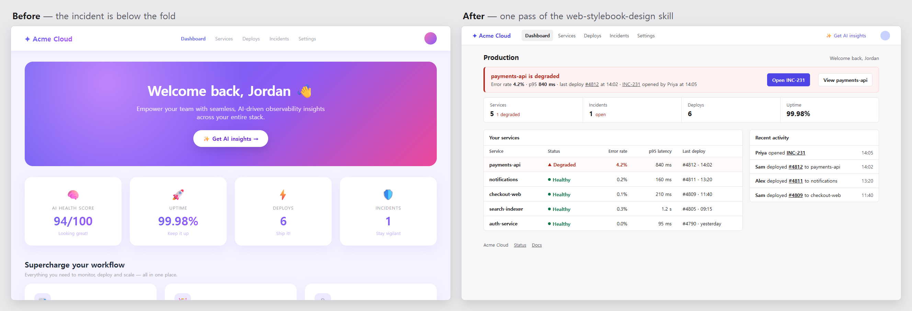

<div align="center">

# web-stylebook-mcp

**Design judgment for coding agents. It improves the UI you already have and shows the evidence.**

[](https://www.npmjs.com/package/web-stylebook-mcp)
[](https://www.npmjs.com/package/web-stylebook-mcp)
[](./LICENSE)
[](https://nodejs.org)
[](https://modelcontextprotocol.io)

**English** · [한국어](./README.ko.md)

</div>



<sub>Left: a fixture dashboard written in a common generated style. Right: the same page after one
pass of the `web-stylebook-design` skill, run by Claude Opus 5.5 with no human edits. Fictional
data. [How it was made, what was measured, and what it does not show →](./docs/demo/README.md)</sub>

- **It knows design.** It bundles 24 researched foundations with 30 attributed sources, 25
  interface principles, 23 UX principles, 48 visual directions and 520 real-world references. Each
  rule says when it applies, when it does not, and how to check the result.
- **It makes the agent finish the job.** The agent captures the page, plans, edits the real source,
  captures again and compares. The run counts as `complete` only with matched before/after
  captures, kept links and test hooks, and behavior and accessibility checks. Otherwise the result
  is `needs-work`, with a list of what is missing.
- **It stays local.** No API key, no model calls, no network, and it never reads your files. The
  same input always gives the same output.

## Install

For any agent with skills (Claude Code, Codex, Cursor and others):

```bash
npx skills add seungdori/web-stylebook-mcp
```

For Claude Code, the plugin installs the skill and the MCP server together (Claude Code 2.1.275 or
later):

```text
/plugin install web-stylebook --marketplace seungdori/web-stylebook-mcp
```

For the MCP server only:

```bash
claude mcp add web-stylebook -- npx -y web-stylebook-mcp@latest
```

```bash
codex mcp add web-stylebook -- npx -y web-stylebook-mcp@latest
```

Cursor, Windsurf and Claude Desktop settings are in the [reference](./docs/reference.md#install).
Node 20 or later is required; `npx skills` needs Node 22.20 or later.

## Use

Ask for a change to a screen you already have:

> Improve the dashboard so on-call sees what is broken first.

The agent captures the page and calls `get_design_improvement_plan`. Then it edits your code,
checks what the edit kept with `compare_page_revisions`, and finishes with
`validate_design_improvement_result`. You get before/after screenshots, each change with its
reason, the checks that ran, and what was not verified.

For a new page, describe the product instead, for example *"a landing page for a payments API"*.
The agent starts with `recommend_design_direction` and shows the candidates it ranked, plus the ones
it rejected and why.

If you ask for a review only, the agent audits and reports without editing anything.

## Without MCP

The skill works without the MCP server. It runs the same tools from the shell and gets the same
results:

```bash
npx -y web-stylebook-mcp tools
```

```bash
npx -y web-stylebook-mcp call get_design_improvement_plan --input plan-args.json
```

## Tools

| For | Tools |
|---|---|
| Improving an existing UI | `get_design_improvement_plan`, `compare_page_revisions`, `validate_design_improvement_result` |
| Reviewing | `get_design_audit_plan`, `audit_page_structure`, `validate_design_audit_result` |
| Choosing a direction | `recommend_design_direction`, `compare_design_directions`, `search_design_references`, `get_design_reference` |
| Principles and states | `get_design_principle_plan`, `get_ux_principle_plan`, `get_ui_state_plan` |
| Building | `compose_design_tokens` (JSON, CSS variables, Tailwind, TypeScript or DESIGN.md) |

The [reference](./docs/reference.md) has an example for each tool, the result contracts, the
resources and prompts, and the CLI.

## More

- [Reference](./docs/reference.md): tool examples, contracts, CLI and compatibility
- [Demo](./docs/demo/README.md): the before/after above, with every evidence file
- [Changelog](./CHANGELOG.md) · [Security](./SECURITY.md) · [Releasing](./RELEASING.md)

## License

[MIT](./LICENSE). It covers the code and the bundled catalog snapshot. The webstylebook.com website
itself is CC BY-NC; attribution details are in the [reference](./docs/reference.md#license).
