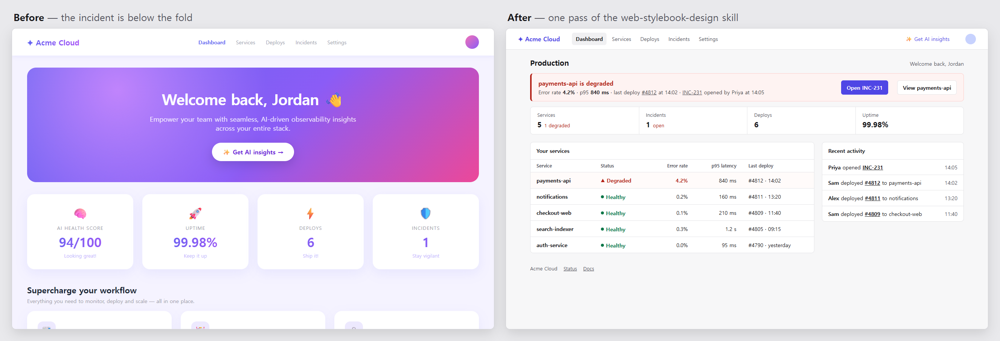

# 変更前後のデモ: 作り方

[English](./README.md) · [한국어](./README.ko.md) · **日本語**



**このデモの内容。** 架空の製品 Acme Cloud を扱う、2つのフィクスチャページです。データと時刻（2026-11-05 14:31 UTC）は固定しています。[before.html](./before.html) は、コーディングエージェントがよく作るスタイルで、このデモ用に書いたものです。グラデーションの挨拶ヒーロー、絵文字の統計カード、マーケティング風の機能カード、薄いグレーの文字が含まれます。[after.html](./after.html) は、同じページに [`web-stylebook-design`](../../skills/web-stylebook-design/SKILL.md) スキルを1回適用した結果です。

**作成者。** Claude Code 上の Claude Opus 5.5 が両方のページを書き、スキルのワークフローを実行しました。MCP サーバーは接続しなかったため、すべてのツールは CLI（`web-stylebook-mcp call …`）で実行しました。after ページは、人が手で編集していません。

## 課題

> オンコール担当のエンジニアが本番のダッシュボードを開き、今まさに何かが壊れているか、その直前に何が変わったか、次に何をすべきかを確認します。

計画に与えた制約は次のとおりです。すべてのリンクと2つの `data-testid` フックを残し、事実と数値はそのまま保ち、存在しない情報を作らないこと。全入力は [evidence/plan-args.json](./evidence/plan-args.json) にあります。

## 手順

1. **変更前のキャプチャ。** Chrome、1280×800、DPR 1、ライトテーマ、en-US、フォント読み込み済みの条件で撮影しました。[スクリーンショット](./evidence/before.png)、[ページ全体](./evidence/before-full.png)、[レンダリング後の HTML](./evidence/before.rendered.html)、[計測値](./evidence/verify-before.json)があります。
2. **計画。** `call get_design_improvement_plan --input plan-args.json` で、6つのデザイン原論を選びました。priority-hierarchy、scannable-content、truthful-evidence、surface-hierarchy、visual-balance、rhythm-consistency です（[plan.json](./evidence/plan.json)）。
3. **編集。** 変更は4つです。いずれもデザイン原論の条件付きの改善策に対応しています（[diff](./evidence/before-to-after.diff)）。
   - 劣化したサービス、その数値、最後のデプロイ、未解決のインシデントを、ページ上部のアラートに移し、対応のためのリンクを付けました。
   - "AI Health Score 94/100" は削除しました。算出方法が示されていないためです。
   - サービス表は、状態を文字と形の両方で示すようにしました。劣化した行を先頭に置き、数値は右揃えにしています。
   - マーケティング用の機能カードは削除しました。
4. **検証。** 同じ条件で再キャプチャし、位置、コントラスト、キーボードフォーカスを計測しました。`compare_page_revisions` で編集で何が残ったかを確認し（[compare.json](./evidence/compare.json)）、その結果は別の監査計画で検証しました（[audit-validate.json](./evidence/audit-validate.json)）。
5. **報告。** `validate_design_improvement_result` は、問題なしで `complete` を返しました（[result](./evidence/improvement-result.json)、[レポート](./report.md)）。

## 計測結果

| | 変更前 | 変更後 |
|---|---|---|
| 劣化したサービス、ページ上端からの位置 | 1375 px（画面外） | 394 px |
| 未解決のインシデント INC-231、上端からの位置 | 1550 px（画面外） | 160 px |
| ページの高さ | 1871 px | 800 px の画面1枚に収まる |
| WCAG AA のコントラストを下回る、ファーストビューの文字 | 計測23件中14件、グラデーション上でさらに7件 | 85件中0件 |
| リンク先 | 18 | 変わらず18 |
| 見えるフォーカスリングを持つタブ停止位置 | 14件中14件 | 14件中14件 |

## 検査結果とレンダリングが食い違った箇所

`compare_page_revisions` は、ブラウザではなく文書の順序から最初の画面を推定します。そのため「What changed」が最初の画面の外に移動したと報告しました。しかし Chrome では、Recent activity パネルは y = 303 の位置にあり、サービス表の横に置かれています。計測した位置は、その理由を付けて確認済みとして記録し、実行結果は両方とも残しました。

## このデモが示さないこと

- 両ページともフィクスチャです。実在の製品ではなく、何もデプロイしていません。
- テストしたのは、1つのブラウザと1つのデスクトップのビューポートだけです。狭いレイアウト、ダークモード、スクリーンリーダーは対象外です。
- コントラストとフォーカスはスクリプトで検査しました。ユーザー調査は行っておらず、品質スコアも主張していません。
- after ページでは、グラデーション、絵文字、挨拶ヒーローを取り除いています。これらを残したいチームもあるかもしれません。

## 再現手順

```bash
npx -y web-stylebook-mcp@latest call get_design_improvement_plan --input docs/demo/evidence/plan-args.json
npx -y web-stylebook-mcp@latest call compare_page_revisions --input docs/demo/evidence/compare-args.json --text
cd docs/demo && npx -y web-stylebook-mcp@latest call validate_design_improvement_result --input evidence/improvement-args.json --text
```

スクリーンショットは、ローカルの Chrome で `playwright-core` を使い、1280×800、`deviceScaleFactor: 1` で撮影しました。
