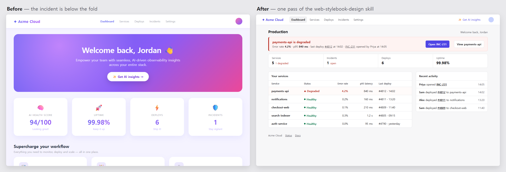

# 전후 비교 데모: 만든 방법

[English](./README.md) · **한국어** · [日本語](./README.ja.md)



**이 데모의 내용.** 가상의 제품 Acme Cloud를 다룬 픽스처 페이지 두 개입니다. 데이터는 고정되어 있고, 시계도 2026-11-05 14:31 UTC로 고정했습니다. [before.html](./before.html)은 코딩 에이전트가 자주 만드는 방식으로 이 데모를 위해 작성했습니다. 그라데이션 인사 히어로, 이모지 통계 카드, 마케팅식 기능 카드, 밝은 회색 글자가 들어 있습니다. [after.html](./after.html)은 같은 페이지에 [`web-stylebook-design`](../../skills/web-stylebook-design/SKILL.md) 스킬을 한 번 적용한 결과입니다.

**작업 주체.** Claude Code에서 Claude Opus 5.5가 두 페이지를 모두 작성하고 스킬의 워크플로를 실행했습니다. MCP 서버는 연결하지 않았으므로 모든 툴은 CLI(`web-stylebook-mcp call …`)로 실행했습니다. 사람이 after 페이지를 직접 수정하지 않았습니다.

## 과제

> 당직자가 프로덕션 대시보드를 열어 지금 무엇이 고장 났는지, 그 직전에 무엇이 바뀌었는지, 다음에 무엇을 해야 하는지 확인합니다.

계획에 준 제약은 다음과 같습니다. 모든 링크와 `data-testid` 훅 두 개를 유지하고, 사실과 수치를 그대로 두며, 없는 내용을 만들지 않습니다. 전체 입력은 [evidence/plan-args.json](./evidence/plan-args.json)에 있습니다.

## 단계

1. **변경 전 캡처.** Chrome, 1280×800, DPR 1, 밝은 테마, en-US, 글꼴 로드 완료 조건에서 찍었습니다. [스크린샷](./evidence/before.png), [전체 페이지](./evidence/before-full.png), [렌더링된 HTML](./evidence/before.rendered.html), [측정값](./evidence/verify-before.json)이 있습니다.
2. **계획.** `call get_design_improvement_plan --input plan-args.json`으로 디자인 원론 여섯 개를 골랐습니다. priority-hierarchy, scannable-content, truthful-evidence, surface-hierarchy, visual-balance, rhythm-consistency입니다([plan.json](./evidence/plan.json)).
3. **수정.** 변경은 네 가지입니다. 각각 원론의 조건부 처방에 대응합니다([diff](./evidence/before-to-after.diff)).
   - 문제가 생긴 서비스, 그 수치, 마지막 배포, 열려 있는 인시던트를 맨 위의 경고로 옮기고, 조치할 링크를 붙였습니다.
   - "AI Health Score 94/100"은 제거했습니다. 산출 방법이 명시되어 있지 않기 때문입니다.
   - 서비스 표는 상태를 글자와 도형으로 함께 보여 줍니다. 문제가 생긴 행을 맨 위에 두고, 숫자는 오른쪽 정렬합니다.
   - 마케팅용 기능 카드는 제거했습니다.
4. **검증.** 같은 조건으로 다시 캡처한 뒤 위치, 대비, 키보드 포커스를 측정했습니다. `compare_page_revisions`로 수정 후에도 유지된 요소를 확인했고([compare.json](./evidence/compare.json)), 그 결과는 별도의 감사 계획으로 검증했습니다([audit-validate.json](./evidence/audit-validate.json)).
5. **보고.** `validate_design_improvement_result`가 문제 없이 `complete`를 반환했습니다([result](./evidence/improvement-result.json), [보고서](./report.md)).

## 측정한 값

| | 변경 전 | 변경 후 |
|---|---|---|
| 문제가 생긴 서비스, 페이지 상단에서의 거리 | 1375 px (화면 밖) | 394 px |
| 열린 인시던트 INC-231, 상단에서의 거리 | 1550 px (화면 밖) | 160 px |
| 페이지 높이 | 1871 px | 800 px 화면 안에 들어감 |
| 첫 화면에서 WCAG AA 대비에 못 미치는 글자 | 측정한 23개 중 14개, 그라데이션 위의 7개 추가 | 85개 중 0개 |
| 링크 목적지 | 18 | 18개 그대로 |
| 보이는 포커스 링이 있는 탭 정지점 | 14개 중 14개 | 14개 중 14개 |

## 검사 결과가 렌더링과 다른 곳

`compare_page_revisions`는 브라우저가 아니라 문서 순서로 첫 화면을 추정합니다. 그래서 "What changed"가 첫 화면 밖으로 밀렸다고 보고했습니다. 하지만 Chrome에서 Recent activity 패널은 y = 303 위치에 있으며, 서비스 표 옆에 놓여 있습니다. 측정한 위치와 그 이유를 확인 항목(acknowledgement)으로 기록했고, 실행 결과에는 두 결과가 모두 들어 있습니다.

## 보여 주지 않는 것

- 두 페이지 모두 픽스처입니다. 실제 제품이 아니며, 배포한 것도 없습니다.
- 브라우저 하나, 데스크톱 뷰포트 하나에서만 테스트했습니다. 좁은 레이아웃, 다크 모드, 스크린 리더는 테스트하지 않았습니다.
- 대비와 포커스는 스크립트로 확인했습니다. 사용자 연구는 하지 않았고, 품질 점수도 주장하지 않습니다.
- after 페이지에서는 그라데이션, 이모지, 인사 히어로를 뺐습니다. 이 가운데 일부를 유지하고 싶은 팀도 있을 것입니다.

## 재현하기

```bash
npx -y web-stylebook-mcp@latest call get_design_improvement_plan --input docs/demo/evidence/plan-args.json
npx -y web-stylebook-mcp@latest call compare_page_revisions --input docs/demo/evidence/compare-args.json --text
cd docs/demo && npx -y web-stylebook-mcp@latest call validate_design_improvement_result --input evidence/improvement-args.json --text
```

스크린샷은 로컬 Chrome에서 `playwright-core`로 찍었고, 1280×800, `deviceScaleFactor: 1`로 설정했습니다.
