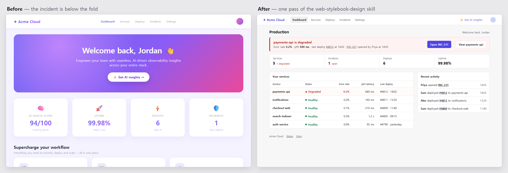

# Before/after demo: how it was made



**What this is.** Two fixture pages for a fictional product, Acme Cloud, with fixed data and a fixed
clock (2026-11-05 14:31 UTC). [before.html](./before.html) was written for this demo in a style that
coding agents often produce: a gradient greeting hero, emoji stat cards, marketing feature cards, and
light-gray text. [after.html](./after.html) is the same page after one pass of the
[`web-stylebook-design`](../../skills/web-stylebook-design/SKILL.md) skill.

**Who did it.** Claude Opus 5.5 in Claude Code wrote both pages and ran the skill's workflow. No MCP
server was connected, so every tool ran through the CLI (`web-stylebook-mcp call …`). A person did
not edit the after page.

## The task

> An on-call engineer opens the production dashboard to learn whether anything is broken right now,
> what changed just before it, and what to do next.

Constraints given to the plan: keep every link and the two `data-testid` hooks, keep the facts and
numbers, and invent nothing. The full input is [evidence/plan-args.json](./evidence/plan-args.json).

## Steps

1. **Capture before.** Chrome at 1280×800, DPR 1, light theme, en-US, fonts loaded:
   [screenshot](./evidence/before.png), [full page](./evidence/before-full.png),
   [rendered HTML](./evidence/before.rendered.html), [measurements](./evidence/verify-before.json).
2. **Plan.** `call get_design_improvement_plan --input plan-args.json` selected six foundations:
   priority-hierarchy, scannable-content, truthful-evidence, surface-hierarchy, visual-balance and
   rhythm-consistency ([plan.json](./evidence/plan.json)).
3. **Edit.** Four changes, each tied to a foundation's conditional remedy
   ([diff](./evidence/before-to-after.diff)):
   - The degraded service, its numbers, its last deploy and the open incident move to an alert at
     the top, with links to act.
   - "AI Health Score 94/100" is removed: it has no stated method.
   - The services table shows state as text plus shape, puts the degraded row first and
     right-aligns numbers.
   - The marketing feature cards are removed.
4. **Verify.** Re-captured under the same conditions, then measured position, contrast and keyboard
   focus. `compare_page_revisions` checked what the edit kept ([compare.json](./evidence/compare.json)),
   and its result was validated under a separate audit plan
   ([audit-validate.json](./evidence/audit-validate.json)).
5. **Report.** `validate_design_improvement_result` returned `complete` with no issues
   ([result](./evidence/improvement-result.json), [report](./report.md)).

## What was measured

| | Before | After |
|---|---|---|
| Degraded service, from the top of the page | 1375 px (off screen) | 394 px |
| Open incident INC-231, from the top | 1550 px (off screen) | 160 px |
| Page height | 1871 px | fits in one 800 px screen |
| First-screen text below WCAG AA contrast | 14 of 23 measured, 7 more on gradients | 0 of 85 |
| Link destinations | 18 | the same 18 |
| Tab stops with a visible focus ring | 14 of 14 | 14 of 14 |

## Where a check disagreed with the render

`compare_page_revisions` estimates the first screen from document order, not a browser. It reported
"What changed" as moved off the first screen. In Chrome, the Recent activity panel sits at y = 303,
beside the services table. The measured position was recorded as an acknowledgement with that
reason, and the run kept both results.

## What this does not show

- Both pages are fixtures. Neither is a real product, and nothing was deployed.
- One browser and one desktop viewport were tested. Narrow layouts, dark mode and screen readers
  were not.
- Contrast and focus were checked by a script. No user study was run, and no quality score is
  claimed.
- The after page drops the gradient, the emoji and the greeting hero, which some teams would keep.

## Reproduce

```bash
npx -y web-stylebook-mcp@latest call get_design_improvement_plan --input docs/demo/evidence/plan-args.json
npx -y web-stylebook-mcp@latest call compare_page_revisions --input docs/demo/evidence/compare-args.json --text
cd docs/demo && npx -y web-stylebook-mcp@latest call validate_design_improvement_result --input evidence/improvement-args.json --text
```

Screenshots used `playwright-core` with a local Chrome, 1280×800, `deviceScaleFactor: 1`.
