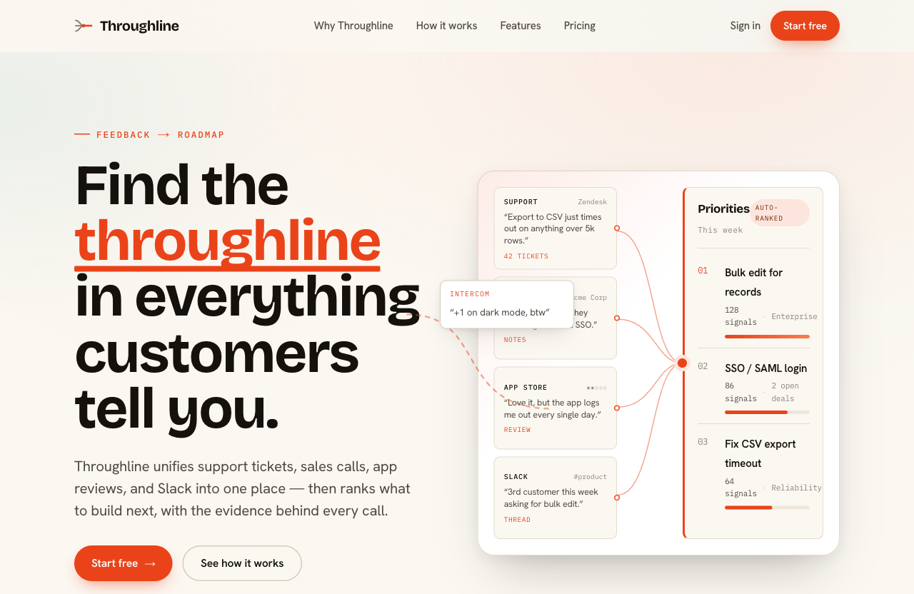
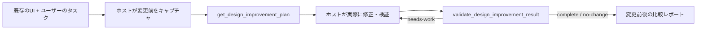

# web-stylebook-mcp リファレンス

[← README](../README.ja.md) · [English](./reference.md) · [한국어](./reference.ko.md) · **日本語**

[README](../README.ja.md) に載せていない内容すべてです。ツールごとの例、結果の契約、リソース、プロンプト、CLI と互換性について説明します。

---

`web-stylebook-mcp` は、コーディングエージェントにデザインの知識と、作業結果を示す手段を与えます。既存の画面では、エージェントは動いている部分を残し、文脈に合った修正を選び、実際のソースを編集して、結果を検証し、変更前後の違いを示します。サーバーは調査済みのデザイン原論を提供し、エージェントが提出した証拠を検査します。編集を行い、キャプチャを取るのはエージェント自身です。新規の構築では、キュレーション済みの [Web Stylebook](https://webstylebook.com) カタログにあるビジュアルの方向性、UX 原則、UI 状態、トークンも使えます。

API キーは不要です。モデル呼び出しもネットワークも使いません。プロジェクトのファイルシステムにもアクセスしません。**決定的で、読み取り専用で、完全にローカルで動作します。**

## 使わない場合と使う場合

| | `web-stylebook-mcp` を使わない場合 | `web-stylebook-mcp` を使う場合 |
|---|---|---|
| **方向性** | 見た目を 1 つ推測して、そのまま決める | 点数付きの候補 + 理由コード + 却下した候補とその理由 |
| **作り込み** | 原則の名前を文書に並べるだけで、検証しない | 原則ごとの配置ガイダンス、観察可能な検査、注意点 |
| **UX の根拠** | 「ヒックの法則によれば…」と言って議論を終わらせる | 根拠の強さのラベル（`strong` / `contextual` / `contested`）付きのプロンプト。法則として言い換えることはできない |
| **UI の状態** | 正常系だけ。空・エラー・読み込み中は後から付け足す | 画面ごとに、必須・推奨・ドメイン固有の状態を最初から用意する |
| **トークン** | 手で選んだ 16 進数。コントラストはほとんど確認しない | 役割ベースのトークンと WCAG コントラストの警告 |
| **構造** | トークンでデフォルトのヒーロー、ロゴ、3 枚のカードのテンプレートを再着色するだけ | 方向性ごとにレイアウトのアーキタイプとシグネチャームーブを定義し、ビルド済みページ内のテンプレートを検出する監査 |
| **監査** | 要約を見て「良さそう」と判断する | 安定した ID、重大度、必要な証拠、未検証の状態を明示した、画面種別を考慮した検査 |
| **結果** | 変更のない UI に対する指摘だけ | 実際の実装、対応づけた比較、証拠にリンクした報告 |

## 既存の UI を改善する — 基本のワークフロー

改善の依頼は **検査 → 判断 → 実装 → 検証 → 比較・報告** の流れで進めます。
ホストのエージェントが実際の UI を編集し、MCP を使って判断を導き、完了を確認します。
批評だけで止めることはありません。レビューのみを明示的に求められた場合は、引き続き読み取り専用です。新規の構築や新しいビジュアルの方向性には、既存の方向性ツールを使います。

`get_design_improvement_plan` が入口です。英語・韓国語・日本語で書かれた **24 件の調査済みデザイン原論、48 件の例示的な適用、30 件の出典** と、構造化されたホストのワークフローを提供します。まず元の UI をキャプチャし、実際のタスクと対象の条件を `context` に記録してください。

```jsonc
// → get_design_improvement_plan
{
  "surface": "data-table",
  "concerns": [
    "scanability",
    "focus",
    "consistency"
  ],
  "limit": 6,
  "locale": "ja",
  "context": {
    "userTask": "最初に対応すべきインシデントを見つける。",
    "targets": [
      {
        "id": "incidents-desktop",
        "surface": "data-table",
        "route": "/incidents",
        "conditions": {
          "viewport": {
            "width": 1280,
            "height": 900
          },
          "theme": "light",
          "locale": "ja-JP",
          "state": "populated",
          "dataKey": "incident-fixture-v1@fixed-clock",
          "scrollAnchor": "first-row",
          "zoom": 1,
          "deviceScaleFactor": 1
        }
      }
    ]
  }
}
```

各原論は、観察、条件付きの対処、反例、維持すべき点、観察可能な検査をつなげています。関連するルールを適用し、実際のソースを編集してください。製品の固有性と既存の動作は維持します。新しいスタイルは任意です。既定は 6 件で、最大は 12 件です。除外された一致は `coverage.omittedIds` に示されます。取得対象を絞るには `category` か、明示的な `foundationIds` を使います。フィルターは AND で組み合わせ、同じフィルター内の concerns は OR で扱います。`webstylebook://foundations` を参照してください。

実装後は、`plan`（`get_design_improvement_plan` に送った入力そのもの）、`expectedPlanHash`（返された `workflow.planHash`）、そして実際のキャプチャ、変更されたファイルや差分、観察した検査、対象ごとの結果、制約を含む `submission` を渡して、**`validate_design_improvement_result`** を呼び出します。

```jsonc
// → validate_design_improvement_result
{
  "plan": { "surface": "data-table", "concerns": ["scanability", "focus", "consistency"], "context": { … } },
  "expectedPlanHash": "sha256:…",
  "submission": { "captures": […], "changes": […], "checks": […], "outcomes": […], "limitations": […] }
}
```

返される内容は次のとおりです。

- `complete`: 提出された実装と比較の証拠が、計画されたすべての対象を網羅している。
- `needs-work`: `nextActions` に従ってください。変更前の画像が不足している、データ・フォント・ビューポートが一致しない、提案だけで編集がない、対象をスキップしている、根拠のない PASS 判定がある、退行がある場合は、完了になりません。
- `no-change`: 実装も提案もなく、変更がないことが完全に検証された UI です。改善として示してはいけません。
- `reportMarkdown`: 変更前後の対応するリンク、変更内容と理由、検証、トレードオフ、未検証の残作業。ホストは実際のスクリーンショットを左右に並べるか、切り替えて表示できます。

各対象には、ビジュアル、動作、維持、影響を受けるアクセシビリティの検査が必要です。静的なマークアップの維持確認だけでは不十分です。ビジュアルと維持の検査は、両方の結果キャプチャを参照しなければなりません。比較条件が無効な場合や、フォントが読み込まれていない場合は、それに依存する検査は合格しません。1 枚のスクリーンショットで、異なるルート、条件、ソースのスナップショットを表すことはできません。検証ルールを更新したら、新しいプランを取得し、その `workflow.planHash`（`validationVersion: 3`）を使ってください。

省略可能なフィールドが 3 つあり、証拠が何を主張できるかを示します。`checks[].method` は、誰がどの方法で検査を観察したかを記録します（`static`、`browser`、`agent-review`、`participant`、`analytics`）。`static` または `agent-review` で観察した動作・アクセシビリティの合格、および `static` で観察した見た目の合格は、`CHECK_METHOD_INSUFFICIENT` となり、未検証として数えられます。`changes[].claim` は、変更が何を主張するかを示します（`observed-defect`、`grounded-concern`、`improvement-hypothesis`、`style-preference`）。スタイルの好みだけに基づく `improved` の結果は `STYLE_PREFERENCE_NOT_IMPROVEMENT` です。懸念や仮説を根拠に改善を主張する場合は、`changes[].successCriterion` が必要です。どの条件で何が変われば改善とみなすかを書いてください。選択時間や完了率のようなユーザーの成果には、`participant` か `analytics` の証拠が必要です。エージェント自身の実行では示せません。
MCP が検証するのは、提供されたカバレッジと整合性だけです。**アーティファクトの内容やデザインの品質は検証しません。** 編集、キャプチャ、観察はホストが行います。ユーザー調査の結果や、数値化された使いやすさの改善を捏造することはありません。コンテキストなしのクエリは、知識の探索には有効ですが、改善の完了には使えません。コミット・プッシュ・リリース・デプロイには、別途の承認が必要です。

[結果の契約とクロス UI の例](../skills/web-stylebook-design/references/improvement-result.md)と、[調査記録](./research/design-foundations.md)（韓国語）を参照してください。機械可読なワークフローは `webstylebook://workflows/improve-ui` にあり、`manifest.improvementWorkflow` でも案内されています。

## 判断の過程を見る

> *「SRE 向けの高密度なモニタリングダッシュボード。オンコール中は一日中見ている。落ち着いていて技術的。cyberpunk は避ける。」*

```jsonc
// → recommend_design_direction  (入力)
{
  "productDescription": "High-density monitoring dashboard for SREs, watched all day on call",
  "productType": "operational-saas",
  "tone": ["calm", "technical"],
  "density": "high",
  "usageFrequency": "daily",
  "avoid": ["cyberpunk"],
  "locale": "ja"
}
```

```jsonc
// ← 結果 (一部のみ表示)
{
  "confidence": "high",
  "candidates": [
    { "styleId": "quiet-utility",  "score": 0.87 },
    { "styleId": "runtime-signal", "score": 0.86 },
    { "styleId": "console-launch", "score": 0.8 },
    { "styleId": "notion-style",   "score": 0.79 },
    { "styleId": "platform-core",  "score": 0.75 }
  ],
  "ranking": {
    "winner": "quiet-utility",
    "runnerUp": "runtime-signal",
    "gap": 0.01,
    "tied": false,
    "reasonCodes": ["FARTHER_FROM_AVOIDED"],
    "explanation": "quiet-utilityがruntime-signalを0.01上回る: 回避対象(cyberpunk-glitch)から遠い(runtime-signalの共通特性: dark, tech)。"
  },
  "rejected": [                        // 全29件のうち3件を表示
    { "styleId": "aurora-gradient",  "reasonCodes": ["PRODUCT_NOT_IDEAL"] },
    { "styleId": "claymorphism",     "reasonCodes": ["PRODUCT_NOT_IDEAL"] },
    { "styleId": "cyberpunk-glitch", "reasonCodes": ["EXPLICITLY_AVOIDED"] }
  ],
  "pairings": [
    {
      "styleId": "notion-style",
      "pairWith": "quiet-utility",
      "role": ["forms", "navigation", "repetitive surfaces"],
      "rationale": "operational-saas向けの補助スタイル — quiet-utilityの静かで反復的な画面を補う。"
    },
    {
      "styleId": "macos-liquid-glass",
      "pairWith": "quiet-utility",
      "role": ["forms", "navigation", "repetitive surfaces"],
      "rationale": "operational-saas向けの補助スタイル — quiet-utilityの静かで反復的な画面を補う。"
    }
  ],
  "guidance": "候補は点数化された根拠だ — 製品文脈で選ぶこと。candidates[0]は最有力だが強制ではない。"
}
```

注目してください。候補ごとにスコアが異なります（0.87、0.86、0.80）。`ranking` は、1 位が 2 位を上回った理由を示しています。この例では差は 0.01 です。`runtime-signal` が、避けるよう指定された `cyberpunk-glitch` と dark・tech の特性を共有しているためです。これほど小さな差でも勝者として報告し、エージェントがプロダクトの文脈とあわせて判断します。上位 2 件が本当に同程度のスコアであれば、`ranking.tied` がそのことを示し、勝者を無理に作ることはありません。却下されたスタイルには理由コードが付きます。ペアリングは提案であり、必須ではありません。サーバーは証拠を提供し、判断はエージェントが行います。

ページの役割は `pageRole` で伝えてください（例: `marketing-landing`、`dashboard`、`settings`、`docs`、`product-detail`）。`operational-saas` 製品のランディングページは、購入を検討する人が一度読むページです。そのため `density` や `usageFrequency` を指定しない場合は、プロダクトタイプではなくページの役割がこれらを決め、プロダクトの適合度にもページの役割（ランディングページなら `campaign`）を加えます。`pageRole` を省略すると、説明文のページ名（"landing page"、"랜딩 페이지"、"ランディングページ" など）から推定します。

次に、選んだ方向性を実際のトークンに変換します。

```jsonc
// → compose_design_tokens({ primaryStyleId: "quiet-utility", format: "css-variables" })
// WCAG コントラスト警告 0 件
:root {
  --color-canvas: #ffffff;
  --color-text:   #1f2328;
  --color-accent: #526371;
  --color-border: #cecfd0;
  /* … 役割別の色・タイポグラフィ・余白・角丸・モーション・密度 */
}
```

呼び出しは 2 回です。エージェントは方向性を選び、却下された候補とその理由を確認し、コードを 1 行も書かずに WCAG を満たすトークンを得ました。

コントラストの検査は、レンダリングされたページを計測したものではなく、トークンの値から計算されます。`accentOverride` は 3 桁・6 桁・8 桁の 16 進数を、`#` の有無を問わず受け付け、`#` 付きで返します。半透明の 8 桁のアクセントは、アルファ値を保ち、返された `canvas` 上に描かれた状態で検査されます。それ以外の背景では、警告がレンダリングしたうえでのコントラスト確認が必要であることを示します。最終的なコントラストは、ページが実際に描画される場所で確認してください。

## トークンだけでなく構造も

トークンだけではページの色が変わるだけです。そのため、すべての候補は `structure` も持ちます。これは、レイアウトのアーキタイプ（ヒーローの構成、グリッドのリズム、セクションの順序、密度、タイプスケールの使い方）、それぞれの役割を示す 2〜3 件のシグネチャームーブ、そしてページに出してはいけないパターンです。`webstylebook://styles/{id}` は各ムーブのビルド手順と、各禁止事項の検出基準を追加します。`compose_design_tokens` はそれを参照し（スタイル ID、リソース URI、ムーブ ID）、テキスト出力にヒーローとムーブを表示します。アーキタイプがスタイルの見本ページから外れる場合は、その `basis` が `authored` になり、`departure` が理由を示します。

ビルドしたら、ページの HTML と CSS を `audit_page_structure` に渡します。以下は、エージェントがデフォルトの SaaS テンプレート（[`generic-saas-tailwind.html`](https://github.com/seungdori/web-stylebook-mcp/blob/master/tests/fixtures/page-structure/generic-saas-tailwind.html)）から作ったページを、`quiet-utility` に照らして監査した実際の出力です。

```jsonc
// → audit_page_structure({ html, styleId: "quiet-utility", locale: "ja" })
// ← 構造監査の結果 (一部)
{
  "summary": { "clean": false, "findings": 9, "major": 7, "minor": 2, "notVerified": 1, "checked": 13, "claims": { "shape-observation": 0, "style-fidelity": 9, "required-element": 0 } },
  "findings": [
    {
      "patternId": "logo-strip",
      "name": "ロゴの帯",
      "severity": "major",
      "locations": ["section#customers > div.mx-auto"],
      "observed": { "logos": 5, "marquee": false, "muted": true },
      "replaceWith": {
        "instruction": "実際の顧客名を出す許可と理由がなければ削除してください。代わりに、訪問者が確かめられる根拠(実際の結果・成果物・名前のある事例)をこのスタイルの根拠ムーブで見せてください。",
        "moves": [
          { "id": "grouped-approval-queue", "name": "Queue grouped by who has to act", "purpose": "Triage: the person sees first what waits on them and what it is worth, then everything else in the same rhythm." },
          { "id": "three-way-match-strip", "name": "Three-way match strip and approval trail", "purpose": "Proof: the reason to approve or dispute is on screen as figures and a sequence, not as a summary sentence." }
        ]
      }
    },
    {
      "patternId": "generic-saas-skeleton",
      "observed": { "sections": "opening → proof → features → testimonials → cta", "templateSections": 5 },
      "replaceWith": {
        "archetype": {
          "sectionOrder": [
            "Top bar with the product mark, the organisation and the signed-in person",
            "Head: the screen title and brief beside the month total, stacked bar and status legend",
            "The queue: segmented view switch, filter token and count, then rows grouped by who has to act",
            "The open record: properties, the three-way match strip and the line items with the one line that differs",
            "The approval trail as a real sequence, with approve and dispute actions and a reason field"
          ]
        }
      }
    }
    // 残り7件: centered-stack-hero, trusted-by-band, icon-feature-grid, testimonial-carousel, closing-cta-banner, quiet-utility/shadow-blur, quiet-utility/corner-radius
  ]
}
```

各検出結果は、パターンがどこにあるか、何が観察されたか、その場所に代わりに何を置くべきかを示します。代わりに置くのは、同じ役割を果たす選んだスタイルのシグネチャームーブ（ロゴの帯の場合は証拠を示すムーブ）、ヒーローの構成、またはセクションの順序です。ページを作り直して監査を再実行し、`get_design_audit_plan.includeGroups` に `"structure"` を加えてから、返された `evidence` と `results` を `validate_design_audit_result` に渡してください。ビューポートごとに、それぞれの `targetId` で監査します。evidence の ID にはそれが含まれるので、実行結果がまとめて検証されます。この検査は、提出された HTML と CSS に対する決定的なヒューリスティックで、ブラウザでのレンダリングではありません。そのため `clean` は、すべての検査が実行され、これらのパターンが見つからなかったことを意味します。デザインが合格したことを意味するわけではありません。スタイルごとのガイダンス（アーキタイプとムーブ）は、カタログの `layout` や `typography` フィールドと同じく英語で書かれています。パターン名と指示は `locale` に従います。

すべての検出結果と検査には `claim` があり、`summary.claims` は claim ごとに検出結果を数えます。形状があるというだけでは、タスクの欠陥とは限らないからです。

| `claim` | いつ | 検出されたときの結果 |
|---|---|---|
| `style-fidelity` | 選んだ `styleId` に照らして確認した、グローバルなパターンまたはスタイルの禁止事項 | FIX_NOW（major）または RISK（minor）: ページが選んだ方向性から外れている |
| `shape-observation` | `styleId` なしで確認したグローバルなパターン | `cant-tell` の証拠付きで NOT_VERIFIED: 形状は存在するが、それがタスクの妨げになるかは確認していない。タスクに照らして判断し（異なるタスクへ導く 3 枚のカードは問題ありません）、`manual` の証拠を付けて PASS、RISK、FIX_NOW のいずれかを提出します。形状が存在しない場合は NOT_APPLICABLE |
| `required-element` | `productType` の必須要素 | 欠けている、またはファーストビューにない場合は FIX_NOW |

`severity` は、claim が確定したあとの重大度です。

### スタイルでは消せない必須要素

方向性によって、ページが機能を失ってはいけません。以前のショーケースの実行（[#7](https://github.com/seungdori/web-stylebook-mcp/issues/7)）では、MCP で作った高級スキンケアのページに購入ボタンが 1 つだけファーストビューに残っていました。一方、比較用のコントロールページには、サイズ、1 晩あたりの価格、カートに入れるボタン、配送と保証の詳細がありました。そのため `recommend_design_direction` は `mustHaves` も返します。これは、解決された製品タイプが必要とする要素と、それぞれが置かれるべきゾーンです。スタイルは見た目を変えられますが、要素を削除したり、ゾーンの外へ移したりすることはできません。これらはアーキタイプのオープニングに対する制限（「1 つの行動、1 行の短い文」）より優先されます。ファーストビューの項目はすべてヒーローに入れます。各候補の `structure.mustHaves` には、同じ役割を果たすそのスタイルのシグネチャームーブが示されます。たとえば、配送と保証の詳細を載せられる証拠のムーブです。

| 製品タイプ | ページ | ファーストビュー | ページ内の任意の位置 |
|---|---|---|---|
| `operational-saas` | メインダッシュボード | 現在の状態 (`current-status`)、何が変わったか (`recent-changes`) | — |
| `developer-tool` | 製品のランディングページ | コードサンプル (`code-sample`)、ドキュメントへのリンク (`docs-link`) | — |
| `documentation` | ドキュメントのトップ | 検索 (`search`)、クイックスタート (`quickstart`) | — |
| `data-analytics` | 分析ダッシュボード | 現在の状態 (`current-status`)、何が変わったか (`recent-changes`)、期間の指定 (`time-range`) | — |
| `security-console` | セキュリティの概要画面 | 現在の状態 (`current-status`)、何が変わったか (`recent-changes`) | — |
| `finance-admin` | 財務の概要画面 | 現在の状態 (`current-status`)、何が変わったか (`recent-changes`) | — |
| `healthcare-portal` | ポータルのトップ | 主要なアクション (`primary-cta`) | 連絡先 (`contact`)、プライバシー通知 (`privacy-notice`) |
| `commerce` | 商品詳細ページ | 価格 (`price`)、バリエーションの選択 (`variant-choice`)、カートに入れる (`add-to-cart`)、配送と保証の詳細 (`purchase-assurance`) | — |
| `ai-chat` | チャット画面 | メッセージの入力欄 (`composer`) | AI の制限に関する注記 (`ai-limits`) |
| `content-editorial` | 記事ページ | 著者 (`author`)、公開日 (`publish-date`) | — |
| `knowledge-base` | ヘルプセンターのトップ | 検索 (`search`) | トピックの一覧 (`topic-index`) |
| `portfolio` | ポートフォリオのトップ | — | 作品サンプル (`work-samples`)、連絡先 (`contact`) |
| `campaign` | ランディングページ | 主要なアクション (`primary-cta`) | 証拠 (`proof`) |
| `consumer-app` | アプリのランディングページ | 主要なアクション (`primary-cta`) | 証拠 (`proof`) |

ファーストビューとは、ページの `h1` を含むオープニングのセクションの末尾までです。加えて、それまでの各セクションが短い（40 語以下で、画像・動画・表・大きな SVG がなく、ビューポートを埋めるサイズでもない）限り、続く 2 セクションまでを含みます。サイトのヘッダーは含み、フッターは含みません。製品タイプが指定されず、推定もできない場合は `other` になります。`other` にはリストがなく、結果はリストを作り出す代わりにその旨を示します。すべての基準は `webstylebook://structure/must-haves` にあります。

必須要素が欠けている場合は FIX_NOW です。ファーストビューより下にしかない場合は RISK です。ファーストビューはマークアップから推定した範囲で、実測ではないためです。要素を上に移すか、そのビューポートで最初のスクロールの前に表示されていることを示すブラウザキャプチャを示してください。例外は、人が行動する前に必要な情報です。「カートに入れる」がファーストビューにあるのに、価格・バリエーションの選択・配送と保証の詳細がファーストビューにない場合、人は内容を見る前に購入できてしまいます。その場合は FIX_NOW のままです。

リストには、ページに不要な要素を求めるものがあります。その場合は、次のいずれかの名前付き条件と観察した事実（`reason`、12〜500 文字）を `mustHaveConditions` に指定し、`audit_page_structure` と `get_design_audit_plan` の両方に渡してください。条件が指す必須要素は任意になります。ある場合は PASS のまま、ない場合は NOT_APPLICABLE です。自由記述では必須要素を対象外にできません。

| 条件 | 製品タイプ | 対象外にする要素 | いつ |
|---|---|---|---|
| `single-variant` | `commerce` | `variant-choice` | 商品が 1 種類だけで販売されている |
| `no-code-interface` | `developer-tool` | `code-sample` | ツールを画面から使う。代わりに実際の画面を見せる |
| `docs-article` | `documentation` | `quickstart` | ページがドキュメントのトップではなく、1 本の記事である |
| `not-time-series` | `data-analytics` | `recent-changes`, `time-range` | ビューが 1 時点の分布やグループを比較する |

`audit_page_structure` に同じ `productType` を渡すと、構築されたページに欠けている必須要素が報告されます。以下は、先ほどのショーケースの失敗を fixture として再現したもの（[`commerce-buy-button-only.html`](https://github.com/seungdori/web-stylebook-mcp/blob/master/tests/fixtures/must-haves/commerce-buy-button-only.html)）に対する実際の出力です。

```jsonc
// → audit_page_structure({ html, styleId: "midnight-noir", productType: "commerce", locale: "ja" })
// ← 必須要素監査の結果 (一部)
{
  "mustHaves": {
    "productType": "commerce",
    "page": "商品詳細ページ",
    "missing": [],
    "misplaced": ["price", "variant-choice", "purchase-assurance"],
    "items": [
      { "id": "price", "checkId": "structure-must-have-price", "zone": "first-screen", "status": "misplaced", "count": 1,
        "locations": ["section#buy > div > p.price:nth-of-type(1)"] },
      { "id": "add-to-cart", "checkId": "structure-must-have-add-to-cart", "zone": "first-screen", "status": "present", "count": 1,
        "locations": ["body > main > section.masthead:nth-of-type(1) > div > a.button"] }
      // 残り2件: variant-choice, purchase-assurance
    ]
  },
  "findings": [
    {
      "patternId": "must-have/price",
      "scope": "must-have",
      "severity": "major",
      "observed": { "status": "misplaced", "zone": "first-screen", "found": 1, "inZone": 0 },
      "replaceWith": {
        "instruction": "ファーストビューに移してください。検査ではページのもっと下でしか見つかりませんでしたが、「カートに追加」はファーストビューにあるため、この情報を見る前に行動できてしまいます。商品名の横に通貨付きで価格を表示します。サイズで価格が変わる場合は、選択中のサイズの価格を表示します。",
        "moves": [
          {"id":"gold-chosen-slot-book","name":"Appointment book with one gold slot","build":"Under a 1px ivory top rule, each day is a row of minmax(0, 2.6fr) for the date (bold day over a muted date) and eight 1fr slots, each 64px tall with a 1px left rule and its time in Bodoni Moda 500 at 1.3125rem with tabular numerals; a stronger 50% ivory rule marks the lunch gap. Taken times go #7f7b73 with a 1px strike-through, hover tints a slot to 7% ivory over 160ms, and the chosen slot alone gets a 12% gold wash, a 1px inset gold line and gold text. Below, the chosen time repeats large at clamp(2rem, 3.4vw, 2.75rem) in columns 1-5 beside a form in columns 7-12 (name and phone side by side, the watch on a full-width line) with underlined inputs and one solid ivory rectangular button.","purpose":"Makes booking a choice of a real free time, with the choice confirmed in gold and restated large before anyone types."}
        ],
        "archetype": { "hero": "A one-line headline naming the actual service, Bodoni Moda …" }
      }
    }
    // 残り2件: must-have/variant-choice, must-have/purchase-assurance
  ]
}
```

各必須要素は、`present`（存在する）、`missing`（欠けている）、`misplaced`（ページにはあるが、ファーストビューにない）、`not-verified`（スタイルシートがセレクタの予算を超えた、ページの末尾に達する前に解析が止まった、またはファーストビューを配置できるセクションがない）のいずれかになります。各要素には `structure-must-have-<id>` の検査も対応します。`get_design_audit_plan` の `structure` グループに `productType` を渡すと、監査の evidence と results はそのまま検証されます。検出は、マークアップ、ARIA ロール、英語・韓国語・日本語の可視テキストを読みます。非表示のもの（`hidden`、`display: none`、視覚的に隠された `sr-only` のボックス、`aria-hidden="true"`）は数えません。ネイティブのコントロールは確実に見つかります。バリエーションには `select` かラジオグループ、検索には `input type="search"`、日付には `time` 要素が使われます。

## エージェントがこれで作るもの

別の依頼です。*「**Throughline** のマーケティング用ランディングページ。散らばった顧客のフィードバック（サポートチケット、営業通話、アプリレビュー、Slack）を、優先順位付きの 1 つのロードマップにまとめる B2B SaaS です。」* レイアウトも、ヒーローも、スタイルも指定されていません。付属スキルに従い、エージェントは既製のヒーローに頼らず、製品の中核となるアイデアからオープニングを組み立てました。右半分は、製品の実際の仕組みを表す専用の図です。フィードバックの各ソースが、自動で順位付けされたロードマップに集まっていきます。どのサイトにも貼り付けられる装飾的なカードではありません。

<div align="center">

</div>

<div align="center"><sub>付属スキルに従って AI エージェントが組み立てたもの。プロンプトはプロダクトとスタックを説明しただけで、レイアウトについては何も指定していません。</sub></div>

## 仕組み



既存の UI の場合はこの流れになります。検証ツールは、提出された証拠を検査しますが、参照先の成果物は開かず、見た目の品質も判定しません。新規に作る場合は、エージェントが製品を説明し、サーバーがキュレーション済みのカタログを採点して、構造化された証拠を返します。ページを作ったら、エージェントはページのマークアップを構造監査に渡します。構造監査は、ファイルを自分では読みません。コードは生成されず、データがお使いのマシンの外に出ることもありません。

## インストール

**Node ≥ 20** が必要です（`skills` インストーラーは Node ≥ 22.20 が必要です）。

**スキル**（Claude Code、Codex、Cursor など、スキルに対応する任意のエージェント向け）。MCP 接続がない場合、スキルは同じツールを [CLI](#cli) 経由で実行します:

```bash
npx skills add seungdori/web-stylebook-mcp
```

**Claude Code プラグイン**（スキルとこの MCP サーバーのセット。Claude Code 2.1.275 以降）:

```text
/plugin install web-stylebook --marketplace seungdori/web-stylebook-mcp
```

**MCP サーバーのみ**、クライアントごと:

<details open>
<summary><b>Codex CLI · IDE 拡張機能</b></summary>

Codex CLI を使う場合:

```bash
codex mcp add web-stylebook -- npx -y web-stylebook-mcp@latest
```

または `~/.codex/config.toml` に追加します。信頼されたリポジトリでは、プロジェクト単位の `.codex/config.toml` も使えます:

```toml
[mcp_servers.web-stylebook]
command = "npx"
args = ["-y", "web-stylebook-mcp@latest"]
```

設定を編集した後は、Codex を再起動するか新しいセッションを開いてください。Codex の TUI で `/mcp` を実行すると、サーバーが有効か確認できます。

</details>

<details>
<summary><b>Claude Code</b></summary>

```bash
claude mcp add web-stylebook -- npx -y web-stylebook-mcp@latest
```

</details>

<details>
<summary><b>Cursor · Windsurf · 汎用 MCP クライアント</b></summary>

Cursor では、[Add to Cursor](https://cursor.com/install-mcp?name=web-stylebook&config=eyJjb21tYW5kIjoibnB4IiwiYXJncyI6WyIteSIsIndlYi1zdHlsZWJvb2stbWNwQGxhdGVzdCJdfQ==)
リンクを開きます。Cursor のインストール用ディープリンクが開きます:

```text
cursor://anysphere.cursor-deeplink/mcp/install?name=web-stylebook&config=eyJjb21tYW5kIjoibnB4IiwiYXJncyI6WyIteSIsIndlYi1zdHlsZWJvb2stbWNwQGxhdGVzdCJdfQ==
```

手動で設定する場合は、下のブロックをプロジェクトの `.cursor/mcp.json` に追加するか、すべてのプロジェクトで使う場合は `~/.cursor/mcp.json` に追加します。他のクライアントも、MCP 設定に同じブロックを記述します:

```json
{
  "mcpServers": {
    "web-stylebook": {
      "command": "npx",
      "args": ["-y", "web-stylebook-mcp@latest"]
    }
  }
}
```

</details>

<details>
<summary><b>Claude Desktop</b></summary>

同じブロックを `claude_desktop_config.json` に追加し、再起動してください:

- **macOS:** `~/Library/Application Support/Claude/claude_desktop_config.json`
- **Windows:** `%APPDATA%\Claude\claude_desktop_config.json`

```json
{
  "mcpServers": {
    "web-stylebook": {
      "command": "npx",
      "args": ["-y", "web-stylebook-mcp@latest"]
    }
  }
}
```

</details>

## コンパニオンスキル

[`skills/web-stylebook-design/`](../skills/web-stylebook-design/SKILL.md) にあるスキルは、いつどのツールを呼ぶか、結果をどう使うかをエージェントに伝えます（色を変えるのではなく組み立てる、候補を複数提示する、信頼は見せかけでなく実際に得る、再利用できるコンポーネントに落とし込む）。[インストール](#インストール) では `npx skills add` と Claude Code プラグインを扱います。スキルは npm パッケージの `skills/` 配下にも含まれています。

スキルに対応していないエージェントの場合は、[`skills/AGENTS.md`](../skills/AGENTS.md)（Codex）または [`skills/CLAUDE.md`](../skills/CLAUDE.md)（Claude Code などのルールファイル）の内容を、プロジェクトのルールファイルにコピーしてください。

## ツール

| ツール | 得られるもの | 限界 |
|------|--------------|-----------------|
| **`get_design_improvement_plan`** | 選ばれたデザイン原論と、キャプチャ → 判断 → 実装 → 検証 → 報告のワークフロー、対象コンテキスト、ワークフローハッシュ | 実際の UI を編集するのはホストです。コンテキストなしの呼び出しは探索にしか使えません |
| **`validate_design_improvement_result`** | 完了状態、不足作業のアクション、正規化された結果、実際の変更・キャプチャ・検査の参照からつくる変更前後のレポート | 提出された証拠の網羅性と整合性を検査します。成果物の中身や、独立に測定したデザイン品質は検査しません |
| **`recommend_design_direction`** | 理由コード付きで採点されたスタイル候補、#1 が #2 に勝った理由を示す `ranking`（または同点の報告）、*なぜ*却下されたかを示す**却下された**スタイル、補助的な組み合わせ、確信度、候補ごとのページ `structure`、製品タイプの `mustHaves` と、それぞれが置かれるべきゾーン | 最終的に選ぶのはモデルです。このツールは根拠を提供する役割です |
| **`compare_design_directions`** | 2〜4 の方向性を、製品適合、反復利用、密度、信頼、独自性、アクセシビリティのリスク、モーション、保守性で比較 | 単一の勝者は示されません |
| **`search_design_references`** | テキスト、カテゴリ、タグで実在の参考事例を範囲を絞って検索し、簡潔でローカライズされた観察を添える | 出典を明記した調査の要約を返します。スクリーンショットやブランド素材を複製するものではありません |
| **`get_design_reference`** | ローカライズ済みの完全な参考事例 1 件。配色・レイアウト・インタラクション・モーションの観察、正規化されたトークン、ソースのリビジョン、帰属表示、権利表示を含みます | 元サイトの文章、書体、スクリーンショット、ビジュアルアイデンティティは、それぞれの権利者に帰属します |
| **`get_design_principle_plan`** | 視覚的な関心事、対象画面、フェーズ、原則 ID で絞り込んだ、配置・適用・検証の計画。参照元が得られる場合は出典も付きます | 制作上のヒントは検証可能な指針であり、実証済みの法則でも固定のレシピでもありません |
| **`get_ux_principle_plan`** | 成果、対象画面、フェーズ、原則 ID で絞り込んだ、適用と検証の計画。確認事項、注意点、確信度、参照を含みます | 原則は文脈に応じた指針であり、普遍的な法則ではなく、調査の代わりにもなりません |
| **`get_ui_state_plan`** | 対象画面（data-table、form、checkout、chat、developer-console）ごとの必須・推奨・ドメイン固有の UI 状態。トリガー、表示必須、表示禁止、a11y、モーション | エージェントが見落としやすい状態（空、エラー、読み込み中、エッジケース）を網羅します |
| **`compose_design_tokens`** | ロールごとのトークンを `json` / `css-variables` / `tailwind` / `typescript` の形式で返します。または `DESIGN.md` ファイル全体（`design-md`）を返します。共有のビジュアル契約を指定すると、作成時のスタイル値とエディターでの変更を保持します | 契約モードでは、作成時の配色モードを使い、明示的に承認されたコントラスト修正だけを適用します |
| **`get_design_audit_plan`** | ローカライズされ、対象画面を考慮した検査。安定 ID、重大度、適用条件、必要な証拠、修正案、ユーザー向けコンテンツの検査、選ばれた原則の検査、UI 状態の網羅を含みます | 監査の計画を立てるだけで、プロジェクトを検査したように振る舞うことはありません。証拠が欠けている項目は `PASS` ではなく `NOT_VERIFIED` になります |
| **`validate_design_audit_result`** | プラン照会、ターゲットの組み合わせ表、永続的な証拠参照、項目とターゲットごとに 1 つの判定について契約を検証します。判定の正規化と安定したハッシュを付けます | 網羅性と証拠の整合性を検証するもので、見た目の品質は検証しません。`valid: true` が、デザイン全体の合格を意味することはありません |
| **`audit_page_structure`** | 渡された HTML と CSS に含まれる、禁止された汎用パターンとスタイル固有のパターン。それぞれに場所、観測値、選ばれたスタイルの置き換えのムーブを添えます。`productType` を指定すると、ページに不足している、またはファーストビューから外れている必須要素を示します。さらに `structure` 監査グループの証拠と結果も返します | 宣言されたスタイルに基づくヒューリスティックで、ブラウザは使いません。問題がなくても、デザインの合格を意味しません |
| **`compare_page_revisions`** | リデザインの変更前後比較。残した、言い換えた、削除したリンク、フォームの項目とラベル、項目の選択肢、フォームのボタン、ハンドラー、テストフック、スクリプトのセレクター、見出し、図版、ランドマーク、表示される単語、製品の必須要素を示します。意図した削除は `acknowledged` で記録できます。さらに `revisionPreservation` 監査計画の証拠と結果も返します | 静的なマークアップを比較するもので、ブラウザではありません。スクリプトは実行せず、スクリーンショットも記録しません |

**カタログ:** 実在のデザイン参考事例 520 件 · スタイル 48 件 · インターフェースのデザイン原則 25 件 · UX 原則 23 件 · 構造化された監査項目 51 件 · コンポーネント 20 件 · 対象画面 5 種 · UI 状態のレシピ 57 件 · モーションプロファイル 29 件 · プロダクトアーキタイプ 14 種。

**構造:** レイアウトアーキタイプ 48 · シグネチャームーブ 144 · 汎用禁止パターン 9 · 検出器 19 種によるスタイル固有の禁止項目 181 · プロダクトタイプ 14 種の必須要素 21 種。

参考事例ライブラリは、[OpenDesign](https://opendesign.cc) から記述の揃った項目を選び、改変したものです。構造化された仕様は [CC BY 4.0](https://creativecommons.org/licenses/by/4.0/) のもとでライセンスされています。Web Stylebook は、上流のスクリーンショットやブランド素材を含みません。元サイト、ブランド、文章、書体、ビジュアルアイデンティティは、それぞれの権利者に帰属します。使用前に、各項目の帰属表示と権利表示を確認してください。

## Web サイトのビジュアル仕様を保つ

選んだスタイルや Web エディターでの調整を、トークン生成後も残す必要がある場合は、共有契約を指定してください:

```json
{
  "primaryStyleId": "brutalist-grid",
  "format": "css-variables",
  "contract": { "schema": "webstylebook.visual.v1" },
  "locale": "ko",
  "overrides": {
    "colors": { "text": "#111111" },
    "typography": { "body": { "lineHeight": 1.75 } }
  }
}
```

`webstylebook://manifest` からは `visualContract.contractSchema` と、同梱ライブラリの `visualContract.contentHash` を読み取ります。`webstylebook://styles/brutalist-grid` からは、選んだスタイルのネイティブ契約と `visualContract.revision` を読み取ります。これらの値を `contract.schema`、`contract.contentHash`、`contract.revision` として渡すと、ソースを固定できます。一致しない場合は `INVALID_INPUT` を返します。`colorMode` を省略すると、スタイルで作成されたネイティブのモードを使います。`light`、`dark`、`both` を指定できるのは、必要なモードが作成されている場合だけです。

`overrides` は、意味的な色、タイポグラフィのロール、余白、密度、フォントのメタデータを受け付けます。別のスタイルから選んだ値には、これらの明示的な値を使ってください。`secondaryStyleId` は従来のアクセントの重ね合わせ用で、契約モードでは拒否されます。未知のフィールドや、競合する `density` と `accentOverride` の別名は拒否されます。`overrides` や `acceptedRepairs` を使うときは、必ず `contract` を指定してください。

結果には、選ばれた `visualContract`、`contract` のソース識別情報、`repairProposals` が含まれます。修正案は、正確な提案オブジェクトを `acceptedRepairs` に送り返すまで適用されません。古い提案は拒否されます。承認した修正は、`light` または `dark` の単一のリクエストで適用してください。`both` のリクエストでは、モードごとに別々の提案を返します。書き出した CSS と一緒に `visualContract` も保管してください。コンポーネントの色の組み合わせ、フォントの読み込みとライセンスのメタデータ、利用ルール、出典、承認済みの修正が含まれています。テーマの出力には `roleStyles` と完全な `metadata` のコンパニオンも含まれます。フォントの読み込みと実際の見た目は、利用するアプリ側で確認が必要です。共有ランタイムには、移植可能な MIT ライセンスのソース 7 件が含まれます。その中には、韓国語・日本語の太字ディスプレイ用フォールバックのための `fontSources.ts` メタデータも含まれますが、ブラウザ用のフォントローダーやフォントファイルは含みません。

## DESIGN.md を書き出す

`compose_design_tokens` で `format: "design-md"` を指定すると、選んだ方向性が [DESIGN.md](https://github.com/google-labs-code/design.md) ファイル（仕様バージョン `alpha`）として返されます。他のエージェントやツールがそれを読めるようになります。サーバーはファイルを書き込みません。`content` を、プロジェクトの `DESIGN.md` として保存してください。

```json
{
  "primaryStyleId": "brutalist-grid",
  "format": "design-md",
  "contract": { "schema": "webstylebook.visual.v1" },
  "locale": "ko",
  "designMd": { "tokenPlacement": "interleaved", "productType": "developer-tool" }
}
```

- `designMd.tokenPlacement`: `front-matter`（既定）は、すべてのトークンを先頭の 1 つの YAML ブロックにまとめます。`interleaved` は、先頭には `name` と `description` だけを残し、各トークングループを該当するセクション内の YAML ブロックに置きます。
- `includeProse`、`includeDoDont`、`includeStructure`（いずれも既定は `true`）は、説明文、スタイルの禁止事項と禁止パターンから作る「やること・やらないこと」、Layout に含めるページ構造を制御します。`productType` を指定すると、その製品タイプの必須要素を Layout に追加します。
- 色は DESIGN.md の名前を使います。`primary` は文字色、`surface` はページの背景、続いて `accent`、`on-accent`、`surface-container`、`outline` などです。Colors の説明文には、各色に対応する `compose_design_tokens` のロールを記載します。色の値は 16 進数です。透明度のある色は 8 桁の 16 進数になります。コンポーネントは `{colors.action-primary}` のようにトークンを参照します。寸法は px、em、rem だけを使います。流動的なタイプスケールでは、最大サイズを保持します。
- 結果には `sections`、`omitted`（除外されたセクションと、その理由）、`lossy`（DESIGN.md に対応するキーがない値。2 つ目の配色モード、ステータスの色、モーション、影など）、`specVersion`、`sourceHash` が含まれます。同じ入力からは同じバイト列が返ります。
- `webstylebook://design-md/{id}` は、1 つのスタイルについて、固定されたビジュアル契約から同じファイルを返します。省略可能なクエリパラメーターは `locale`、`mode`、`placement` です。

すべてのスタイルについて、両方の配置、3 つのロケールすべて、契約の有無のすべての組み合わせで、`npx @google/design.md lint`（0.4.0）がエラーなしで通ります。警告は、4.5:1 未満のテキストと背景の組み合わせだけです。`compose_design_tokens` も同じ警告を報告します。

## 出力の言語

すべてのツールは、省略可能な `locale` を受け付けます。理由コード、ガイダンス、ラベルは、指定した言語で返されます:

```text
"en" | "ko" | "ja"     // English · 한국어 · 日本語
```

## リソース

MCP リソースで、カタログを直接参照できます:

```
webstylebook://manifest
webstylebook://styles · /styles/{id}
webstylebook://motion · /motion/{id}
webstylebook://components · /components/{id}
webstylebook://principles · /principles/{id}
webstylebook://design-principles · /design-principles/{id}
webstylebook://foundations · /foundations/{id}?locale=ko · /foundations/sources
webstylebook://states/surfaces · /states/{surface} · /states/{surface}/{state}
webstylebook://products · /products/{id}
webstylebook://references · /references/{id}
webstylebook://policies/anti-patterns · /policies/verification · /policies/audit-checks
webstylebook://structure/banned-patterns · /structure/must-haves
webstylebook://design-md/{id}
webstylebook://workflows/improve-ui · /workflows/new-ui
webstylebook://typography/pairings · /typography/pairings/{id}
webstylebook://copy/guide/{locale} · /copy/patterns/{locale}
```

スタイルの詳細は、省略可能な `locale`、`mode`、期待される `revision` のクエリパラメーターを受け付けます（例: `webstylebook://styles/brutalist-grid?locale=ko&mode=light`）。解決された 1 つのロケールとモードを返します。対応していない値、重複したパラメーター、未知のクエリ名は、明示的なエラーを返します。

原論の詳細は、省略可能な `locale=en|ko|ja` パラメーターを 1 つ受け付けます。`manifest.designFoundations` は、独立してバージョン管理される MCP の知識レイヤーを説明します。Web サイトの正式なカタログとそのコンテンツハッシュは、これとは別のままです。

`webstylebook://workflows/new-ui` には、新しいページや画面を作る流れと構成の指針がすべて入っています。起動時の instructions は短くしてこのリソースを指し、`manifest.newUiWorkflow` が入口のツールを示します。

`webstylebook://typography/pairings` は、代わりのフォントの組み合わせの一覧と、スタイルごとの既定のフォントと合う組み合わせを示します。`/typography/pairings/{id}?locale=ko` は、1 つのスタイルの組み合わせを、韓国語または日本語の書体、貼り付けて使う `<link>` タグと CSS のフォントスタック、ライセンスとともに返します。既定は引き続き `compose_design_tokens` が返すフォントです。

`webstylebook://copy/guide/{locale}` は、ボタン・空の状態・エラー・読み込み・確認ダイアログ・数字・文体の規則と、製品タイプごとの文章の声、hero・空の状態・エラーの例を返します。`webstylebook://copy/patterns/{locale}` は、ページの文言を確かめるパターンの一覧です。生成されたページで繰り返された型は `observation`、出典のないユーザー数や成果の割合は `fix-now` です。

## プロンプト

よく使うワークフロー向けの、すぐに使える MCP プロンプト:

`improve-ui` · `design-product` · `design-screen` · `complete-ui-states` · `redesign-with-style` · `audit-design-direction` · `audit-design-principles` · `audit-ux-principles`

`improve-ui` は、既存のインターフェースの実装と比較のワークフローを開始します。実行を妨げる不足情報だけを尋ね、定型的な再承認は求めません。`audit-design-direction` は、明示的なレビュー用のプロンプトです。対象範囲を省略すると、既定では読み取り専用の見た目とコンテンツの検査になります。`auditScope` と `changeScope` のパラメーターで、より狭いレビュー、提案、実装を指定できます。`implement-and-verify` は、改善ワークフローを最後まで進めます。

コンテンツの検査は、専門用語のチェックにとどまりません。重要な主張、結論、推奨事項が、その根拠と示された確信度に合っているかを確認します。目立つ文章が、具体的で文脈に即した情報を伝えているかも見ます。視覚的な強調が、情報の価値、タスクとの関係、根拠の強さに見合っているかも確認します。カード、統計、サイトマップのリンクは、種類として一律に禁止されるのではなく、実際のユーザーのタスクにどれだけ役立つかで判断されます。

## リデザインでも機能していた部分を残す

リデザインでは、リンク、フォームの項目、ハンドラー、スクリプトが参照するセレクター、必須要素が、気づかないうちに失われがちです。ページをリデザインする前に、そのレンダリング後の HTML（例: `document.documentElement.outerHTML`）と CSS を保存してください。リデザインが完成したら、両方のバージョンを `compare_page_revisions` に渡します:

```json
{
  "before": { "html": "<!doctype html>…", "css": ["…"] },
  "after": { "html": "<!doctype html>…", "css": ["…"] },
  "scriptSelectors": ["#cart-form", ".js-variant"],
  "productType": "commerce",
  "acknowledged": [
    { "kind": "link", "key": "/pricing", "change": "dropped", "reason": "料金案内を営業問い合わせページに移しました" }
  ]
}
```

| インベントリ | 比較の対象 | 失われたときの扱い |
|---|---|---|
| links | `a[href]`。スキームとホストは小文字にし、末尾のスラッシュは取り除き、クエリパラメーターは並べ替えます | FIX_NOW、major |
| fields | `input`、`select`、`textarea` を、所属するフォーム内で `name`（なければ `id`）で照合し、各項目がラベルを保っているかを見ます | FIX_NOW、major |
| options | 両方のページにある項目について、ラジオボタンとチェックボックスの値、`select` の選択肢を値で照合します。新しい選択肢のラベルは `reworded`（言い換え）とします | RISK |
| form buttons | 各フォームの `button`、送信・画像・リセットのボタン、`input` のボタンを、役割と名前で照合します | フォームに送信ボタンが残らない場合は FIX_NOW、major。それ以外は RISK |
| handlers | フォームの action と method、`formaction`、インラインの `on*` 属性 | FIX_NOW、major |
| test hooks | `data-testid`、`data-test`、`data-cy` | FIX_NOW、minor |
| script hooks | 元のページで一致していた各 `scriptSelectors` の項目 | FIX_NOW、major |
| headings, figures, landmarks | h1〜h3 のテキスト、画像の alt と図のキャプション、`main`/`nav`/`footer` | RISK |
| words | 表示される単語。韓国語、中国語、日本語は文字単位で数えます | 元のページが 80 語を超え、リデザイン後に残る単語が 60% 未満の場合は RISK |
| must-haves | `productType` を指定した場合に `audit_page_structure` が見つける必須要素 | 変更前にあった必須要素が変更後に欠けているか、ファーストビューから外れている場合は FIX_NOW |

配置や遷移先は変わらず、文言だけが変わった見出しやリンクは、`reworded`（RISK）として報告されます。フォームは、method と action で照合し、次に共有しているフィールドとボタンで照合し、最後に位置で照合します。ページに複数のフォームがあってフィールドやボタンが存在する場合は、キーにフォームを示します。例: `form POST /login > name=email`。選択肢とフォームのボタンは `redesign-kept-fields` の下に報告され、`kind` が `option` または `control` の `acknowledged` で承認できます。`acknowledged` の項目には、対応する `kind`、`key`、`change` と、12 文字以上の理由が必要です。12 文字未満の理由では損失は免除されず、RISK の検出項目が追加されます。リンク、見出し、図版、ランドマーク、単語、必須要素は、表示される要素だけを数えます。フィールド、選択肢、フォームのボタン、ハンドラー、両方の種類のフックは、非表示の要素も数えます。非表示の CSRF フィールド、閉じたダイアログ、`display: none` の背後にあるカートのドロワーも、ページの動作の一部だからです。

結果には `verdict`（`PASS`、`FIX_NOW`、`RISK` のいずれか）、残った・失われた・言い換えられた・承認された項目を含む `inventory`、`wordCount`、`findings`、そして `redesign-kept-<inventory>` 検査の `evidence` と `results` が含まれます。記録するには、`revisionPreservation: true`（および同じ `productType`）を指定して `get_design_audit_plan` を呼び出します。この計画にはこれらの検査だけが含まれるため、`validate_design_audit_result` は証拠と結果をそのまま受け付けます。`revisionPreservation` を指定しない計画は、従来の検査とハッシュを保ちます。

### 原則ごとの検査と証拠の方法

`designPrincipleIds` または `uxPrincipleIds` で原則を選ぶと、原則の verify 文ごとに `principle-<design|ux>-<id>-verify-<n>` の検査が 1 つずつ加わります。これは一般の `principles` 検査 4 つとは別です。`principles` の各原則は `checkIds` を示し、`coverage.principleChecks` はその数を数えます。一般の検査に答えても、これらの検査に答えたことにはなりません。`src/audit/principle-verify.ts` の検討済みの表が、文ごとに答えられる方法を割り当てています。判定を主張するには、検査が受け入れる `method`（`evidenceMethods`）の、結論の出ている証拠が必要です。そうでなければ validator は `EVIDENCE_METHOD_NOT_ACCEPTED` を報告し、判定は `NOT_VERIFIED` になります。

| 証拠の `method` | 裏付けるもの | 確定できないもの |
|---|---|---|
| `static` | ラベル・属性・構造・トークンが存在すること | クリックできること、理解されること |
| `browser` | 押せる範囲、フォーカスの順序、復旧、状態の保持、ビューポートやモードでの描画 | 人が選ぶまでにかかる時間 |
| `agent-review` | 階層・グループ・密度に関する、根拠のある懸念や改善仮説 | ユーザーの成功や満足度 |
| `participant`、`analytics` | 明示した条件で測った時間・エラー・完了・想起 | 他のユーザー・タスク・製品でも同じ結果になること |

たとえばヒックの法則の 1 文目（最初の意味のある選択までの時間）は、`participant` か `analytics` の証拠だけを受け付けます。エージェントが自分のクリック時間を測っても `NOT_VERIFIED` のままです。2 文目（優先度に応じた見た目が頻度と影響に合っているか）は `agent-review` を受け付けます。これらの検査は `when-present` です。ページにない機能についての文は、`inapplicable` の証拠とともに `NOT_APPLICABLE` と答えます。

## 監査結果の契約

`get_design_audit_plan` は、カタログのバージョンとハッシュを含む `identity`、決定的な `planHash` を返します。実際の実装を確認したら、同じプラン照会に以下を加えて提出します:

- 確認したルート、画面、状態、ビューポート、テーマ、ロケール、役割ごとに 1 つのターゲット。検査の基準でビューポートが指定されている場合、その検査はそのビューポート内のターゲットでのみ数えられます（`mobile-renders-cleanly` は 390px 以下、`desktop-composition-holds` は 1280px 以上。それ以外のターゲットでは `NOT_APPLICABLE` と答えます）。`no-horizontal-scroll` は、狭い（390px 以下）、中くらい（391〜1439px）、広い（1440px 以上）の 3 種類のターゲットがそろっている場合にだけ、その範囲を対象にします;
- 永続的な成果物の参照、コンテンツハッシュ、または正確なルート・セレクター・ファイル・領域を持つ証拠。静的な証拠と `before` の証拠は、そのターゲットの `route` と一致する必要があります。`input`、`after`、`recovery` の証拠は、操作の結果たどり着いたルートを記録できます（例: `/checkout` → `/confirmation`）;
- 操作に関する証拠には before／input／after／recovery のフェーズを付けます。キーボードのフォーカス、reduced motion（動きの抑制）、フォームのエラー、ナビゲーションなど、操作の結果を検査する項目では、`passed` または `failed` の結果を持つ `after` の観察が必要です;
- 計画された項目とターゲットの組ごとに 1 つの結果。任意で、前の項目を置き換える証拠（修正後の再実行や、誤検知の訂正）には `supersedes` を付けられます。意図的に外した、計画された対象画面、必要な状態、ビューポート範囲には、それぞれ理由を付けた `scopeExclusions` を付けられます。

`validate_design_audit_result` は、プランを再生成したうえで、次のものを拒否します。古いプランのハッシュ、欠けた結果のスロットや重複したスロット、壊れた証拠の参照、別のターゲットの証拠、別のルートの証拠、不正な領域、根拠のない `NOT_APPLICABLE`（合格、不合格、判定不能の証拠を引用するものを含む）。さらに、必要な証拠や操作後の結果がない `PASS`、指定されたビューポートの外の `PASS`、不合格の証拠と矛盾する `PASS` も拒否します。欠けている結果のスロットは、隠さず `NOT_VERIFIED` として補われます。`coverage.reportingState` は、提出したターゲットのすべてのスロットに結果があるかを示します。`coverage.scope` は、プランの対象画面、必要な状態（`stateCoverage`）、ビューポート範囲を、検証済みの結果があるターゲットと比べ、不足しているものを警告として挙げます。`coverage.state` は、両方が満たされたときにだけ `full` になります。`global` のみを指定したプランは、基準として `submitted-targets-only` を報告します。これらのビューポート、フェーズ、範囲の規則は検証ツールの中にあり、`planHash` には含まれません。`supersedes` と `scopeExclusions` は任意です。結果のハッシュには、`scopeExclusions` を指定した場合にだけそれが含まれます。

`includeGroups` に `structure` を含め、`styleId` を指定すると、禁止パターンごとに自動検査が 1 つずつ追加されます。`styleId` がない場合は、作業上の判断を確認する `shape-observation` の検査が 1 つ追加され、`manual` の証拠が必要になります。`productType` を指定すると、必須要素ごとに検査が 1 つずつ追加されます。`audit_page_structure` は、検証ツールがそのまま受け入れる検査 ID について、証拠と結果を返します。`revisionPreservation: true` を指定すると、プランには `compare_page_revisions` が回答する `redesign-kept-*` の検査だけが含まれます。結果には、再チェックを比較できるように、コンテンツアドレス方式のプランのハッシュ、証拠バンドルのハッシュ、正規化された結果のハッシュが含まれます。このツールは証拠の参照先を開かず、契約が有効かどうかをデザインの品質スコアに変換することもありません。

このリポジトリには、契約の品質を再現できるベンチマークが含まれています:

```bash
npm run eval:audit-contract
```

ラベル付きの通常ケースと敵対的ケースを 24 件使って評価しました（そのうち 14 件は人手でラベル付けし、#22 と #23 のために追加した 10 件は、それぞれの issue からラベルを取っています）。従来の素通し方式の判定は、24 件中 9 件（37.5%）の正解で、誤って `PASS` とした結果が 13 件ありました。検証ツールは 24 件中 24 件で正解し、誤って `PASS` とした結果は 0 件でした。契約として有効なケースと無効なケースは、すべて正しく分類されました。このコーパスには、欠けている、説明文だけの証拠、不明、ターゲットをまたぐ、判定不能、フェーズのない、blocker/major/minor の不合格、`NOT_VERIFIED` を正しく返すケース、有効と無効の `NOT_APPLICABLE` のケースを含みます。さらに、不合格の証拠を引用する `NOT_APPLICABLE`、操作前の証拠だけの操作、別のルートからの証拠、誤ったビューポートで判定された検査も含みます。それぞれに、正しく扱うべき対照ケース（該当しない証拠、ルートの遷移、置き換えられた不合格、範囲内のビューポート）を付けています。このベンチマークが評価するのは、スロットごとの判定と契約の妥当性であり、計画された対象範囲の網羅性は評価しません。これは結果の契約の正しさを示すもので、主観的な見た目の判断そのものが 100% 正確であるとは主張しません。

## CLI

MCP クライアントが、サーバーを自動的に起動します。引数なし（または `--stdio`）で実行すると、stdio 上でサーバーが動き、クライアントの接続を待ちます。以下のオプションは、表示して終了します:

```bash
npx -y web-stylebook-mcp --help
npx -y web-stylebook-mcp --version
npx -y web-stylebook-mcp --catalog-info       # カタログのバージョン・ハッシュ・件数
npx -y web-stylebook-mcp --validate-catalog   # 失敗すると 0 以外の終了コード
```

同じツールは、MCP クライアントがなくても実行できます。各コマンドはサーバーをプロセス内で起動するため、引数は同じスキーマでチェックされ、結果は MCP の呼び出しとまったく同じになります:

```bash
npx -y web-stylebook-mcp tools                            # ツール名と1行の概要
npx -y web-stylebook-mcp schema compose_design_tokens     # 入力の JSON Schema
npx -y web-stylebook-mcp call compose_design_tokens --input args.json
echo '{"primaryStyleId":"quiet-utility","format":"json"}' | npx -y web-stylebook-mcp call compose_design_tokens -
npx -y web-stylebook-mcp read webstylebook://workflows/improve-ui
```

`call` は構造化された結果を JSON で表示します。`--text` を付けると、短いテキストの要約を表示します。引数は、JSON 文字列、標準入力の `-`、または `--input <file>` で渡せます。一部のシェル、特に Windows PowerShell では、インラインの JSON が壊れることがあるため、ファイルを使うことを推奨します。終了コード 0 は成功です。終了コード 1 は、ツールがエラーを返したことを示します。その場合も `error` オブジェクトは標準出力に表示されます。終了コード 2 は使い方の誤りを示し、ヘルプは標準エラー出力に表示されます。

## プライバシーとセキュリティ

| 項目 | |
|----------|---|
| APIキー | なし |
| モデルの呼び出し | なし |
| ネットワークアクセス | なし。完全にオフラインで動作します |
| プロジェクトのファイルシステムへのアクセス | なし。サーバーは同梱されたカタログのスナップショットだけを読みます |
| 動作 | 決定的で、読み取り専用 |

サーバーは、パッケージに同梱されたカタログのスナップショットを読みます。何も外部に送信されません。同じ入力からは、常に同じ契約が返ります。脆弱性を報告する場合は、[SECURITY.md](../SECURITY.md) の手順に従ってください。

## 互換性

- **Node:** ≥ 20
- **トランスポート:** stdio（Model Context Protocol）
- **クライアント:** Codex CLI / IDE 拡張機能、Claude Code、Claude Desktop、Cursor、Windsurf、その他の MCP 対応クライアント

ツールの入力は、新しい任意の値が追加された以外は変わりません。`structure` は出力に追加されたフィールドです。`includeGroups` を指定しないプランは、従来の検査とハッシュを保ちます。`structure` はオプションだからです。`contract` を指定しない呼び出しは、従来のトークンの形を保ち、ライトモードを既定とします。0.11.1 以降（0.11.0 はタグ付けされましたが、公開はされていません）では、これらの呼び出しは汎用のやわらかい影ではなく、固定されたスタイルで作成された影を出力します。また、エディトリアル系やモノスペースが中心のスタイルは、スタイルのファミリーのフォントではなく、作成されたフォントファミリーを出力します。配色、タイプスケール、行の高さ、余白、角丸、モーション、省略された密度は、従来の経路のままです。明示的に指定した `density` は、ファミリーの行と余白より優先されます。CSS とテーマの出力は、行の高さのトークンを保持します。作成時の仕様をすべて使うには、`contract` を渡してください。共有契約は追加的なもので、新しいツールは必要ありません。

## 開発

```bash
npm ci
npm test       # ビルドしてからテストを実行
npm run dev    # ソースから stdio サーバーを直接起動
```

変更内容は [CHANGELOG.md](../CHANGELOG.md) に記載しています。[リリースガイド](../RELEASING.md) では、このリポジトリからの公開と、同梱カタログの更新について説明しています。

## ライセンス

[MIT](../LICENSE) — コードと**同梱のカタログのスナップショットの両方**に適用されます（商用利用も無償で可能です）。

> [webstylebook.com](https://webstylebook.com) の Web サイトは CC BY-NC でライセンスされています。同じ権利者が、このパッケージに同梱したカタログのスナップショットに MIT ライセンスを付与しています。
>
> UX 原則の項目は、独自に執筆した適用・検証のガイドです。[Laws of UX](https://lawsofux.com)
> (CC BY-NC-ND 4.0) と補助的な参考資料を出典として示し、リンクしています。Laws of UX の文章、
> イラスト、ページレイアウトは同梱していません。
>
> インターフェースデザイン原則の項目は、現代のインターフェース向けに独自に執筆した、タスク中心の
> レビュー体系です。意味構造、レスポンシブなリフロー、ローカライズ、トークンとテーマ、複数の入力方式、
> 完全な状態モデル、復旧、モーションに関するユーザー設定を扱います。
