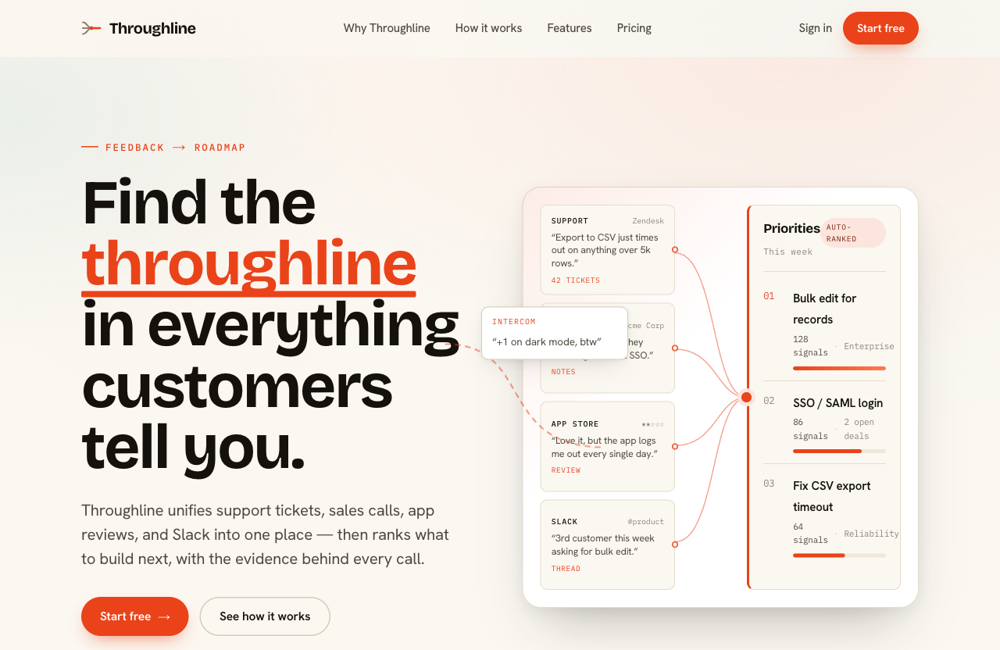
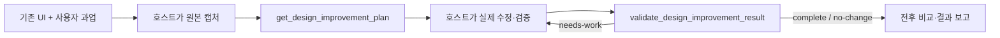

# web-stylebook-mcp 레퍼런스

[← README](../README.ko.md) · [English](./reference.md) · **한국어** · [日本語](./reference.ja.md)

[README](../README.ko.md)에서 뺀 내용을 모았습니다. 툴별 예시, 결과 계약, 리소스, 프롬프트, CLI, 호환성 메모가 있습니다.

---

`web-stylebook-mcp`는 코딩 에이전트에게 디자인 지식과, 작업 결과를 증명할 방법을 줍니다. 기존 화면에서는 이미 잘 되는 부분을 지키고, 상황에 맞는 수정법을 골라 실제 소스를 고친 뒤 검증과 전후 비교까지 진행합니다. 서버는 조사된 디자인 원론을 제공하고 에이전트가 제출한 증거를 검사하며, 수정과 캡처는 에이전트가 직접 합니다. 새 UI에는 [Web Stylebook](https://webstylebook.com)의 시각 방향·UX 원칙·상태 계획·토큰도 사용할 수 있습니다.

API 키 없음. 모델 호출 없음. 네트워크 없음. 프로젝트 파일시스템 접근 없음. **결정적이고, 읽기 전용이며, 완전히 로컬.**

## 없을 때 / 있을 때

| | `web-stylebook-mcp` 없이 | `web-stylebook-mcp`로 |
|---|---|---|
| **방향** | 한 가지 룩을 찍어서 밀어붙임 | 점수화된 후보 + 사유 코드 + *무엇을 왜 탈락*시켰는지 |
| **제작 원칙** | 문서에 원칙 이름만 적고 검증은 없음 | 원칙마다 배치 지침 + 관찰 가능한 검증 기준 + 주의점 |
| **UX 근거** | "힉의 법칙에 따르면…"으로 논의 종료 | 근거 신뢰도(strong·contextual·contested)가 붙어 법칙으로 단정할 수 없는 점검 질문 |
| **UI 상태** | 해피패스만, 빈/에러/로딩은 나중에 덧붙임 | 표면별 필수/권장/도메인 상태를 처음부터 |
| **토큰** | 손으로 고른 hex, 대비는 거의 미확인 | 역할 기반 토큰 + WCAG 대비 경고 |
| **구조** | 토큰이 기본 템플릿(히어로 + 로고 + 카드 3장)의 색만 바꿈 | 방향마다 레이아웃 아키타입과 시그니처 무브, 그리고 빌드한 페이지에서 템플릿을 잡아내는 감사 |
| **감사** | 요약만 보고 "좋아 보임" 판정 | 안정적인 검사 ID·심각도·필요 증거·미검증 상태를 갖춘 화면별 감사 계획 |
| **결과** | 지적과 제안에서 끝나는 검토 | 실제 수정·검증·전후 비교를 포함한 결과 보고 |

## 기존 UI를 실제로 개선하기 — 기본 흐름

개선 요청의 기본은 **현재 화면 확인 → 판단 → 실제 수정 → 검증 → 전후 비교·보고**입니다.
호스트 AI가 실제 UI를 고치고 MCP는 판단 근거와 완료 검사를 제공합니다. 설명이나 리뷰만으로
끝내지 않습니다. 사용자가 명시한 검토 전용 요청은 읽기만 하며, 새 UI나 새 시각 방향에는 기존
방향 선택 도구를 사용합니다.

진입점은 `get_design_improvement_plan`입니다. **원론 지식 24개·적용 예시 48개·출처 30개**를
영어·한국어·일본어로 제공하고, 호스트가 실행할 흐름도 함께 반환합니다. 원본 UI를 캡처한 뒤
실제 과업과 비교 대상의 조건을 `context`에 기록합니다:

```jsonc
// → get_design_improvement_plan
{
  "surface": "data-table",
  "concerns": [
    "scanability",
    "focus",
    "consistency"
  ],
  "limit": 6,
  "locale": "ko",
  "context": {
    "userTask": "인시던트 목록에서 먼저 확인할 항목을 찾는다.",
    "targets": [
      {
        "id": "incidents-desktop",
        "surface": "data-table",
        "route": "/incidents",
        "conditions": {
          "viewport": {
            "width": 1280,
            "height": 900
          },
          "theme": "light",
          "locale": "ko-KR",
          "state": "populated",
          "dataKey": "incident-fixture-v1@fixed-clock",
          "scrollAnchor": "first-row",
          "zoom": 1,
          "deviceScaleFactor": 1
        }
      }
    ]
  }
}
```

각 지식은 관찰할 문제, 조건에 맞는 수정, 반례, 보존할 내용, 확인할 결과를 연결합니다.
맞는 규칙을 적용해 실제 소스를 고치고 제품 정체성과 정상 동작을 보존합니다. 새 스타일 선택은
필수가 아닙니다. 기본 6개·최대 12개를 반환하며 나머지는 `coverage.omittedIds`로 알려 줍니다.
`category`·`foundationIds`로 좁힐 수 있고 필터 간에는 AND, 관심사 내부에는 OR를 적용합니다.
목록은 `webstylebook://foundations`에서 볼 수 있습니다.

수정 후 **`validate_design_improvement_result`**에 `plan`(`get_design_improvement_plan`에 보낸
입력 그대로), `expectedPlanHash`(반환된 `workflow.planHash`), 그리고 실제 캡처·변경 파일과 diff·
관찰한 검사·대상별 결과·한계를 담은 `submission`을 제출합니다.

```jsonc
// → validate_design_improvement_result
{
  "plan": { "surface": "data-table", "concerns": ["scanability", "focus", "consistency"], "context": { … } },
  "expectedPlanHash": "sha256:…",
  "submission": { "captures": […], "changes": […], "checks": […], "outcomes": […], "limitations": […] }
}
```

다음 결과를 반환합니다.

- `complete`: 계획한 모든 대상에 구현과 전후 검증 증거가 갖춰졌습니다.
- `needs-work`: `nextActions`를 따라 계속 작업합니다. 원본 캡처 누락, 데이터·폰트·화면 크기
  불일치, 수정 없는 제안, 대상 누락, 근거 없는 통과 판정, 퇴행은 완료로 처리하지 않습니다.
- `no-change`: 실제 변경·미완료 제안 없이 변화 없음을 검증한 결과입니다. 개선했다고 표현하지 않습니다.
- `reportMarkdown`: 전후 링크, 무엇을 왜 고쳤는지, 검증·상충점·남은 미검증 항목을 담습니다.
  호스트가 실제 이미지로 나란히 보기나 전환형 보고서를 만들 수 있습니다.

대상마다 시각·동작·보존·관련 접근성 검사가 필요하며 정적 마크업 비교만으로는 충분하지 않습니다.
시각·보존 검사는 결과에 연결한 전후 캡처를 모두 참조해야 합니다. 비교 조건이 다르거나 폰트가
로딩되지 않은 캡처에 의존한 검사는 통과하지 못하며, 같은 이미지를 서로 다른 경로·조건·소스의
증거로 사용할 수 없습니다. 검증 규칙 업데이트 후에는 계획을 다시 받아 `workflow.planHash`를
사용하세요(`validationVersion: 3`).

선택 필드 세 개는 증거가 주장할 수 있는 범위를 밝힙니다. `checks[].method`는 누가 어떤 방법으로
관찰했는지 기록합니다(`static`, `browser`, `agent-review`, `participant`, `analytics`). `static`이나
`agent-review`로 관찰한 동작·접근성 통과와 `static`으로 관찰한 시각 통과는
`CHECK_METHOD_INSUFFICIENT`이며 미검증으로 셉니다. `changes[].claim`은 변경이 주장하는 내용입니다
(`observed-defect`, `grounded-concern`, `improvement-hypothesis`, `style-preference`). 스타일 선호뿐인
변경으로 `improved`를 주장하면 `STYLE_PREFERENCE_NOT_IMPROVEMENT`입니다. 우려나 가설로 개선을
주장하려면 `changes[].successCriterion`에 어떤 조건에서 무엇이 바뀌면 개선인지 적어야 합니다. 선택
시간이나 완료율 같은 사용자 성과는 `participant`나 `analytics` 증거가 필요합니다. 에이전트가 직접
실행한 결과로는 보여 줄 수 없습니다.
MCP는 제출된 증거의 범위와 일관성을 검사하고 **실제 파일 내용이나 디자인 품질을 독립 인증하지
않습니다**. 편집·캡처·관찰은 호스트가 수행하며 사용자 조사 결과나 사용성 점수를 꾸며내지 않습니다.
`context` 없는 지식 조회도 지원하지만 개선 완료로 처리할 수는 없습니다. 커밋·푸시·릴리스·배포에는
별도 권한이 필요합니다.

[결과 계약과 서로 다른 UI 예시](../skills/web-stylebook-design/references/improvement-result.md),
[조사 기록](./research/design-foundations.md)을 참고하세요. 기계가 읽는 실행 흐름은
`webstylebook://workflows/improve-ui`에 있고 `manifest.improvementWorkflow`에서도 찾을 수 있습니다.

## 직접 판단하는 걸 보세요

> *"SRE용 고밀도 모니터링 대시보드. 온콜로 하루 종일 본다. 차분하고 기술적으로. 사이버펑크는 피해서."*

```jsonc
// → recommend_design_direction  (입력)
{
  "productDescription": "High-density monitoring dashboard for SREs, watched all day on call",
  "productType": "operational-saas",
  "tone": ["calm", "technical"],
  "density": "high",
  "usageFrequency": "daily",
  "avoid": ["cyberpunk"],
  "locale": "ko"
}
```

```jsonc
// ← 결과 (일부만 표시)
{
  "confidence": "high",
  "candidates": [
    { "styleId": "quiet-utility",  "score": 0.87 },
    { "styleId": "runtime-signal", "score": 0.86 },
    { "styleId": "console-launch", "score": 0.8 },
    { "styleId": "notion-style",   "score": 0.79 },
    { "styleId": "platform-core",  "score": 0.75 }
  ],
  "ranking": {
    "winner": "quiet-utility",
    "runnerUp": "runtime-signal",
    "gap": 0.01,
    "tied": false,
    "reasonCodes": ["FARTHER_FROM_AVOIDED"],
    "explanation": "quiet-utility — runtime-signal보다 0.01점 높음: 회피 대상(cyberpunk-glitch)에서 더 멂 (runtime-signal 공통 특성: dark, tech)."
  },
  "rejected": [                        // 모두 29개, 3개만 표시
    { "styleId": "aurora-gradient",  "reasonCodes": ["PRODUCT_NOT_IDEAL"] },
    { "styleId": "claymorphism",     "reasonCodes": ["PRODUCT_NOT_IDEAL"] },
    { "styleId": "cyberpunk-glitch", "reasonCodes": ["EXPLICITLY_AVOIDED"] }
  ],
  "pairings": [
    {
      "styleId": "notion-style",
      "pairWith": "quiet-utility",
      "role": ["forms", "navigation", "repetitive surfaces"],
      "rationale": "operational-saas용으로 짝지은 보조 스타일 — quiet-utility의 차분하고 반복적인 화면을 보완한다."
    },
    {
      "styleId": "macos-liquid-glass",
      "pairWith": "quiet-utility",
      "role": ["forms", "navigation", "repetitive surfaces"],
      "rationale": "operational-saas용으로 짝지은 보조 스타일 — quiet-utility의 차분하고 반복적인 화면을 보완한다."
    }
  ],
  "guidance": "후보는 점수화된 근거다 — 제품 맥락으로 직접 고르라. candidates[0]은 가장 강한 후보일 뿐 강제가 아니다."
}
```

여기서 달라진 점에 주목하세요 — 후보마다 다른 점수(0.87, 0.86, 0.80)를 받고, `ranking`이 1위가 2위를 이긴 이유를 알려 줍니다. 이 예시에서는 차이가 0.01점입니다. `runtime-signal`이 피하라고 한 `cyberpunk-glitch`와 dark·tech 특성을 공유하기 때문입니다. 이렇게 작은 차이도 승자로 보고하며, 에이전트가 제품 맥락과 함께 판단합니다. 상위 두 방향의 점수가 정말 같으면 승자를 만들어 내지 않고 `ranking.tied`로 동점이라고 알립니다. 탈락한 스타일에는 사유 코드가 붙고, 페어링은 강제가 아니라 제안입니다. 서버는 근거를 주고, 결정은 에이전트가 합니다.

`pageRole`로 페이지가 하는 일을 알려 주세요(예: `marketing-landing`, `dashboard`, `settings`, `docs`, `product-detail`). `operational-saas` 제품의 랜딩 페이지는 구매를 검토하는 사람이 한 번 읽는 페이지입니다. 그래서 `density`나 `usageFrequency`를 주지 않으면 제품 유형 대신 페이지 역할이 이 값을 정하고, 제품 적합도에도 페이지가 하는 일(랜딩 페이지는 `campaign`)을 함께 셉니다. `pageRole`을 빼면 설명문의 페이지 이름("landing page", "랜딩 페이지", "ランディングページ" 등)으로 추론합니다.

그다음 고른 방향을 실제 토큰으로:

```jsonc
// → compose_design_tokens({ primaryStyleId: "quiet-utility", format: "css-variables" })
// WCAG 대비 경고 0건
:root {
  --color-canvas: #ffffff;
  --color-text:   #1f2328;
  --color-accent: #526371;
  --color-border: #cecfd0;
  /* … 역할 기반 색·타이포·간격·radius·모션·밀도 */
}
```

호출 두 번으로 에이전트는 방향을 고르고, 무엇이 왜 탈락했는지 보고, WCAG를 통과하는 토큰까지 받았습니다. 코드 한 줄 생성하지 않고.

이 대비 검사는 렌더링된 화면을 측정한 값이 아니라 토큰 값으로 계산한 결과입니다. `accentOverride`는 `#`가 있든 없든 3·6·8자리 hex를 받아 `#`를 붙인 값으로 돌려줍니다. 반투명한 8자리 강조색은 alpha를 그대로 두고 반환한 `canvas` 위에 칠한 색으로 검사하며, 그 밖의 배경에서는 렌더링 화면에서 대비를 확인해야 한다고 경고합니다. 최종 대비는 페이지가 렌더링되는 곳에서 확인하세요.

## 토큰이 아니라 구조

토큰은 페이지의 색만 바꿉니다. 그래서 모든 후보에 `structure`가 함께 붙습니다. 레이아웃 아키타입(히어로 구성, 그리드 리듬, 섹션 순서, 밀도, 타입 스케일 쓰는 법), 각자 맡는 역할이 적힌 시그니처 무브 2~3개, 그리고 페이지에 넣으면 안 되는 패턴입니다. `webstylebook://styles/{id}`에는 무브별 구현 단계와 금지 항목별 탐지 기준이 더 들어 있습니다. `compose_design_tokens`는 이 구조를 가리키는 참조(스타일 id, 리소스 URI, 무브 id)를 돌려주고 텍스트 출력에 히어로와 무브를 적습니다. 아키타입이 스타일의 표본 페이지와 다르면 `basis`가 `authored`이고, `departure`에 그 이유가 있습니다.

빌드한 뒤에는 페이지의 HTML과 CSS를 `audit_page_structure`에 넘깁니다. 아래는 에이전트가 기본 SaaS 템플릿으로 만든 페이지([`generic-saas-tailwind.html`](https://github.com/seungdori/web-stylebook-mcp/blob/master/tests/fixtures/page-structure/generic-saas-tailwind.html))를 `quiet-utility` 기준으로 검사한 실제 출력입니다.

```jsonc
// → audit_page_structure({ html, styleId: "quiet-utility", locale: "ko" })
// ← 구조 감사 결과 (일부)
{
  "summary": { "clean": false, "findings": 9, "major": 7, "minor": 2, "notVerified": 1, "checked": 13, "claims": { "shape-observation": 0, "style-fidelity": 9, "required-element": 0 } },
  "findings": [
    {
      "patternId": "logo-strip",
      "name": "로고 띠",
      "severity": "major",
      "locations": ["section#customers > div.mx-auto"],
      "observed": { "logos": 5, "marquee": false, "muted": true },
      "replaceWith": {
        "instruction": "실제 고객을 밝힐 권한과 이유가 없다면 지우세요. 대신 방문자가 직접 확인할 수 있는 근거(실제 결과·결과물·이름이 있는 사례)를 이 스타일의 근거 무브로 보여 주세요.",
        "moves": [
          { "id": "grouped-approval-queue", "name": "Queue grouped by who has to act" },
          { "id": "three-way-match-strip", "name": "Three-way match strip and approval trail" }
        ]
      }
    },
    {
      "patternId": "generic-saas-skeleton",
      "observed": { "sections": "opening → proof → features → testimonials → cta", "templateSections": 5 },
      "replaceWith": {
        "archetype": "sectionOrder"
      }
    }
    // 나머지 7개: centered-stack-hero, trusted-by-band, icon-feature-grid, testimonial-carousel, closing-cta-banner, quiet-utility/shadow-blur, quiet-utility/corner-radius
  ],
  "replacements": {
    "moves": {
      "grouped-approval-queue": { "name": "Queue grouped by who has to act", "purpose": "Triage: the person sees first what waits on them and what it is worth, then everything else in the same rhythm.", "build": "Split the list into collapsible groups whose 40px head buttons sit on …" },
      "three-way-match-strip": { "name": "Three-way match strip and approval trail", "purpose": "Proof: the reason to approve or dispute is on screen as figures and a sequence, not as a summary sentence.", "build": "Show Ordered, Received and Invoiced as three equal cells (repeat(3, …" }
    },
    "sectionOrder": [
      "Top bar with the product mark, the organisation and the signed-in person",
      "Head: the screen title and brief beside the month total, stacked bar and status legend",
      "The queue: segmented view switch, filter token and count, then rows grouped by who has to act",
      "The open record: properties, the three-way match strip and the line items with the one line that differs",
      "The approval trail as a real sequence, with approve and dispute actions and a reason field"
    ]
  }
}
```

발견 항목마다 위치, 관찰값, 그리고 그 자리에 대신 넣을 것을 알려 줍니다. 대신 넣을 것은 고른 스타일에서 같은 역할을 하는 시그니처 무브(로고 띠라면 근거 역할), 히어로 구성, 섹션 순서입니다. 발견 항목에는 무브와 아키타입 부분의 이름만 있고, 그 목적·만드는 방법·히어로·섹션 순서는 `replacements`에 한 번씩 있습니다. 여러 발견 항목이 같은 무브를 가리키기 때문입니다. 다시 빌드하고 감사를 한 번 더 돌린 뒤, `get_design_audit_plan.includeGroups`에 `"structure"`를 넣고 돌려받은 `evidence`와 `results`를 `validate_design_audit_result`에 넘기세요. 뷰포트마다 다른 `targetId`로 감사하세요. 증거 id에 `targetId`가 들어가므로 여러 실행 결과를 함께 검증할 수 있습니다. 이 검사는 브라우저 렌더링이 아니라 제출한 HTML과 CSS에 대한 결정적 휴리스틱입니다. `clean`은 모든 검사가 실행되었고 이 패턴들을 찾지 못했다는 뜻이지, 디자인이 통과했다는 뜻이 아닙니다. 스타일별 지침(아키타입과 무브)은 카탈로그의 `layout`·`typography` 필드처럼 영어로 작성되어 있고, 패턴 이름과 안내 문장은 `locale`을 따릅니다.

모든 발견 항목과 검사에는 `claim`이 있고, `summary.claims`는 claim별 발견 수를 셉니다. 형태 자체는 과업의 결함이 아니기 때문입니다.

| `claim` | 언제 | 발견했을 때 결과 |
|---|---|---|
| `style-fidelity` | 고른 `styleId`에 비추어 검사한 일반 금지 패턴과 스타일 전용 금지 항목 | FIX_NOW(major) 또는 RISK(minor). 페이지가 고른 방향에서 벗어났다는 뜻입니다 |
| `shape-observation` | `styleId` 없이 검사한 일반 금지 패턴 | `cant-tell` 증거와 함께 NOT_VERIFIED. 형태는 있지만 과업을 방해하는지는 확인하지 않았습니다. 과업에 비추어 판단하고(서로 다른 업무로 이동하는 카드 3개는 문제가 아닙니다), `manual` 증거와 함께 PASS, RISK, FIX_NOW를 제출하세요. 형태가 없으면 NOT_APPLICABLE입니다 |
| `required-element` | `productType`의 필수 요소 | 없거나 첫 화면 밖에 있으면 FIX_NOW |

`severity`는 주장이 확인됐을 때의 심각도입니다. 페이지가 사진의 스톡 사이트를 밝힌 `stock-photo-hero`("Photo by … on Unsplash"나 그 사이트 링크)는 `styleId`가 있어도 `shape-observation`입니다. 사진이 제품의 실제 장소·소재·쓰임을 보여 주는지 판단하세요. `styleId`가 있으면 도구 항목을 이유와 함께 `supersedes`하는 `dom` 증거로 PASS를 기록합니다. 출처 표기가 없으면 `style-fidelity`이고, 플레이스홀더 서비스는 출처 표기로 보지 않습니다.

### 스타일이 뺄 수 없는 필수 요소

디자인 방향 때문에 페이지가 제 기능을 잃으면 안 됩니다. 앞선 쇼케이스 실험([#7](https://github.com/seungdori/web-stylebook-mcp/issues/7))에서 MCP로 만든 럭셔리 스킨케어 페이지는 첫 화면에 구매 버튼 하나만 남겼습니다. 대조군 페이지는 용량, 하룻밤 기준 가격, 장바구니 담기, 배송·보증 안내를 보여 줬습니다. 그래서 `recommend_design_direction`은 `mustHaves`도 반환합니다. 판단한 제품 유형에 꼭 필요한 요소와 각 요소가 있어야 할 위치(zone)입니다. 스타일은 이 요소의 모양을 바꿀 수 있지만, 빼거나 정해진 위치 밖으로 옮기면 안 됩니다. 이 요소는 첫 화면에 대한 아키타입의 제한("행동 하나, 짧은 문장 하나")보다 우선합니다. 첫 화면 항목은 모두 히어로에 넣으세요. 후보마다 `structure.mustHaves`가 같은 역할을 하는 그 스타일의 시그니처 무브를 알려 줍니다. 예를 들어 배송·보증 안내를 담을 수 있는 근거 무브입니다.

| 제품 유형 | 페이지 | 첫 화면 | 페이지 어디든 |
|---|---|---|---|
| `operational-saas` | 메인 대시보드 | 현재 상태 (`current-status`), 변경 사항 (`recent-changes`) | — |
| `developer-tool` | 제품 랜딩 페이지 | 코드 예시 (`code-sample`), 문서 링크 (`docs-link`) | — |
| `documentation` | 문서 홈 | 검색 (`search`), 빠른 시작 (`quickstart`) | — |
| `data-analytics` | 분석 대시보드 | 현재 상태 (`current-status`), 변경 사항 (`recent-changes`), 기간 (`time-range`) | — |
| `security-console` | 보안 개요 화면 | 현재 상태 (`current-status`), 변경 사항 (`recent-changes`) | — |
| `finance-admin` | 재무 개요 화면 | 현재 상태 (`current-status`), 변경 사항 (`recent-changes`) | — |
| `healthcare-portal` | 포털 홈 | 주요 행동 (`primary-cta`) | 연락 방법 (`contact`), 개인정보 안내 (`privacy-notice`) |
| `commerce` | 상품 상세 페이지 | 가격 (`price`), 옵션 선택 (`variant-choice`), 장바구니 담기 (`add-to-cart`), 배송·보증 안내 (`purchase-assurance`) | — |
| `ai-chat` | 대화 화면 | 메시지 입력창 (`composer`) | AI 한계 안내 (`ai-limits`) |
| `content-editorial` | 기사 페이지 | 작성자 (`author`), 발행일 (`publish-date`) | — |
| `knowledge-base` | 도움말 센터 홈 | 검색 (`search`) | 주제별 목록 (`topic-index`) |
| `portfolio` | 포트폴리오 홈 | — | 작업 예시 (`work-samples`), 연락 방법 (`contact`) |
| `campaign` | 랜딩 페이지 | 주요 행동 (`primary-cta`) | 근거 (`proof`) |
| `consumer-app` | 앱 랜딩 페이지 | 주요 행동 (`primary-cta`) | 근거 (`proof`) |

첫 화면은 첫 섹션(페이지의 `h1`이 있는 섹션)의 끝까지입니다. 지금까지의 섹션이 모두 짧으면 뒤따르는 섹션을 2개까지 더 넣습니다. 짧은 섹션은 40단어 이하이고, 이미지·비디오·표·큰 SVG가 없고, 화면을 채우는 높이를 선언하지 않은 섹션입니다. 사이트 헤더는 첫 화면에 들어가고, 푸터는 들어가지 않습니다. 제품 유형을 받지도 추론하지도 못한 설명은 `other`가 됩니다. `other`에는 목록이 없고, 결과는 목록을 지어내지 않고 그 사실을 알립니다. 모든 판단 기준은 `webstylebook://structure/must-haves`에 있습니다.

빠진 필수 요소는 FIX_NOW입니다. 첫 화면 아래에서만 찾은 요소는 RISK입니다. 첫 화면은 잰 값이 아니라 마크업으로 추정한 범위이기 때문입니다. 위로 옮기거나, 그 뷰포트의 브라우저 캡처로 첫 스크롤 전에 보인다는 것을 증거로 내세요. 예외는 행동 전에 알아야 하는 정보입니다. 장바구니 담기가 첫 화면에 있는데 가격, 옵션 선택, 배송·보증 안내가 첫 화면에 없으면 사용자가 그 정보를 보기 전에 살 수 있습니다. 그래서 이 경우는 FIX_NOW로 남습니다.

어떤 목록은 페이지에 필요 없는 요소를 요구합니다. 그럴 때는 아래 조건 중 하나와 관찰한 사실(`reason`, 12-500자)을 `mustHaveConditions`로 `audit_page_structure`와 `get_design_audit_plan`에 함께 넘기세요. 조건이 가리키는 필수 요소는 선택 사항이 됩니다. 있으면 PASS이고, 없으면 NOT_APPLICABLE입니다. 자유 문장으로는 필수 요소를 뺄 수 없습니다.

| 조건 | 제품 유형 | 빼는 요소 | 언제 |
|---|---|---|---|
| `single-variant` | `commerce` | `variant-choice` | 상품이 한 가지로만 팔립니다 |
| `no-code-interface` | `developer-tool` | `code-sample` | 도구를 화면으로 씁니다. 대신 실제 화면을 보여 주세요 |
| `docs-article` | `documentation` | `quickstart` | 문서 홈이 아니라 개별 문서입니다 |
| `not-time-series` | `data-analytics` | `recent-changes`, `time-range` | 한 시점의 분포나 집단을 비교합니다 |

같은 `productType`을 `audit_page_structure`에 넘기면, 빌드한 페이지에서 빠진 필수 요소를 알려 줍니다. 아래는 쇼케이스의 실패 사례를 fixture로 다시 만든 페이지([`commerce-buy-button-only.html`](https://github.com/seungdori/web-stylebook-mcp/blob/master/tests/fixtures/must-haves/commerce-buy-button-only.html))의 실제 출력입니다.

```jsonc
// → audit_page_structure({ html, styleId: "midnight-noir", productType: "commerce", locale: "ko" })
// ← 필수 요소 감사 결과 (일부)
{
  "mustHaves": {
    "productType": "commerce",
    "page": "상품 상세 페이지",
    "missing": [],
    "misplaced": ["price", "variant-choice", "purchase-assurance"],
    "items": [
      { "id": "price", "checkId": "structure-must-have-price", "zone": "first-screen", "status": "misplaced", "count": 1,
        "locations": ["section#buy > div > p.price:nth-of-type(1)"] },
      { "id": "add-to-cart", "checkId": "structure-must-have-add-to-cart", "zone": "first-screen", "status": "present", "count": 1,
        "locations": ["body > main > section.masthead:nth-of-type(1) > div > a.button"] }
      // 나머지 2개: variant-choice, purchase-assurance
    ]
  },
  "findings": [
    {
      "patternId": "must-have/price",
      "scope": "must-have",
      "severity": "major",
      "observed": { "status": "misplaced", "zone": "first-screen", "found": 1, "inZone": 0 },
      "replaceWith": {
        "instruction": "첫 화면으로 옮기세요. 검사에서는 페이지 더 아래에서만 찾았는데 '장바구니 담기'은(는) 첫 화면에 있어서, 이 정보를 보기 전에 행동할 수 있습니다. 상품명 옆에 통화와 함께 가격을 보여 주세요. 용량마다 가격이 다르면 고른 용량의 가격을 보여 주세요.",
        "moves": [
          { "id": "gold-chosen-slot-book", "name": "Appointment book with one gold slot" }
        ],
        "archetype": "hero"
      }
    }
    // 나머지 2개: must-have/variant-choice, must-have/purchase-assurance
  ],
  "replacements": {
    "moves": {
      "gold-chosen-slot-book": { "name": "Appointment book with one gold slot", "purpose": "Makes booking a choice of a real free time, with the choice confirmed in gold and restated large before anyone types.", "build": "Under a 1px ivory top rule, each day is a row of minmax(0, 2.6fr) for …" }
    },
    "hero": "A one-line headline naming the actual service, Bodoni Moda 500 at …"
  }
}
```

필수 요소의 상태는 `present`(있음), `missing`(없음), `misplaced`(페이지에는 있지만 첫 화면에는 없음), `not-verified`(확인 못 함) 중 하나입니다. `not-verified`는 스타일시트가 선택자 한도를 넘었거나, 페이지 끝까지 분석하지 못했거나, 첫 화면을 정할 섹션이 없을 때입니다. 필수 요소마다 `structure-must-have-<id>` 검사도 있습니다. `get_design_audit_plan`에 `structure` 그룹과 `productType`을 함께 넘기면, 감사가 돌려준 evidence와 results를 그대로 검증할 수 있습니다. 탐지는 마크업, ARIA role, 영어·한국어·일본어로 된 보이는 텍스트를 읽습니다. 숨긴 요소(`hidden`, `display: none`, 시각적으로 숨긴 `sr-only` 상자, `aria-hidden="true"`)는 세지 않습니다. 기본 컨트롤은 안정적으로 찾습니다. 옵션 선택은 `select`나 라디오 그룹, 검색은 `input type="search"`, 날짜는 `time` 요소로 찾습니다.

## 에이전트가 이걸로 만든 결과물

다른 브리프 — *"흩어진 고객 피드백(지원 티켓, 세일즈 콜, 앱 리뷰, 슬랙)을 하나의 우선순위 로드맵으로 정리해주는 B2B SaaS **Throughline**의 마케팅 랜딩."* 레이아웃도, 히어로도, 스타일도 지정하지 않았습니다. 동반 스킬을 따라 에이전트는 스톡 히어로로 도망치는 대신 **제품의 핵심 아이디어에서** 첫 화면을 구성했습니다 — 오른쪽 절반은 다른 사이트에 복붙할 수 있는 장식 카드가 아니라, 제품의 실제 메커니즘(피드백 소스가 모여 자동 랭킹된 로드맵이 되는)을 그린 맞춤 다이어그램입니다.

<div align="center">

</div>

<div align="center"><sub>동반 스킬을 따른 AI 에이전트가 구성 — 프롬프트는 제품과 스택만 설명했고, 레이아웃은 한마디도 없었습니다.</sub></div>

## 동작 방식



위 그림은 기존 UI를 개선하는 흐름입니다. validator는 참조된 artifact를 직접 열거나 시각 품질을 판단하지 않고, 제출된 증거만 검증합니다. 새로 만들 때는 에이전트가 제품을 설명하면 서버가 큐레이션 카탈로그를 점수화해 구조화된 근거를 돌려주고, 빌드한 뒤에는 에이전트가 페이지 마크업을 구조 감사에 넘깁니다. 구조 감사는 스스로 파일을 읽지 않습니다. 코드는 생성하지 않고, 어떤 것도 기기를 벗어나지 않습니다.

## 설치

**Node 20 이상**이 필요합니다. `skills` 설치 도구는 Node 22.20 이상이 필요합니다.

**스킬 (스킬을 지원하는 모든 에이전트: Claude Code, Codex, Cursor 등).** MCP가 연결되어 있지 않으면
스킬이 같은 툴을 [CLI](#cli)로 실행합니다.

```bash
npx skills add seungdori/web-stylebook-mcp
```

**Claude Code 플러그인** (스킬과 이 MCP 서버를 함께 설치, Claude Code 2.1.275 이상):

```text
/plugin install web-stylebook --marketplace seungdori/web-stylebook-mcp
```

**MCP 서버만** 쓰려면 클라이언트별로 아래처럼 추가합니다.

<details open>
<summary><b>Codex CLI · IDE 확장</b></summary>

Codex CLI로 추가:

```bash
codex mcp add web-stylebook -- npx -y web-stylebook-mcp@latest
```

또는 `~/.codex/config.toml`에 추가하세요. 신뢰한 저장소에서는 프로젝트 범위
`.codex/config.toml`도 사용할 수 있습니다:

```toml
[mcp_servers.web-stylebook]
command = "npx"
args = ["-y", "web-stylebook-mcp@latest"]
```

설정을 편집한 뒤 Codex를 재시작하거나 새 세션을 여세요. Codex TUI에서는 `/mcp`로
서버 활성 상태를 확인할 수 있습니다.

</details>

<details>
<summary><b>Claude Code</b></summary>

```bash
claude mcp add web-stylebook -- npx -y web-stylebook-mcp@latest
```

</details>

<details>
<summary><b>Cursor · Windsurf · 일반 MCP 클라이언트</b></summary>

Cursor에서는 [Cursor에 추가](https://cursor.com/install-mcp?name=web-stylebook&config=eyJjb21tYW5kIjoibnB4IiwiYXJncyI6WyIteSIsIndlYi1zdHlsZWJvb2stbWNwQGxhdGVzdCJdfQ==)
링크를 여세요. 이 링크는 Cursor 설치 딥링크를 엽니다.

```text
cursor://anysphere.cursor-deeplink/mcp/install?name=web-stylebook&config=eyJjb21tYW5kIjoibnB4IiwiYXJncyI6WyIteSIsIndlYi1zdHlsZWJvb2stbWNwQGxhdGVzdCJdfQ==
```

직접 설정하려면 아래 블록을 프로젝트의 `.cursor/mcp.json`에 추가하세요. 모든 프로젝트에서 쓰려면
`~/.cursor/mcp.json`에 추가합니다. 다른 클라이언트도 MCP 설정에 같은 블록을 넣습니다.

```json
{
  "mcpServers": {
    "web-stylebook": {
      "command": "npx",
      "args": ["-y", "web-stylebook-mcp@latest"]
    }
  }
}
```

</details>

<details>
<summary><b>Claude Desktop</b></summary>

같은 블록을 `claude_desktop_config.json`에 추가하고 재시작:

- **macOS:** `~/Library/Application Support/Claude/claude_desktop_config.json`
- **Windows:** `%APPDATA%\Claude\claude_desktop_config.json`

```json
{
  "mcpServers": {
    "web-stylebook": {
      "command": "npx",
      "args": ["-y", "web-stylebook-mcp@latest"]
    }
  }
}
```

</details>

## 동반 스킬

[`skills/web-stylebook-design/`](../skills/web-stylebook-design/SKILL.md)의 스킬은 에이전트에게 어떤 순간에 어떤 툴을 부르고 결과를 어떻게 쓸지 알려 줍니다. 색만 바꾸지 말고 구성할 것, 후보를 여러 개 제시할 것, 신뢰를 지어내지 말 것, 재사용 컴포넌트로 마무리할 것 같은 내용입니다. 설치 방법(`npx skills add`, Claude Code 플러그인)은 [설치](#설치)에 있습니다. npm 패키지의 `skills/`에도 들어 있습니다.

스킬을 지원하지 않는 에이전트라면 [`skills/AGENTS.md`](../skills/AGENTS.md)(Codex)나
[`skills/CLAUDE.md`](../skills/CLAUDE.md)(Claude Code와 기타 rules 파일)를 프로젝트의 rules 파일에 복사하세요.
두 블록 모두 새 페이지 흐름을 `start_ui_design`으로 시작합니다. Claude Code는 MCP 도구를 불러오기 전까지
이름만 보여 줍니다. 그래서 `skills/CLAUDE.md`의 첫 줄에 `mcp__web-stylebook__start_ui_design`을 적었습니다.

Cursor에서는 아래 규칙을 `.cursor/rules/web-stylebook.mdc`로 추가하세요. `alwaysApply: true`이면 Cursor가
모든 채팅에 이 규칙을 넣고 `globs`는 무시합니다. 그래서 규칙에 `globs`를 넣지 않았습니다.

```markdown
---
description: Call Web Stylebook before writing UI code
alwaysApply: true
---

Before writing HTML, CSS, JSX or other UI code for a new page or screen, call `start_ui_design`
(web-stylebook MCP server) once with the product context and `pageRole`. If tools are listed by
name only, load it first. For dashboards and charts, use it with your chart skill. Call
`compose_design_tokens` when you write CSS or a theme. After building, run `audit_page_structure`
and `audit_copy` on the rendered page, fix what they find, then call `get_design_audit_plan` and
`validate_design_audit_result`.
```

## 툴

| 툴 | 받는 것 | 정직한 점 |
|------|--------------|-----------------|
| **`get_design_improvement_plan`** | 선택한 원론 지식과 캡처 → 판단 → 구현 → 검증 → 보고 흐름, 대상 조건과 workflow hash | 실제 수정은 호스트가 수행하며 context 없는 호출은 지식 탐색용입니다 |
| **`validate_design_improvement_result`** | 실제 변경·캡처·검사 참조로 완료 상태, 남은 작업, 정규화 결과와 전후 보고서 반환 | 제출 증거의 범위·일관성을 검사하며 파일 내용이나 디자인 품질을 독립 인증하지 않습니다 |
| **`start_ui_design`** | 새 페이지의 첫 호출: 상위 방향 3개, 고른 스타일의 hero·섹션 순서·signature move·금지 패턴, 페이지의 must-have, 저작 글꼴과 로딩 코드가 붙은 글꼴 짝 2개, 사진 계획, 문구 지침, 인자가 붙은 다음 호출을 16 KiB 안에 줍니다 | 사진과 문구는 계획만 줍니다. 검색하거나 쓰지 않으며, 방향은 판정이 아니라 근거입니다 |
| **`recommend_design_direction`** | 사유 코드가 붙은 점수화 스타일 후보, 1위가 2위를 이긴 이유(또는 동점)를 알리는 `ranking`, *이유*가 붙은 **탈락** 스타일, 보조 페어링, 신뢰도, 후보별 페이지 `structure`, 제품 유형의 필수 요소와 각 위치를 담은 `mustHaves` | 최종 선택은 모델이 — 이건 근거 제공자입니다 |
| **`compare_design_directions`** | 2~4개 방향을 제품 적합성·반복 사용·밀도·신뢰·차별성·접근성 리스크·모션·유지보수로 비교 | 정답 하나를 선언하지 않습니다 |
| **`search_design_references`** | 실제 디자인 레퍼런스를 텍스트·카테고리·태그로 제한 검색하고 간결한 다국어 관찰 결과 제공 | 스크린샷이나 브랜드 자산 복제가 아니라 출처가 붙은 연구 요약을 반환합니다 |
| **`get_design_reference`** | 팔레트·레이아웃·인터랙션·모션 관찰, 정규화 토큰, 원본 리비전, 출처와 권리 고지를 포함한 레퍼런스 1건 | 원 사이트 카피·서체·스크린샷·시각 정체성의 권리는 각 권리자에게 있습니다 |
| **`get_design_principle_plan`** | 시각적 관심사·화면·설계 단계·원칙 ID로 고른 배치/적용/검증 계획 — 가능한 경우 출처 링크 포함 | 제작 원칙은 경험 법칙이나 고정 레시피가 아니라 검증 가능한 점검 질문입니다 |
| **`get_ux_principle_plan`** | 결과 목표·화면·설계 단계·원칙 ID로 고른 적용/검증 계획 — 질문·주의점·근거 신뢰도·참고 링크 포함 | 원칙은 보편 법칙이나 사용자 조사의 대체물이 아니라 맥락별 점검 질문입니다 |
| **`get_ui_state_plan`** | 표면(데이터 테이블·폼·체크아웃·채팅·개발자 콘솔)의 필수/권장/도메인 UI 상태 — 트리거·표시 필수·금지·접근성·모션 | 에이전트가 잊는 상태까지: 빈·에러·로딩·엣지 |
| **`compose_design_tokens`** | 역할 기반 토큰을 `json` / `css-variables` / `tailwind` / `typescript`로 출력하거나 `DESIGN.md` 파일 하나(`design-md`)로 내보내며, 공통 시각 명세를 선택하면 스타일 원본과 편집값을 보존 | 명세에 작성된 색상 모드를 사용하며, 명시적으로 수락한 대비 수정만 적용합니다 |
| **`get_design_audit_plan`** | 안정적인 검사 ID·심각도·적용 조건·필요 증거·수정 방향·사용자용 콘텐츠 검사·선택 원칙 검사·UI 상태 범위를 담은 다국어 감사 계획 | 프로젝트를 실제로 봤다고 가장하지 않으며, 증거가 없으면 `PASS`가 아니라 `NOT_VERIFIED`입니다 |
| **`validate_design_audit_result`** | plan query·대상 행렬·지속 가능한 증거 참조·검사/대상별 판정을 검증하고 정규화 판정과 안정 hash를 반환 | 범위와 증거 정합성을 검증할 뿐 시각 품질을 판정하지 않으며, `valid: true`는 전체 디자인 통과가 아닙니다 |
| **`audit_copy`** | 페이지의 보이는 텍스트(또는 일반 텍스트)에서 찾은 템플릿 문구와 출처 없는 주장을 selector나 줄, 일치한 문구, 고칠 방향과 함께 줍니다. `productType`을 주면 보이스의 존댓말 체계와 문장 길이도 봅니다. `copy` 그룹의 evidence와 results를 16 KiB 안에 줍니다 | 독해가 아니라 패턴 검사입니다. 템플릿 문구는 판단하기 전까지 관찰이고, 깨끗한 결과가 좋은 문구라는 뜻은 아닙니다 |
| **`audit_page_structure`** | 넘겨받은 HTML·CSS에서 일반 금지 패턴과 스타일 전용 금지 항목을 찾아, 위치·관찰값·고른 스타일의 대체 무브와 함께 반환합니다. `productType`을 주면 페이지에 없거나 첫 화면 밖에 있는 필수 요소도 알려 줍니다. `structure` 감사 그룹용 증거와 결과도 만듭니다 | 브라우저가 아니라 선언된 스타일로 판단하며, 결과가 깨끗해도 디자인 통과가 아닙니다 |
| **`compare_page_revisions`** | 리디자인 전후를 비교해 링크, 폼 필드와 라벨, 선택지, 폼 버튼, 핸들러, 테스트 훅, 스크립트 선택자, 제목, 그림, 랜드마크, 보이는 단어 수, 제품 필수 요소 중 무엇을 유지·문구 변경·삭제했는지 알려 줍니다. 의도한 삭제는 `acknowledged`로 표시합니다. `revisionPreservation` 감사 계획용 증거와 결과도 만듭니다 | 브라우저가 아니라 정적 마크업 비교이며, 스크립트를 실행하거나 스크린샷을 남기지 않습니다 |

**카탈로그:** 실제 디자인 레퍼런스 520 · 스타일 48 · 인터페이스 디자인 원칙 25 · UX 원칙 23 · 구조화 감사 검사 51 · 컴포넌트 20 · 표면 5 · UI 상태 레시피 57 · 모션 프로파일 29 · 제품 아키타입 14.

**구조:** 레이아웃 아키타입 48 · 시그니처 무브 144 · 일반 금지 패턴 9 · 탐지기 19종으로 만든 스타일 전용 금지 항목 181 · 제품 유형 14개의 필수 요소 21종.

레퍼런스 라이브러리는 [OpenDesign](https://opendesign.cc)의 완성도 높은 항목을 선별·수정한 데이터이며, 구조화 스펙은 [CC BY 4.0](https://creativecommons.org/licenses/by/4.0/)으로 제공됩니다. Web Stylebook은 원본 스크린샷과 브랜드 자산을 포함하지 않습니다. 원 사이트·브랜드·카피·서체·시각 정체성의 권리는 각 권리자에게 있으므로 사용 전 상세 항목의 출처와 권리 고지를 확인하세요.

## 웹사이트의 시각 명세 그대로 전달하기

선택한 스타일이나 웹 편집기에서 수정한 값을 토큰으로 옮길 때 공통 명세를 선택합니다.

```json
{
  "primaryStyleId": "brutalist-grid",
  "format": "css-variables",
  "contract": { "schema": "webstylebook.visual.v1" },
  "locale": "ko",
  "overrides": {
    "colors": { "text": "#111111" },
    "typography": { "body": { "lineHeight": 1.75 } }
  }
}
```

`webstylebook://manifest`에서 `visualContract.contractSchema`와 번들 명세의 `visualContract.contentHash`를 읽습니다. `webstylebook://styles/brutalist-grid`에서는 선택한 스타일의 기본 명세와 `visualContract.revision`을 읽습니다. 이 값을 각각 `contract.schema`, `contract.contentHash`, `contract.revision`으로 보내면 원본을 고정할 수 있으며, 일치하지 않으면 `INVALID_INPUT`을 반환합니다. `colorMode`를 생략하면 스타일의 원래 모드를 사용합니다. `light`, `dark`, `both`는 필요한 모드가 원본에 작성되어 있을 때만 가능합니다.

`overrides`는 역할별 색상, 타이포그래피, 간격, 밀도, 폰트 정보를 받습니다. 다른 스타일에서 가져온 요소도 이 명시적 값으로 전달합니다. 기존 `secondaryStyleId`는 강조색만 겹치는 옵션이므로 공통 명세와 함께 사용하면 거절합니다. 알 수 없는 필드, `density` 또는 `accentOverride`와 충돌하는 편집값도 거절합니다. `overrides`나 `acceptedRepairs`를 보낼 때는 `contract`가 필요합니다.

응답에는 선택한 `visualContract`, 원본 식별 정보인 `contract`, 대비 수정안인 `repairProposals`가 들어 있습니다. 수정안의 객체를 그대로 `acceptedRepairs`에 담아 다시 보내야 적용되며, 현재 값과 맞지 않는 이전 수정안은 거절합니다. CSS를 전달할 때도 `visualContract`를 함께 보존하세요. 여기에는 컴포넌트별 색상 조합, 폰트 로딩·라이선스 정보, 사용 규칙, 출처, 적용한 수정이 남습니다. 테마 출력은 `roleStyles`와 전체 명세인 `metadata`도 포함합니다. 실제 폰트 로딩과 화면 표현은 적용하는 앱에서 확인해야 합니다. 공통 런타임에는 한국어·일본어 굵은 디스플레이 대체 글꼴 정보(`fontSources.ts`)를 포함한 MIT 소스 7개가 들어 있지만, 브라우저 폰트 로더나 폰트 파일은 없습니다.

수정안을 수락할 때는 `light` 또는 `dark`를 각각 요청합니다. `both`는 모드별 제안만 반환하며, 수락한 수정안을 두 모드에 일괄 적용하지 않습니다.

## DESIGN.md로 내보내기

`compose_design_tokens`에 `format: "design-md"`를 주면 고른 방향을 [DESIGN.md](https://github.com/google-labs-code/design.md) 파일(스펙 버전 `alpha`)로 돌려줍니다. 다른 에이전트와 도구가 이 파일을 읽을 수 있습니다. 서버는 파일을 쓰지 않습니다. `content`를 프로젝트에 `DESIGN.md`로 저장하세요.

```json
{
  "primaryStyleId": "brutalist-grid",
  "format": "design-md",
  "contract": { "schema": "webstylebook.visual.v1" },
  "locale": "ko",
  "designMd": { "tokenPlacement": "interleaved", "productType": "developer-tool" }
}
```

- `designMd.tokenPlacement`: `front-matter`(기본값)는 모든 토큰을 맨 위 YAML 블록 하나에 넣습니다. `interleaved`는 그 블록에 `name`과 `description`만 두고, 토큰 그룹은 각 섹션 안의 YAML 블록에 넣습니다.
- `includeProse`, `includeDoDont`, `includeStructure`(모두 기본값 `true`)는 산문, 스타일 금지 항목과 금지 페이지 패턴으로 만든 Do's and Don'ts, Layout의 페이지 구조를 켜고 끕니다. `productType`을 주면 그 제품 유형의 필수 요소를 Layout에 적습니다.
- 색 이름은 DESIGN.md 관례를 따릅니다. `primary`는 글자색, `surface`는 페이지 배경이고, 그다음 `accent`, `on-accent`, `surface-container`, `outline` 등이 옵니다. Colors 산문에 각 이름의 `compose_design_tokens` 역할을 적습니다. 색 값은 hex이고, 반투명 색은 8자리 hex로 바꿉니다. 컴포넌트는 `{colors.action-primary}`처럼 토큰을 참조합니다. 치수는 px, em, rem만 쓰고, 유동 크기 글자는 최댓값을 씁니다.
- 결과에는 `sections`, `omitted`(뺀 섹션과 이유), `lossy`(DESIGN.md에 키가 없는 값: 두 번째 색상 모드, 상태 색, 모션, 그림자 등), `specVersion`, `sourceHash`도 들어 있습니다. 입력이 같으면 출력 바이트도 같습니다.
- `webstylebook://design-md/{id}`는 스타일 하나의 같은 파일을 고정한 시각 명세로 만들어 돌려줍니다. 선택 쿼리: `locale`, `mode`, `placement`.

모든 스타일을 두 배치 방식, 세 언어, 시각 명세 사용 여부별로 만들어 `npx @google/design.md lint`(0.4.0)로 검사했고, 오류는 없습니다. 경고는 글자/배경 대비가 4.5:1보다 낮은 쌍에서만 나오며, 이 쌍은 `compose_design_tokens`도 경고합니다.

## 다국어 출력

모든 툴은 선택적 `locale`을 받습니다. 사유 코드·가이던스·라벨이 요청한 언어로 돌아옵니다:

```text
"en" | "ko" | "ja"     // English · 한국어 · 日本語
```

## 리소스

카탈로그를 MCP 리소스로 직접 탐색:

```
webstylebook://manifest
webstylebook://styles · /styles/{id}
webstylebook://motion · /motion/{id}
webstylebook://components · /components/{id}
webstylebook://principles · /principles/{id}
webstylebook://design-principles · /design-principles/{id}
webstylebook://foundations · /foundations/{id}?locale=ko · /foundations/sources
webstylebook://states/surfaces · /states/{surface} · /states/{surface}/{state}
webstylebook://products · /products/{id}
webstylebook://references · /references/{id}
webstylebook://policies/anti-patterns · /policies/verification · /policies/audit-checks
webstylebook://structure/banned-patterns · /structure/must-haves
webstylebook://design-md/{id}
webstylebook://workflows/improve-ui · /workflows/new-ui
webstylebook://typography/pairings · /typography/pairings/{id}
webstylebook://copy/guide/{locale} · /copy/patterns/{locale}
```

스타일 상세에는 `locale`, `mode`, 기대하는 `revision`을 쿼리로 지정할 수 있습니다. 예: `webstylebook://styles/brutalist-grid?locale=ko&mode=light`. 선택한 언어와 모드 1개의 명세를 반환하며, 지원하지 않는 값·중복 인자·알 수 없는 쿼리 이름은 명확한 오류로 반환합니다.

원론 상세는 `locale=en|ko|ja` 쿼리 하나를 선택적으로 받습니다. `manifest.designFoundations`는 독립 버전으로 관리하는 MCP 지식층을 설명하며, 웹사이트 정본 카탈로그와 그 content hash는 별도로 유지됩니다.

`webstylebook://workflows/new-ui`에는 새 페이지나 화면을 만드는 전체 흐름과 구성 지침이 있습니다. 시작할 때 받는 instructions는 짧게 두고 이 리소스를 가리키며, `manifest.newUiWorkflow`가 진입 도구를 알려 줍니다.

`webstylebook://typography/pairings`는 대안 글꼴 짝의 목록과, 스타일마다 저작된 글꼴과 어울리는 짝을 보여 줍니다. `/typography/pairings/{id}?locale=ko`는 한 스타일의 짝을 한국어 또는 일본어 글꼴, 붙여 넣을 `<link>` 태그와 CSS 글꼴 스택, 라이선스와 함께 반환합니다. 기본값은 계속 `compose_design_tokens`가 주는 저작 글꼴입니다.

`webstylebook://copy/guide/{locale}`는 버튼, 빈 상태, 오류, 로딩, 확인 대화상자, 숫자, 존댓말 체계의 규칙과, 제품 유형마다 문장 보이스와 hero·빈 상태·오류 예시를 줍니다. `webstylebook://copy/patterns/{locale}`은 페이지 문구를 검사할 패턴 목록입니다. 생성된 페이지에서 반복된 틀은 `observation`이고, 출처 없는 사용자 수나 성과 비율은 `fix-now`입니다.

## 프롬프트

자주 쓰는 워크플로우용 MCP 프롬프트:

`build-page` · `improve-ui` · `design-product` · `design-screen` · `complete-ui-states` · `redesign-with-style` · `audit-design-direction` · `audit-design-principles` · `audit-ux-principles`

`build-page`는 `product`, `pageRole`, `locale`을 받아 새 페이지 하나를 `start_ui_design`부터
`audit_page_structure`, `audit_copy`를 거쳐 `validate_design_audit_result`까지 진행합니다.

`improve-ui`는 기존 화면의 구현·전후 비교 흐름을 시작합니다. 일상적인 재승인 대신 실행을
막는 정보만 질문합니다. `audit-design-direction`은 명시적인 검토용이며 범위를 생략하면
시각·콘텐츠를 읽기 전용으로 검사합니다. `auditScope`·`changeScope`로 더 좁은 검토, 제안,
실제 수정을 지정할 수 있고 `implement-and-verify`는 개선 흐름으로 이어집니다.

콘텐츠 감사는 내부 용어만 검사하지 않습니다. 중요한 주장·결론·권고의 강도와 확신이
근거에 맞는지, 눈에 띄는 문구가 구체적이고 해당 맥락에 필요한 정보를 전달하는지,
시각적 강조가 정보 가치·과업 관련성·근거 수준에 맞는지도 검사합니다. 카드·통계·Sitemap
링크는 유형 자체를 금지하지 않고 실제 사용자 과업에 도움이 되는지로 판단합니다.

## 리디자인에서 잘 되던 것 지키기

리디자인을 하면 링크, 폼 필드, 핸들러, 스크립트가 찾는 선택자, 필수 요소가 조용히 사라지곤 합니다. 페이지를 리디자인하기 전에 렌더링된 HTML(예: `document.documentElement.outerHTML`)과 CSS를 보관하세요. 리디자인을 빌드한 뒤 두 버전을 `compare_page_revisions`에 넘기세요.

```json
{
  "before": { "html": "<!doctype html>…", "css": ["…"] },
  "after": { "html": "<!doctype html>…", "css": ["…"] },
  "scriptSelectors": ["#cart-form", ".js-variant"],
  "productType": "commerce",
  "acknowledged": [
    { "kind": "link", "key": "/pricing", "change": "dropped", "reason": "가격 안내를 영업 문의 페이지로 옮겼습니다" }
  ]
}
```

| 인벤토리 | 비교 대상 | 사라지면 |
|---|---|---|
| 링크 | `a[href]`. scheme과 host는 소문자로 바꾸고, 끝의 슬래시는 떼고, 쿼리 인자는 정렬해 비교 | FIX_NOW, major |
| 필드 | `input`, `select`, `textarea`를 그 필드가 속한 폼 안에서 `name`(없으면 `id`)으로 비교하고 라벨이 남았는지 확인 | FIX_NOW, major |
| 선택지 | 두 페이지에 모두 있는 필드의 라디오·체크박스 값과 `select` 옵션을 값으로 비교. 옵션 라벨만 바뀌면 `reworded` | RISK |
| 폼 버튼 | 폼마다 `button`과 submit, image, reset, button 유형의 `input`을 역할과 이름으로 비교 | 폼에 제출 버튼이 하나도 남지 않으면 FIX_NOW, major. 그 밖에는 RISK |
| 핸들러 | 폼 action과 method, `formaction`, 인라인 `on*` 속성 | FIX_NOW, major |
| 테스트 훅 | `data-testid`, `data-test`, `data-cy` | FIX_NOW, minor |
| 스크립트 훅 | 원래 페이지에서 맞던 `scriptSelectors` 항목 | FIX_NOW, major |
| 제목, 그림, 랜드마크 | h1~h3 텍스트, 이미지 대체 텍스트와 그림 캡션, `main`/`nav`/`footer` | RISK |
| 단어 수 | 보이는 단어. 한국어·중국어·일본어는 글자 수 | 원래 80개를 넘고 리디자인이 60% 미만만 남기면 RISK |
| 필수 요소 | `productType`을 주면 `audit_page_structure`가 찾는 필수 요소 | 이전에 있던 요소가 없어지거나 첫 화면 밖으로 가면 FIX_NOW |

위치나 링크 대상은 그대로인데 문구만 바뀐 제목과 링크는 `reworded`(RISK)로 보고합니다. 폼은 method와 action, 그다음 함께 가진 필드와 버튼, 그다음 위치로 짝을 짓습니다. 필드나 버튼이 두 개 이상의 폼에 있는 페이지에서는 `form POST /login > name=email`처럼 key에 폼을 적습니다. 선택지와 폼 버튼은 `redesign-kept-fields`에서 보고하고, `kind` `option` 또는 `control`로 인정합니다. `acknowledged` 항목은 `kind`, `key`, `change`가 맞아야 하고 이유가 12자 이상이어야 합니다. 이유가 더 짧으면 손실을 면제하지 않고 RISK 발견 항목을 하나 더 냅니다. 링크, 제목, 그림, 랜드마크, 단어 수, 필수 요소는 보이는 요소만 셉니다. 필드, 선택지, 폼 버튼, 핸들러, 두 종류의 훅은 숨긴 요소도 셉니다. 숨긴 CSRF 필드, 닫힌 대화상자, `display: none` 뒤의 장바구니 서랍도 페이지 동작의 일부이기 때문입니다.

결과에는 `verdict`(`PASS`, `FIX_NOW`, `RISK`), 유지·손실·문구 변경·인정 항목을 담은 `inventory`, `wordCount`, `findings`, 그리고 `redesign-kept-<inventory>` 검사용 `evidence`와 `results`가 들어 있습니다. 기록하려면 `revisionPreservation: true`(와 같은 `productType`)로 `get_design_audit_plan`을 호출하세요. 이 계획에는 이 검사들만 들어 있어서 `validate_design_audit_result`가 evidence와 results를 그대로 받습니다. `revisionPreservation`이 없는 계획은 검사와 hash가 바뀌지 않습니다.

### 원칙별 검사와 증거 방법

`designPrincipleIds`나 `uxPrincipleIds`로 원칙을 고르면, 원칙의 verify 문장마다 `principle-<design|ux>-<id>-verify-<n>` 검사가 하나씩 붙습니다. 이 검사는 일반 `principles` 검사 4개와 따로 있습니다. `principles`의 각 원칙은 `checkIds`를 알려 주고, `coverage.principleChecks`는 그 수를 셉니다. 일반 검사에 답해도 이 검사에는 답한 것이 아닙니다. `src/audit/principle-verify.ts`의 검토한 표가 문장마다 답할 수 있는 방법을 정합니다. PASS, RISK, FIX_NOW를 내려면 검사가 받는 `method`(`evidenceMethods`)로 모은 결론 있는 증거가 필요합니다. 없으면 validator가 `EVIDENCE_METHOD_NOT_ACCEPTED`를 보고하고 판정은 `NOT_VERIFIED`가 됩니다.

| 증거 `method` | 뒷받침하는 것 | 확정하지 못하는 것 |
|---|---|---|
| `static` | 라벨·속성·구조·토큰이 있다는 사실 | 실제로 누를 수 있는지, 사람이 이해하는지 |
| `browser` | 누르는 영역, 포커스 순서, 오류 복구, 상태 보존, 뷰포트·모드별 렌더링 | 사람이 고르는 데 걸리는 시간 |
| `agent-review` | 위계·그룹·밀도에 대한 근거 있는 우려나 개선 가설 | 사용자 성공률이나 만족도 |
| `participant`, `analytics` | 밝힌 조건에서 잰 시간·오류·완료율·기억 | 다른 사용자·과업·제품에서도 같다는 일반화 |

예를 들어 힉의 법칙의 첫 문장(첫 의미 있는 선택까지 걸리는 시간)은 `participant`나 `analytics` 증거만 받습니다. 에이전트가 자기 클릭 시간을 재면 `NOT_VERIFIED`로 남습니다. 두 번째 문장(우선순위 스타일이 빈도와 결과에 맞는지)은 `agent-review`를 받습니다. 이 검사들은 `when-present`입니다. 페이지에 없는 기능에 대한 문장은 `inapplicable` 증거와 함께 `NOT_APPLICABLE`로 답하세요.

## 감사 결과 계약

`get_design_audit_plan`은 catalog version/hash와 결정론적 `planHash`를 담은 `identity`를
반환합니다. 실제 구현을 검사한 뒤 같은 plan query와 함께 다음을 제출합니다.

- 검사한 route 또는 screen·state·viewport·theme·locale·role별 target. 기준에 viewport가 적힌
  검사는 그 범위의 target에서만 인정되며(`mobile-renders-cleanly` ≤390px,
  `desktop-composition-holds` ≥1280px, 다른 target에서는 `NOT_APPLICABLE`),
  `no-horizontal-scroll`은 narrow(≤390px)·medium(391–1439px)·wide(≥1440px) target이 모두 있어야
  범위 전체가 검증됩니다;
- 지속 가능한 artifact reference, content hash 또는 정확한 route/selector/file/region이 있는 evidence.
  static과 `before` evidence는 target의 `route`와 같아야 하고, `input`·`after`·`recovery` evidence는
  상호작용으로 이동한 route를 기록할 수 있습니다(예: `/checkout` → `/confirmation`);
- interaction evidence의 before/input/after/recovery phase. 동작의 결과를 보는 검사(키보드 포커스,
  reduced motion, 폼 오류, 내비게이션)에는 `passed` 또는 `failed` outcome이 있는 `after` 관찰;
- 모든 계획된 check/target 쌍에 대한 결과 1건. 선택적으로, 이전 항목을 대체하는 evidence(수정 후
  재실행이나 오탐 정정)에는 `supersedes`를, 일부러 감사하지 않은 계획 surface·필수 상태·viewport
  범위에는 `scopeExclusions`를 이유와 함께 붙입니다.

`validate_design_audit_result`는 plan을 다시 생성해 오래된 plan hash, 누락·중복 결과,
끊어진 evidence reference, 다른 target의 evidence, 다른 route의 evidence, 잘못된 region, 부당한
`NOT_APPLICABLE`(통과·실패·판정 불가 evidence를 인용한 경우 포함), 필수 증거나 동작 후 결과가
없거나, 검사가 지정한 viewport 밖이거나, 실패 증거와 모순되는 `PASS`를 거부합니다. 누락된
결과는 숨기지 않고 `NOT_VERIFIED`로 구체화합니다. `coverage.reportingState`는 제출한 target의
모든 슬롯에 결과가 있는지를, `coverage.scope`는 plan의 surface·필수 상태(`stateCoverage`)·viewport
범위를 검증된 결과가 있는 target과 비교해 빠진 것을 경고로 알려 줍니다. `coverage.state`는 둘 다
충족될 때만 `full`입니다. `global`만 지정한 plan의 기준은 `submitted-targets-only`입니다. 이
viewport·phase·범위 규칙은 validator에 있고 `planHash`에 들어가지 않습니다. `supersedes`와
`scopeExclusions`는 선택 사항이며, result hash는 `scopeExclusions`를 줬을 때만 그것을 포함합니다.
`includeGroups`에 `structure`를 넣고 `styleId`를 주면,
plan에 금지 패턴마다 자동 검사가 1개씩 붙고(`styleId`가 없으면 과업 판단을 `manual` 증거로 받는 `shape-observation` 보조 검사가 붙습니다), `productType`을 주면 필수 요소마다 1개씩 더 붙습니다. `audit_page_structure`는 이 검사 id에 맞는 evidence와
results를 돌려주고, validator는 그대로 받습니다. 선택 그룹 `copy`는 plan의 `locale`에 해당하는 문구 패턴마다 검사를 1개씩 붙이고(`productType`을 주면 보이스 검사도 붙습니다), `audit_copy`가 답합니다. 선택 그룹 `assets`는 글꼴과 이미지 검사를 붙이고(`assets-font-choice`는 `styleId`가 있을 때만), `audit_page_structure`의 `assets.evidence`와 `assets.results`가 답합니다. `revisionPreservation: true`를 주면 plan에는 `compare_page_revisions`가 답하는 `redesign-kept-*` 검사만 들어갑니다. 재검증 가능한 비교를 위해 plan,
evidence bundle, 정규화된 result의 content-addressed hash도 반환합니다. 이 툴은 artifact를
직접 열지 않으며 계약 유효성을 디자인 품질 점수로 바꾸지 않습니다.

저장소에는 재현 가능한 계약 품질 벤치마크가 포함됩니다.

```bash
npm run eval:audit-contract
```

정상·adversarial 사례 24건(사람이 라벨링한 14건과, #22·#23의 기대 결과로 라벨을 붙인 10건)에서 기존 pass-through 판정은 9/24(37.5%)와
잘못된 `PASS` 13건을 기록했습니다. 새 validator는 24/24, 잘못된 `PASS` 0건이며 계약의
유효/무효도 24건 모두 올바르게 분류했습니다. 증거 누락·서술뿐인 증거·알 수 없는 증거·
다른 target의 증거·판정 불가·interaction phase 누락·blocker/major/minor 실패·정직한
`NOT_VERIFIED`·유효/무효 `NOT_APPLICABLE`에 더해, 실패 증거를 인용한 `NOT_APPLICABLE`·before만
있는 상호작용·다른 route의 증거·잘못된 viewport에서의 판정과 각각의 정상 대조 사례(inapplicable
증거, route 전환, 대체된 실패, 범위 안 viewport)를 포함합니다. 슬롯별 판정과 계약 유효성을
채점하며, 계획 범위 coverage는 채점하지 않습니다. 이는 결과 계약의 정확도 개선을
증명하며, 주관적 시각 판단 자체가 100% 정확하다고 주장하는 수치는 아닙니다.

## CLI

서버는 MCP 클라이언트가 실행합니다. 인자 없이(또는 `--stdio`로) 실행하면 stdio로 서버를 띄우고 클라이언트를 기다립니다. 나머지 옵션은 출력 후 종료합니다.

```bash
npx -y web-stylebook-mcp --help
npx -y web-stylebook-mcp --version
npx -y web-stylebook-mcp --catalog-info       # 카탈로그 버전·해시·개수
npx -y web-stylebook-mcp --validate-catalog   # 실패하면 0이 아닌 종료 코드
```

MCP 클라이언트 없이도 같은 툴을 실행할 수 있습니다. 명령마다 서버를 프로세스 안에서 띄우므로, 인자는 같은 스키마로 검사되고 결과도 MCP 호출과 똑같습니다.

```bash
npx -y web-stylebook-mcp tools                            # 툴 이름과 한 줄 요약
npx -y web-stylebook-mcp schema compose_design_tokens     # 입력 JSON Schema
npx -y web-stylebook-mcp call compose_design_tokens --input args.json
echo '{"primaryStyleId":"quiet-utility","format":"json"}' | npx -y web-stylebook-mcp call compose_design_tokens -
npx -y web-stylebook-mcp read webstylebook://workflows/improve-ui
```

`call`은 구조화된 결과를 JSON으로 출력하고, `--text`를 붙이면 짧은 요약 텍스트를 출력합니다. 인자는 JSON 문자열, 표준 입력(`-`), 파일(`--input <file>`) 중 하나로 넘깁니다. 일부 셸, 특히 Windows PowerShell에서는 인라인 JSON이 깨지므로 파일을 권합니다. 종료 코드 0은 성공입니다. 1은 툴이 오류를 반환한 경우인데, 이때도 `error` 객체가 표준 출력에 나옵니다. 2는 사용법 오류이고 도움말이 표준 오류에 나옵니다.

## 프라이버시 · 보안

| 항목 | |
|----------|---|
| API 키 | 없음 |
| 모델 호출 | 없음 |
| 네트워크 접근 | 없음 — 완전 오프라인 동작 |
| 프로젝트 파일시스템 접근 | 없음 — 서버는 번들된 카탈로그 스냅샷만 읽음 |
| 동작 | 결정적, 읽기 전용 |

서버는 패키지에 번들된 카탈로그 스냅샷만 읽습니다. 어디로도 전송하지 않으며, 같은 입력은 항상 같은 계약을 냅니다. 보안 취약점은 [SECURITY.md](../SECURITY.md)에 따라 제보해 주세요.

## 호환성

- **Node:** 20 이상
- **전송:** stdio (Model Context Protocol)
- **클라이언트:** Codex CLI / IDE 확장 · Claude Code · Claude Desktop · Cursor · Windsurf, 그리고 모든 MCP 호환 클라이언트

도구 입력은 새 선택값이 생긴 것 말고는 그대로이고, `structure`는 출력에 추가된 필드입니다. `structure` 그룹은 직접 지정할 때만 들어가므로, `includeGroups` 없이 요청한 plan의 검사 목록과 hash는 바뀌지 않습니다. `contract`를 생략한 호출은 같은 토큰 형식과 라이트 모드 기본값을 유지합니다. 0.11.1부터(0.11.0은 태그만 있고 배포되지 않았습니다) 이 호출은 일반 소프트 섀도 대신 핀된 스타일의 작성 섀도를 내고, 에디토리얼·모노스페이스 스타일은 계열 글꼴 대신 작성된 글꼴을 냅니다. 색, 타입 스케일, 행간, 간격, 반지름, 모션, 밀도를 생략했을 때의 값은 이전 레거시 경로입니다. 명시한 밀도는 여전히 계열의 row·gutter보다 우선하고, CSS·테마 출력에 줄간격 토큰이 포함됩니다. 작성값 전체가 필요하면 `contract`를 넘깁니다. 공통 명세는 기존 도구에 추가한 옵션이므로 새 도구가 필요하지 않습니다.

## 개발

```bash
npm ci
npm test       # 빌드 후 테스트 실행
npm run dev    # 소스에서 바로 stdio 서버 실행
```

변경 내역은 [CHANGELOG.md](../CHANGELOG.md)에 있습니다. 이 저장소에서 패키지를 배포하는 방법과 카탈로그 갱신 절차는 [릴리스 가이드](../RELEASING.md)에 있습니다.

## 라이선스

[MIT](../LICENSE) — 코드 **및** 번들된 카탈로그 스냅샷에 적용 (상업적 사용 자유).

> [webstylebook.com](https://webstylebook.com) 웹사이트는 CC BY-NC로 배포됩니다. 동일한 저작권자가 이 패키지에 번들된 카탈로그 스냅샷에 대해 MIT를 부여합니다.
>
> UX 원칙 항목은 독자적으로 작성한 적용·검증 가이드입니다. [Laws of UX](https://lawsofux.com)
> (CC BY-NC-ND 4.0)와 보조 근거를 출처로 표시하고 링크하지만, Laws of UX의 문구·삽화·페이지
> 레이아웃은 번들하지 않습니다.
>
> 인터페이스 디자인 원칙은 현대 인터페이스를 위한 과업 중심 검토 체계로 독자 작성했습니다.
> 의미 구조·반응형 재배치·현지화·토큰과 테마·다중 입력 방식·전체 상태 모델·복구·동작 선호를
> 함께 다룹니다.
